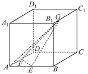

# Mathematics - 题目 1623

**ID**: 2d28ca2ba0dd4f6bac67efc8132e7d12
**年级**: Grade 11
**难度**: Medium-Hard
**题型**: Multiple-select

## 题目
如图，已知正方体 $ABCD-A{{}_{1}}B{{}_{1}}C{{}_{1}}D{{}_{1}}$ 的棱长为 $2$ ，点 $E,F$ 分别为棱 $AB,AD$ 的中点， $\overrightarrow {{B{{}_{1}}G}}=λ\overrightarrow {{B{{}_{1}}C{{}_{1}}}}\left ({0\leqslant λ\leqslant 1}\right )$ ，则下列说法正确的是（      ）​​​​​​​‌

## 解答

1. 对于选项A，如图1所示，当 $λ=1$ 时， $\overrightarrow {{B{{}_{1}}G}}=\overrightarrow {{B{{}_{1}}C{{}_{1}}}}$ ，此时 $G$ 与 $C{{}_{1}}$ 重合，
2. 不妨设面 $GEF\cap $ 面 $A{{}_{1}}B{{}_{1}}C{{}_{1}}D{{}_{1}}=l$ ，易知 $EF//$ 面 $A{{}_{1}}B{{}_{1}}C{{}_{1}}D{{}_{1}}$ ，又 $EF\subset $ 面 $GEF$ ，
3. 所以 $EF//l$ ，连接 $BD,B{{}_{1}}D{{}_{1}}$ ，易知 $EF//BD,BD//B{{}_{1}}D{{}_{1}}$ ，所以 $l//B{{}_{1}}D{{}_{1}}$ ，
4. 设 $l$ 分别与 $A{{}_{1}}B{{}_{1}},A{{}_{1}}D{{}_{1}}$ 的延长线交于 $Q,P$ ，连接 $EQ,EP$ ，分别交 $BB{{}_{1}},DD{{}_{1}}$ 于 $M,N$ ，
5. 连接 $EM,MC{{}_{1}},FN,NC{{}_{1}}$ ，
6. 因为 $\mathbf{Q}\in l$ ，则 $\mathbf{Q}\in $ 面 $GEF$ ，所以 $EQ\subset $ 面 $GEF$ ，又 $M\in EQ$ ，则 $M\in $ 面 $GEF$ ，
7. 所以 $EM,MC{{}_{1}}\subset $ 面 $GEF$ ，同理可得 $FN,NC{{}_{1}}\subset $ 面 $GEF$ ，
8. 所以，当 $λ=1$ 时，平面 $GEF$ 截正方体所得截面为五边形 $EMC{{}_{1}}NF$ ，故选项A错误，
9. 
10. 对于选项B，当 $λ=\frac {1}{2}$ 时， $\overrightarrow {{B{{}_{1}}G}}=\frac {1}{2}\overrightarrow {{B{{}_{1}}C{{}_{1}}}}$ ，此时 $G$ 为 $B{{}_{1}}C{{}_{1}}$ 的中点，
11. 设面 $GEF\cap $ 面 $A{{}_{1}}B{{}_{1}}C{{}_{1}}D{{}_{1}}$ 于 $HG$ ，如图2所示，连接 $BD,B{{}_{1}}D{{}_{1}}$ ，
12. 易知 $EF//$ 面 $A{{}_{1}}B{{}_{1}}C{{}_{1}}D{{}_{1}}$ ，又 $EF\subset $ 面 $GEF$ ，面 $GEF\cap $ 面 $A{{}_{1}}B{{}_{1}}C{{}_{1}}D{{}_{1}}=HG$ ，
13. 所以 $EF//GH$ ，又 $EF//BD,BD//B{{}_{1}}D{{}_{1}}$ ，所以 $B{{}_{1}}D{{}_{1}}//GH$ ，又 $GH\subset $ 面 $GEF$ ， $B{{}_{1}}D{{}_{1}}\not\subset $ 面 $GEF$ ，
14. 所以 $D{{}_{1}}B{{}_{1}}//$ 平面 $EFG$ ，故选项B正确，
15. 
16. 对于选项C，如图3所示，因为 $V{{}_{C-EFG}}=V{{}_{G-CEF}}=\frac {1}{3}S{{}_{\vartriangle CEF}}h$ ，
17. 又易知 $S{{}_{\vartriangle EFC}}=4-\frac {1}{2}-1-1=\frac {3}{2}$ ， $h=2$ ，得到 $V{{}_{C-EFG}}=\frac {1}{3}\times \frac {3}{2}\times 2=1$ ，所以选项C正确，
18. 
19. 对于选项D，以 $D$ 为坐标原点，建立如图3所示的空间直角坐标系，
20. 易知 $A\left ({2,0,0}\right ),B\left ({2,2,0}\right ),C\left ({0,2,0}\right ),B{{}_{1}}\left ({2,2,2}\right )$ ，所以 $\overrightarrow {{BC}}=\left ({-2,0,0}\right )$ ，
21. 又 $\overrightarrow {{B{{}_{1}}G}}=λ\overrightarrow {{B{{}_{1}}C{{}_{1}}}}=λ\overrightarrow {{BC}}=\left ({-2λ,0,0}\right )$ ，得到 $G\left ({2-2λ,2,2}\right )$ ，
22. 所以 $\overrightarrow {{AG}}=\left ({-2λ,2,2}\right )$ ，设异面直线 $BC$ 与 $AG$ 所成的角为 $θ$ ，
23. 则 ${\rm{c}}{\rm{o}}{\rm{s}}θ=\left |{{\rm{c}}{\rm{o}}{\rm{s}}\left \langle {\overrightarrow {{BC}},\overrightarrow {{AG}}}\right \rangle }\right |=\frac {\left |{\overrightarrow {{BC}}\cdot \overrightarrow {{AG}}}\right |}{\left |{\overrightarrow {{BC}}}\right |\cdot \left |{\overrightarrow {{AG}}}\right |}=\frac {4λ}{2\sqrt {4λ{^{2}}+8}}=\frac {λ}{\sqrt {λ{^{2}}+2}}$ ，
24. 又 $0\mathrm{\leqslant }λ\mathrm{\leqslant }1$ ，当 $λ=0$ 时， ${\rm{c}}{\rm{o}}{\rm{s}}θ=0$ ，当 $0<λ\leqslant 1$ 时， ${\rm{c}}{\rm{o}}{\rm{s}}θ=\frac {1}{\sqrt {1+\frac {2}{λ{^{2}}}}}$ ，
25. 又 $1+\frac {2}{λ{^{2}}}\geqslant 3$ ，所以 ${{0}}<{\rm{c}}{\rm{o}}{\rm{s}}θ\leqslant \frac {\sqrt {3}}{3}$ ，综上， ${{0}}\leqslant {\rm{c}}{\rm{o}}{\rm{s}}θ\leqslant \frac {\sqrt {3}}{3}$ ，所以选项D正确.
26. 故选BCD.

## 知识点

**中文**:
  - 向量法求异面直线所成角
  - 等积变换法
  - 球的切接问题
  - 直线与平面平行的判定
  - 截面问题

**English**:
  - Angle between Skew Lines
  - Method of Equal Volume Transformation
  - Tangency and Inscribed/Circumscribed Spheres
  - Line-Plane Parallelism Determination
  - Cross-section Problems

---
