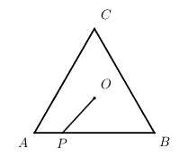

# Mathematics - 题目 1266

**ID**: 361b1499f38945b6b933726e3de07abd
**年级**: Grade 11
**难度**: Medium-Hard
**题型**: Multiple-select

## 题目
如图，在等边三角形 $ABC$ 中， $AB=6$ .​​​​​​​‌动点 $P$ 从点 $\mathrm{A}$ 出发，沿着此三角形三边逆时针运动回到 $\mathrm{A}$ 点，记 $P$ 运动的路程为 $x$ ，点 $P$ 到此三角形中心 $O$ 距离的平方为 $f(x)$ ，给出下列结论正确的有（      ）

## 解答

1. $P$ 分别在 $AB$ 上运动时的函数解析式 $f(x)=\left |{OP}\right |{^{2}}=3+{\left({x-3}\right)^{2}}$ ， $\left ({0\leqslant x\leqslant 6}\right )$ ，
2. $P$ 分别在 $BC$ 上运动时的函数解析式 $f(x)=\left |{OP}\right |{^{2}}=3+{\left({x-9}\right)^{2}}$ ， $\left ({6\leqslant x\leqslant 12}\right )$ ，
3. $P$ 分别在 $CA$ 上运动时的函数解析式 $f(x)=\left |{OP}\right |{^{2}}=3+{\left({x-15}\right)^{2}}$ ， $\left ({12\leqslant x\leqslant 18}\right )$ ，
4. $f(x)=\left |{OP}\right |{^{2}}=\begin{cases}3+(x-3){^{2}},(0\leqslant x\leqslant 6)\\3+(x-9){^{2}},(6\leqslant x\leqslant 12)\\3+(x-15){^{2}},(12\leqslant x\leqslant 18)\end{cases}$ ，
5. 由图象可得，方程 $f(x)=kx+3$ 最多有6个实数根，函数 $f(x)$ 的最大值为12，最小值为3，当 $x=3$ 时 $f(x)$ 能取得最小值
6. 故选AC.
7. 
8. 

## 知识点

**中文**:
  - 分段函数模型及应用

**English**:
  - Piecewise Function Model

---
