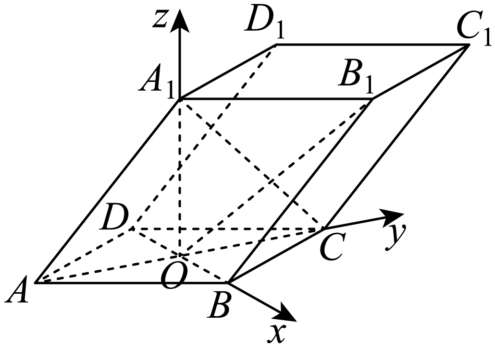

# Mathematics - 题目 3519

**ID**: 4ec3fab5968d4ada82a9b2bb9b9d2464
**年级**: Grade 11
**难度**: Medium-Hard
**题型**: Multiple-select

## 题目
如图，四棱柱 $ABCD-A{{}_{1}}B{{}_{1}}C{{}_{1}}D{{}_{1}}$ 的底面 $ABCD$ 是正方形， $O$ 为底面中心， $A{{}_{1}}O\bot $ 平面 $ABCD$ ， $AB=AA{{}_{1}}=2$ ．以 $O$ 为坐标原点，建立如图所示的空间直角坐标系，则（      ）​​​​​​​‌

## 解答

1. 由题意有：底面 $ABCD$ 是正方形，且 $AB=AA{{}_{1}}=2$ ，
2. 所以 $AC=BD=2\sqrt {2}$ ，所以 $OA=OB=OC=OD=\sqrt {2}$ ，
3. 所以 $A\left ({0,-\sqrt {2},0}\right ),B\left ({\sqrt {2},0,0}\right ),C\left ({0,\sqrt {2},0}\right ),D\left ({-\sqrt {2},0,0}\right )$ ，
4. 又 $OA{{}_{1}}=\sqrt {A{\rm A}{_{1}^{2}}-OA{^{2}}}=\sqrt {2}$ ，所以 $A{{}_{1}}\left ({0,0,\sqrt {2}}\right )$ ，
5. 又因为 $\overrightarrow {{A{{}_{1}}B{{}_{1}}}}=\overrightarrow {{AB}}=\left ({\sqrt {2},\sqrt {2},0}\right )$ ，所以 $B{{}_{1}}\left ({\sqrt {2},\sqrt {2},\sqrt {2}}\right )$ ，
6. 所以 $\overrightarrow {{OB{{}_{1}}}}=\left ({\sqrt {2}，\sqrt {2}，\sqrt {2}}\right )$ ，故B错误； $\overrightarrow {{A{{}_{1}}C}}=\left ({0,\sqrt {2},-\sqrt {2}}\right ),\overrightarrow {{BB{{}_{1}}}}=\left ({0,\sqrt {2},\sqrt {2}}\right )$ ，
7. 所以 $\overrightarrow {{A{{}_{1}}C}}\cdot \overrightarrow {{BB{{}_{1}}}}=0\times 0+\sqrt {2}\times \sqrt {2}+\left ({-\sqrt {2}}\right )\times \sqrt {2}=0$ ，所以 $A{{}_{1}}C\bot BB{{}_{1}}$ ，故C正确；
8. 因为 $\overrightarrow {{A{{}_{1}}D{{}_{1}}}}=\overrightarrow {{BC}}=\left ({-\sqrt {2},\sqrt {2},0}\right )$ ， $\overrightarrow {{OA{{}_{1}}}}=\left ({0,0,\sqrt {2}}\right )$ ，
9. 所以 $\overrightarrow {{OD{{}_{1}}}}=\overrightarrow {{OA{{}_{1}}}}+\overrightarrow {{A{{}_{1}}D{{}_{1}}}}=\left ({0,0,\sqrt {2}}\right )+\left ({-\sqrt {2},\sqrt {2},0}\right )=\left ({-\sqrt {2},\sqrt {2},\sqrt {2}}\right )$ ，
10. 所以 $\overrightarrow {{BA{{}_{1}}}}=\left ({-\sqrt {2},0,\sqrt {2}}\right ),\overrightarrow {{A{{}_{1}}C{{}_{1}}}}=\overrightarrow {{AC}}=\left ({0,2\sqrt {2},0}\right )$ ，
11. 设平面 $BA{{}_{1}}C{{}_{1}}$ 的法向量为 $\overrightarrow n=\left ({x,y,z}\right )$ ，
12. 所以 $\begin{cases}\overrightarrow n\cdot \overrightarrow {{BA{{}_{1}}}}=-\sqrt {2}x+\sqrt {2}z=0\\\overrightarrow n\cdot \overrightarrow {{A{{}_{1}}C{{}_{1}}}}=2\sqrt {2}y=0\end{cases}$ ，令 $x=1$ ，得 $\overrightarrow n=\left ({1,0,1}\right )$ ，
13. 所以 $\overrightarrow n\cdot \overrightarrow {{OD{{}_{1}}}}=-\sqrt {2}\times 1+\sqrt {2}\times 0+\sqrt {2}\times 1=0$ ，所以 $\overrightarrow n\bot \overrightarrow {{OD{{}_{1}}}}$ ，又 $OD{{}_{1}}\not\subset $ 平面 $BA{{}_{1}}C{{}_{1}}$ ，
14. 所以 $D{{}_{1}}O//$ 平面 $BA{{}_{1}}C{{}_{1}}$ ，故A正确；
15. 因为 $\overrightarrow {{A{{}_{1}}C}}=\left ({0,\sqrt {2},-\sqrt {2}}\right )$ ， $\overrightarrow {{A{{}_{1}}B}}=\left ({\sqrt {2},0,-\sqrt {2}}\right ),d=\frac {\overrightarrow {{A{{}_{1}}B}}\cdot \overrightarrow {{A{{}_{1}}C}}}{\left |{\overrightarrow {{A{{}_{1}}C}}}\right |}=1$ ，
16. 所以点 $B$ 到直线 $A{{}_{1}}C$ 的距离为 $\sqrt {\left |{\overrightarrow {{A{{}_{1}}B}}}\right |{^{2}}-d{^{2}}}=\sqrt {4-1}=\sqrt {3}$ ，故D正确，
17. 故选ACD.

## 知识点

**中文**:
  - 向量法求距离-点线距离
  - 用向量证明平行问题
  - 用向量证明垂直问题

**English**:
  - Point-Line Distance
  - Proving Parallelism
  - Proving Perpendicularity

---
