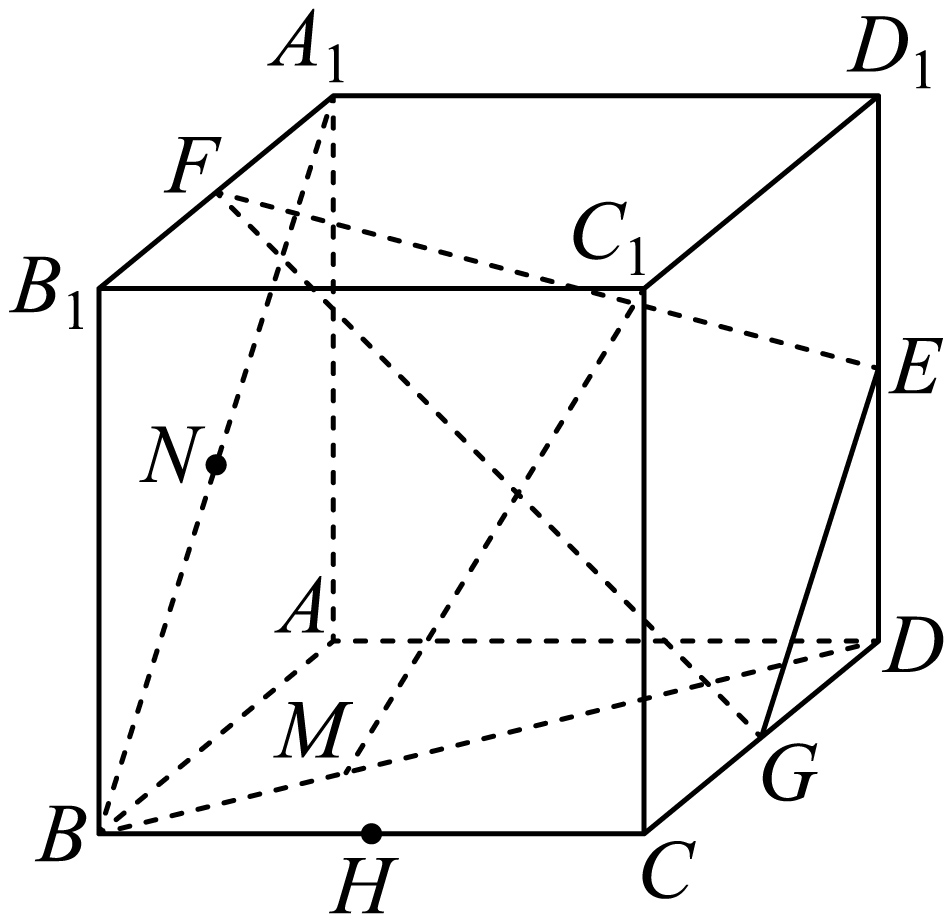

# Mathematics - 题目 708

**ID**: 5ac307e7365249fc86902745c11e1a74
**年级**: Grade 11
**难度**: Medium-Hard
**题型**: Multiple-select

## 题目
如图，在棱长为 $2$ 的正方体 $ABCD-A{{}_{1}}B{{}_{1}}C{{}_{1}}D{{}_{1}}$ 中， $E$ ， $F$ ， $G$ ， $H$ 分别是 $DD{{}_{1}}$ ， $A{{}_{1}}B{{}_{1}}$ ， $CD$ ， $BC$ 的中点，则下列说法正确的有（      ）​​​​​​​‌

## 解答

1. 如图，以点 $A$ 为原点，建立空间直角坐标系，
2. 则 $E\left ({0,2,1}\right ),F\left ({1,0,2}\right ),G\left ({1,2,0}\right ),H\left ({2,1,0}\right )$ ，
3. 故 $\overrightarrow {{EF}}=\left ({1,-2,1}\right ),\overrightarrow {{EG}}=\left ({1,0,-1}\right ),\overrightarrow {{EH}}=\left ({2,-1,-1}\right )$ ，
4. 设 $\overrightarrow {{EH}}=m\overrightarrow {{EF}}+n\overrightarrow {{EG}}$ ，即 $\left ({2,-1,-1}\right )=\left ({m+n,-2m,m-n}\right )$ ，
5. 所以 $\begin{cases}m+n=2\\-2m=-1\\m-n=-1\end{cases}$ ，解得 $\begin{cases}m=\frac {1}{2}\\n=\frac {3}{2}\end{cases}$ ，
6. 所以 $\overrightarrow {{EH}},\overrightarrow {{EF}},\overrightarrow {{EG}}$ 共面，
7. 又 $E$ 为公共始点，所以 $E$ ， $F$ ， $G$ ， $H$ 四点共面，故A正确；
8. $B\left ({2,0,0}\right ),D\left ({0,2,0}\right )$ ，则 $\overrightarrow {{BD}}=\left ({-2,2,0}\right )$ ，
9. 所以 ${\cos}\left \langle {\overrightarrow {{EF}},\overrightarrow {{BD}}}\right \rangle =\frac {\overrightarrow {{EF}}\cdot \overrightarrow {{BD}}}{\left |{\overrightarrow {{EF}}}\right |\left |{\overrightarrow {{BD}}}\right |}=-\frac {\sqrt {3}}{2}$ ，
10. 所以 $BD$ 与 $EF$ 所成角的余弦值为 $\frac {\sqrt {3}}{2}$ ，
11. 所以 $BD$ 与 $EF$ 所成角的大小为 $\frac {{\rm{\mathrm{π}}}}{6}$ ，故B正确；
12. 对于C，假设在线段 $BD$ 上存在 $M$ ，可设  $M\left ({x,2-x,0}\right ),0\leqslant x\leqslant 2$ ， $C{{}_{1}}\left ({2,2,2}\right )$ ，
13. 则 $\overrightarrow {{MC{{}_{1}}}}=\left ({2-x,x,2}\right )$ ， $\overrightarrow {{EF}}=\left ({1,-2,1}\right )$ ， $\overrightarrow {{EG}}=\left ({1,0,-1}\right )$
14. 由 $\overrightarrow {{MC{{}_{1}}}}\cdot \overrightarrow {{EF}}=2-x-2x+2=0$ ，得 $x=\frac {4}{3}$
15. 由 $\overrightarrow {{MC{{}_{1}}}}\cdot \overrightarrow {{EG}}=2-x-2=0$ ，得 $x=0$ ，
16. 即 $MC{{}_{1}}$ 与 $EF$ 垂直和 $MC{{}_{1}}$ 与 $EG$ 垂直不能同时成立，
17. 所以 $MC{{}_{1}}$ 与平面 $EFG$ 不垂直，故C错误；
18. $A{{}_{1}}\left ({0,0,2}\right )$ ，则 $\overrightarrow {{A{{}_{1}}B}}=\left ({2,0,-2}\right )=2\overrightarrow {{EG}}$ ，所以 $\overrightarrow {{A{{}_{1}}B}}{\rm{/}}{\rm{/}}\overrightarrow {{EG}}$ ，
19. 又 $A{{}_{1}},B,E,G$ 不共面，所以 $A{{}_{1}}B{\rm{/}}{\rm{/}}EG$ ，
20. 又 $EG\subset $ 平面 $EFG$ ， $A{{}_{{{1}}}}B\not\subset $ 平面 $EFG$ ，
21. 所以 $A{{}_{1}}B$  ${\rm{/}}{\rm{/}}$ 平面 $EFG$ ，
22. 所以点 $N$ 到平面 $EFG$ 的距离即为点 $B$ 到平面 $EFG$ 的距离，为定值，
23. 又 $\vartriangle EFG$ 的面积为定值，所以三棱锥 $N-EFG$ 的体积为定值，故D正确.
24. 
25. 故选ABD.

## 知识点

**中文**:
  - 向量法求异面直线所成角
  - 棱柱、棱锥、棱台的体积
  - 用向量证明垂直问题

**English**:
  - Angle between Skew Lines
  - Volume of Polyhedra
  - Proving Perpendicularity

---
