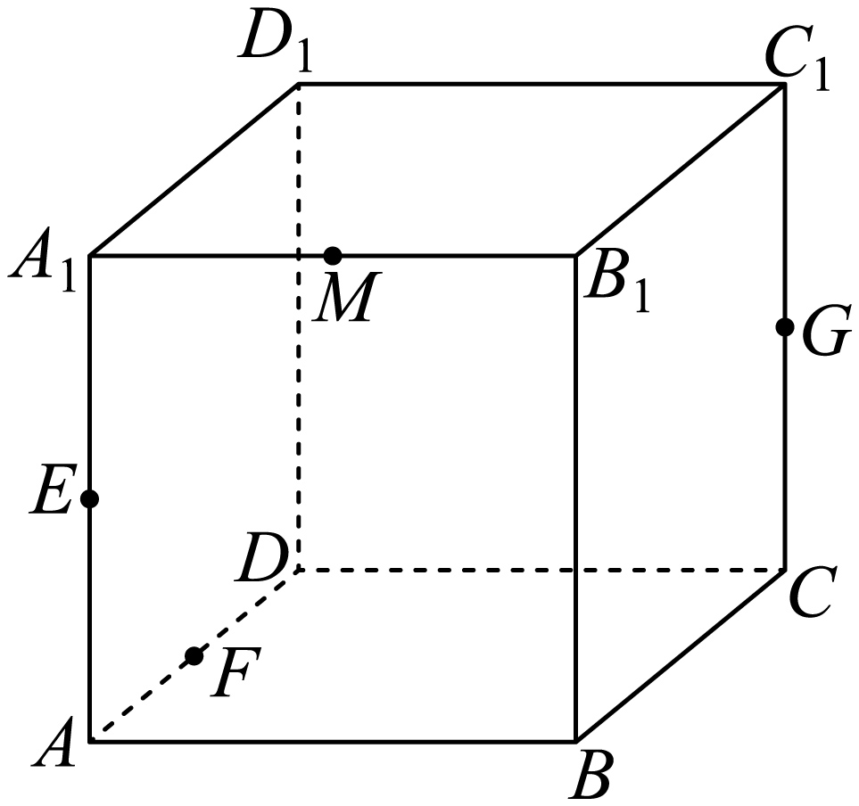

# Mathematics - 题目 2865

**ID**: 6c4d30a505344fd787b4d9afdea15716
**年级**: Grade 11
**难度**: Medium-Hard
**题型**: Multiple-select

## 题目
如图，正方体 $ABCD-A{{}_{1}}B{{}_{1}}C{{}_{1}}D{{}_{1}}$ 的表面积为 ${\rm 24，}E,F,G,M$ 分别为 $AA{{}_{1}},AD$ ， $CC{{}_{1}},A{{}_{1}}B{{}_{1}}$ 的中点，则下列说法正确的是（      ）​​​​​​​‌

## 解答

1. 对于A，如图所示，取AB中点 $J$ ，连接 $JA{{}_{1}},DA{{}_{1}}$ ，
2. 由于 $JA{{}_{1}}//MB,DA{{}_{1}}//EF$ ， $JA{{}_{1}}$ 与 $DA{{}_{1}}$ 相交，所以 $EF$ 与 $MB$ 为异面直线，所以A正确；
3. 
4. 对于B，以 $A$ 为坐标原点，建立如图所示的空间直角坐标系，
5. 设正方体的棱长为 $a$ ，因为正方体的表面积为24，可得 $6a{^{2}}=24$ ，解得 $a=2$ ，
6. 则 $E(0,0,1),F(0,1,0),M(1,0,2),G(2,2,1)$ ，可得 $\overrightarrow {{EM}}=(1,0,1),\overrightarrow {{FG}}=(2,1,1)$ ，
7. 则 $\overrightarrow {{EM}}\cdot \overrightarrow {{FG}}=3$ ， $\left |{\overrightarrow {{FG}}}\right |=\sqrt {6}$ ，所以向量 $\overrightarrow {{EM}}$ 在 $\overrightarrow {{FG}}$ 上的投影向量为 $\frac {\overrightarrow {{EM}}\cdot \overrightarrow {{FG}}}{|\overrightarrow {{FG}}|{^{2}}}\cdot \overrightarrow {{FG}}=\frac {1}{2}\overrightarrow {{FG}}$ ，所以B正确；
8. 
9. 对于C，若 $Q$ 为 $CA{{}_{1}}$ 上靠近点 $A{{}_{1}}$ 的四等分点，可得 $4\overrightarrow {{A{{}_{1}}Q}}=\overrightarrow {{A{{}_{1}}C}}$ ，
10. 则 $4\left ({\overrightarrow {{AQ}}-\overrightarrow {{AA{{}_{1}}}}}\right )=\overrightarrow {{A{{}_{1}}A}}+\overrightarrow {{AB}}+\overrightarrow {{AD}}$ ，可得 $4\overrightarrow {{AQ}}=\overrightarrow {{AB}}+\overrightarrow {{AD}}+5\overrightarrow {{AA{{}_{1}}}}$ ，所以C错误；
11. 对于D，假设线段CD上存在点 $P(a,2,0)$ ，其中 $0\leqslant a\leqslant 2$ ，使得 $EF//$ 平面 $PGM$ ，
12. 由上 $\overrightarrow {{MG}}=(1,2,-1),\overrightarrow {{GP}}=(a-2,0,-1)$ ，
13. 设平面 $PGM$ 的一个法向量为 $\overrightarrow {{m}}=(x,y,z)$ ，则 $\begin{cases}\overrightarrow m\cdot \overrightarrow {{MG}}=x+2y-z=0\\\overrightarrow m\cdot \overrightarrow {{GP}}=(a-2)x-z=0\end{cases}$ ，
14. 取 $x=2$ ，可得 $\overrightarrow {{m}}=(2,a-3,2a-4)$ ，
15. 又由 $\overrightarrow {{EF}}=(0,1,-1)$ 且 $EF//$ 平面 $PGM$ ，可得 $\overrightarrow {{EF}}\bot \overrightarrow {{m}}$ ，
16. 所以 $\overrightarrow {{EF}}\cdot \overrightarrow {{m}}=(0,1,-1)\cdot (2,a-3,2a-4)=a-3-2a+4=0$ ，解得 $a=1$ ，
17. 此时 $P$ 为 $CD$ 中点，则 $\overrightarrow {{EF}}=(0,1,-1),\overrightarrow {{FP}}=(1,1,0),\overrightarrow {{m}}=(2,-2,-2)$ ，
18. 又由 $\overrightarrow {{m}}\cdot \overrightarrow {{EF}}=0,\overrightarrow {{m}}\cdot \overrightarrow {{FP}}=0$ ，所以向量 $\overrightarrow {{m}}=(2,-2,-2)$ 也是平面 $EFP$ 的法向量，
19. 又因为平面 $EFP$ 与平面 $PGM$ 有公共点 $P$ ，因此平面 $EFP$ 与平面 $PGM$ 重合，
20. 所以 $EF\subset $ 平面 $PGM$ ，所以D错误.
21. 故选AB.
22. 

## 知识点

**中文**:
  - 直线与直线的位置关系的判断

**English**:
  - Determining Line-Line Relationships

---
