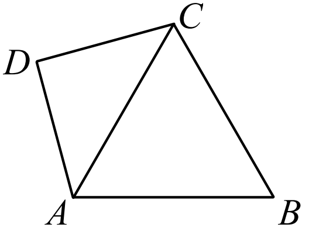

# Mathematics - 题目 696

**ID**: 7eae112b514c4d90b0d2a29fe4466528
**年级**: Grade 11
**难度**: Medium-Hard
**题型**: Multiple-select

## 题目
如图，四边形ABCD中，AB＝BC＝AC＝2，DA＝DC＝ $\sqrt {2}$ ，将四边形沿对角线AC折起，使点D不在平面ABC内，则在翻折过程中，以下结论正确的是（      ）​​​​​​​‌

## 解答

1. 对于A，以 $O$ 为坐标原点，过 $z$ 轴垂直平面 $ABC$ ，建立如图所示的空间直角坐标系，所以
2. $A\left ({1,0,0}\right ),$  $C\left ({-1,0,0}\right ),$  $B\left ({0,\sqrt {3},0}\right ),$ 设 $D\left ({x,y,z}\right )$ ，
3. $\begin{cases}DA=\sqrt {2}\\DO=1\end{cases}\Rightarrow \begin{cases}{\left({x-1}\right)^{2}}+y{^{2}}+z{^{2}}=2\\x{^{2}}+y{^{2}}+z{^{2}}=1\end{cases}\Rightarrow \begin{cases}x=0\\y{^{2}}+z{^{2}}=1\end{cases}$ ，所以 $y\in \left ({-1,1}\right )$
4. 所以 $D\left ({0,y,z}\right )$ ， $\overrightarrow {{AB}}=\left ({-1,\sqrt {3,}0}\right ),\overrightarrow {{CD}}=\left ({1,y,z}\right )$ ，
5. 所以设两条异面直线AB与CD所成角为 $θ$ ，
6. ${\cos}θ=\left |{{\cos}\overrightarrow {{AB}},\overrightarrow {{CD}}}\right |=\left |{\frac {\overrightarrow {{AB}}\cdot \overrightarrow {{CD}}}{\left |{\overrightarrow {{AB}}}\right |\left |{\overrightarrow {{CD}}}\right |}}\right |=\left |{\frac {-1+\sqrt {3}y}{2\times \sqrt {2}}}\right |$ ，
7. 当 $y=-1$ 时， ${\cos}θ=\frac {\sqrt {6}+\sqrt {2}}{4}$ ，此时 $θ=\frac {π}{12}$ ，但 $y=-1$ 时，D在平面ABC内.
8. 故A不正确；
9. 对于B,CD⊥AB时， $\overrightarrow {{CD}}=\left ({1,y,z}\right ),\overrightarrow {{AB}}=\left ({-1,\sqrt {3},0}\right ),\overrightarrow {{CD}}\cdot \overrightarrow {{AB}}=0$ ，
10. 解得： $y=\frac {\sqrt {3}}{3}$ ，又因为 $y{^{2}}+z{^{2}}=1$ ，所以 $z=\frac {\sqrt {6}}{3}$ ，所以 $D\left ({0,\frac {\sqrt {3}}{3},\frac {\sqrt {6}}{3}}\right )$
11. P为线段CD上一点（包括端点）,设 $\overrightarrow {{CP}}=λ\overrightarrow {{CD}}\left ({0\leqslant λ\leqslant 1}\right )$
12. 解得 $P\left ({λ-1,\frac {\sqrt {3}}{3}λ,\frac {\sqrt {6}}{3}λ}\right )$ .
13. 而 $\overrightarrow {{PA}}=\left ({2-λ,-\frac {\sqrt {3}}{3}λ,-\frac {\sqrt {6}}{3}λ}\right ),\overrightarrow {{PB}}=\left ({-λ+1,\sqrt {3}-\frac {\sqrt {3}}{3}λ,-\frac {\sqrt {6}}{3}λ}\right )$ ，
14. $\overrightarrow {{PA}}\cdot \overrightarrow {{PB}}=2λ{^{2}}+2-4λ=2{\left({λ-1}\right)^{2}}\geqslant 0$ ，所以 $\angle APB\leqslant \frac {π}{2}$ ，故B正确；
15. 对于C，当平面 $DAC\bot $ 平面 $ABC$ 时，三棱锥D−ABC的体积最大，且连接 $DO$ ，
16. $DO\bot AC$ ，则 $DO\bot $ 平面 $ABC$ ，所以 $V=\frac {1}{3}S{{}_{\vartriangle ABC}}\cdot DO=\frac {1}{3}\times \frac {\sqrt {3}}{4}\times 4\times 1=\frac {\sqrt {3}}{3}$ .
17. 故C正确；
18. 
19. 对于D，取 $AC$ 中点 $O$ ，连接 $OB$ ，取 $\vartriangle ABC$ 的外心 $O{{}_{1}}$ ， 过 $O$ 作一条垂线垂直平面 $DAC$ ，
20. 过 $O{{}_{2}}$ 作一条垂线垂直平面 $ABC$ ，两条垂直相交于点 $H$ ，则 $H$ 为三棱锥D−ABC的外接球的球心，且二面角D−AC−B的大小为 $\frac {\mathrm{π}}{6}$ ，即 $\angle OHO{{}_{2}}=\frac {π}{6}$ ，所以在直角三角形 $OHO{{}_{2}}$ 中， $OO{{}_{2}}=\frac {\sqrt {3}}{3}$ ，所以 ${\tan}\frac {π}{6}=\frac {OO{{}_{2}}}{O{{}_{2}}H}=\frac {\sqrt {3}}{3}$ ，则 $O{{}_{2}}H=1$ ，所以 $BH{^{2}}=R{^{2}}=O{{}_{2}}B{^{2}}+O{{}_{2}}H{^{2}}={\left({\frac {2\sqrt {3}}{3}}\right)^{2}}+1=\frac {7}{3}$ ，所以三棱锥D−ABC的外接球表面积为 $S=4πR{^{2}}=\frac {28π}{3}$ ，故D正确.
21. 
22. 故选：BCD.

## 知识点

**中文**:
  - 空间向量与立体几何
  - 空间点、直线、平面之间的位置关系

**English**:
  - Spatial Vectors and Solid Geometry
  - Positional Relationships in Space

---
