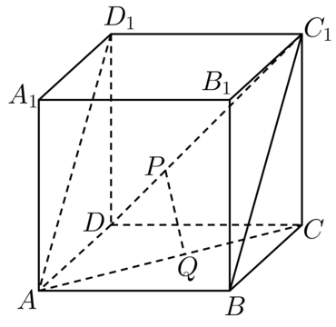

# Mathematics - 题目 1453

**ID**: 8833094499b44640aa9e5a58ddc1d80b
**年级**: Grade 11
**难度**: Medium-Hard
**题型**: Multiple-select

## 题目
如图，正方体 $ABCD-A{{}_{1}}B{{}_{1}}C{{}_{1}}D{{}_{1}}$ 的棱长为2，动点P，Q分别在线段 $C{{}_{1}}D$ ， $AC$ 上，则下列命题正确的是（      ）​​​​​​​‌

## 解答

1. 解：由题意得：
2. 正方体 $ABCD-A{{}_{1}}B{{}_{1}}C{{}_{1}}D{{}_{1}}$ 的棱长为2
3. 对于选项A：连接 $B{{}_{1}}C$ ，设 $B{{}_{1}}C、BC{{}_{1}}$ 交于O点
4. $\because B{{}_{1}}C\bot BC{{}_{1}},B{{}_{1}}C\bot AB$
5. $\therefore B{{}_{1}}C\bot $ 平面 $ABC{{}_{1}}D{{}_{1}}$
6. $\therefore \angle CBC{{}_{1}}$ 即为直线BC与平面 $ABC{{}_{1}}D{{}_{1}}$ 所成的角，且 $\angle CBC{{}_{1}}=\frac {π}{4}$ ，故A正确；
7. 对于选项B：连接 $B{{}_{1}}C$ ，设 $B{{}_{1}}C、BC{{}_{1}}$ 交于O点
8. $\because CO\bot BC{{}_{1}},B{{}_{1}}C\bot AB$
9. $\therefore CO\bot $ 平面 $ABC{{}_{1}}D{{}_{1}}$
10. $\therefore $ 点 $C$ 到平面 $ABC{{}_{1}}D{{}_{1}}$ 的距离为 $CO=\frac {1}{2}B{{}_{1}}C=\frac {1}{2}\times 2\sqrt {2}=\sqrt {2}$ ,故B正确；
11. 对于选项C：连接 $D{{}_{1}}C$ 、 $AD{{}_{1}}$ ，由正方体性质可知 $AD{{}_{1}}$∥$BC{{}_{1}}$
12. 故异面直线 $D{{}_{1}}C$ 和 $BC{{}_{1}}$ 所成的角即为 $D{{}_{1}}C$ 和 $AD{{}_{1}}$ 所成的角 $\angle AD{{}_{1}}C$
13. 又 $\because AD{{}_{1}}=AC=CD{{}_{1}}$
14. $\therefore \vartriangle AD{{}_{1}}C$ 为等边三角形
15. $\therefore \angle AD{{}_{1}}C=\frac {π}{3}$
16. 故C错误；
17. 对于选项D：过 $P$ 作 $PM\bot CD$ ，过 $M$ 作 $MQ\bot AC$ ，连接PQ
18. $PQ$ 为异面直线之间的距离，这时 $PQ$ 距离最小；
19. 设 $DP=x$ ， $Rt\vartriangle DPM$ 为等腰直角三角形，则 $PM=\frac {\sqrt {2}}{2}x$ ， $CM=CD-DM=2-\frac {\sqrt {2}}{2}x$
20. $Rt\vartriangle CQM$ 也为等腰直角三角形，则 $MQ=\frac {\sqrt {2}}{2}CM=\frac {\sqrt {2}}{2}\times \left ({2-\frac {\sqrt {2}}{2}x}\right )=\sqrt {2}-\frac {1}{2}x$
21. $\because \vartriangle PMQ$ 为直角三角形
22. 故 $PQ{^{2}}=PM{^{2}}+MQ{^{2}}={\left({\frac {\sqrt {2}}{2}x}\right)^{2}}+{\left({\sqrt {2}-\frac {1}{2}x}\right)^{2}}=\frac {3}{4}x{^{2}}-\sqrt {2}x+2=\frac {3}{4}(x-\frac {2\sqrt {2}}{3}){^{2}}+\frac {4}{3}$
23. 当 $x=\frac {2\sqrt {2}}{3}$ 时， $PQ{^{2}}$ 取最小值 $\frac {4}{3}$ ，故 $PQ{{}_{{\rm \min }}}=\frac {2\sqrt {3}}{3}$ ，故D正确；
24. 故选：ABD
25. 

## 知识点

**中文**:
  - 异面直线所成角
  - 直线与平面所成的角
  - 点与面之间的距离

**English**:
  - Angle between Skew Lines
  - Line-Plane Angle
  - Point-Plane Distance

---
