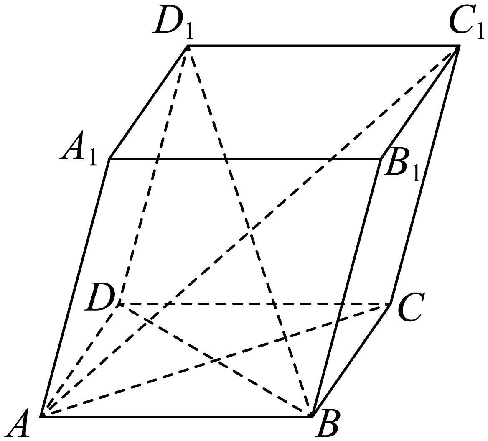

# Mathematics - 题目 293

**ID**: 97a0fb3abcb742c180a981fb2158a27a
**年级**: Grade 11
**难度**: Medium-Hard
**题型**: Multiple-select

## 题目
如图，平行六面体 $ABCD-A{{}_{1}}B{{}_{1}}C{{}_{1}}D{{}_{1}}$ 中，以 $A$ 为顶点的三条棱长均为1，且两两之间的夹角都是 $60{}\degree $ ，则下列说法中正确的是（      ）​​​​​​​‌

## 解答

1. $\because $ 在平行六面体 $ABCD-A{{}_{1}}B{{}_{1}}C{{}_{1}}D{{}_{1}}$ 中，
2. 其中以顶点 $A$ 为端点的三条棱长均为1 ，且彼此夹角都是 $60{}\degree $ ，
3. 所以 $\overrightarrow {{AA{{}_{1}}}}{^{2}}=\overrightarrow {{AB}}{^{2}}=\overrightarrow {{AD}}{^{2}}=1$ ， $\overrightarrow {{AA{{}_{1}}}}\cdot \overrightarrow {{AB}}=\overrightarrow {{AA{{}_{1}}}}\cdot \overrightarrow {{AD}}=\overrightarrow {{AD}}\cdot \overrightarrow {{AB}}=1\times 1\times {\cos}60{}\degree =\frac {1}{2}$ .
4. 对于A，因为 $\overrightarrow {{AC{{}_{1}}}}=\overrightarrow {{AA{{}_{1}}}}+\overrightarrow {{AB}}+\overrightarrow {{AD}}$ ，
5. 所以 $\left |{\overrightarrow {{AC{{}_{1}}}}}\right |{^{2}}={\left({\overrightarrow {{AA{{}_{1}}}}+\overrightarrow {{AB}}+\overrightarrow {{AD}}}\right)^{2}}$  $=\overrightarrow {{AA{{}_{1}}}}{^{2}}+\overrightarrow {{AB}}{^{2}}+\overrightarrow {{AD}}{^{2}}+2\overrightarrow {{AA{{}_{1}}}}\cdot \overrightarrow {{AB}}+2\overrightarrow {{AB}}\cdot \overrightarrow {{AD}}+2\overrightarrow {{AA{{}_{1}}}}\cdot \overrightarrow {{AD}}$  $=1+1+1+3\times 2\times \frac {1}{2}=6$ ，
6. $\therefore \left |{\overrightarrow {{AC{{}_{1}}}}}\right |=\left |{\overrightarrow {{AA{{}_{1}}}}+\overrightarrow {{AB}}+\overrightarrow {{AD}}}\right |=\sqrt {6}$ ，故A正确；
7. 对于B，因为 $\overrightarrow {{DB{{}_{1}}}}=\overrightarrow {{AA{{}_{1}}}}+\overrightarrow {{AB}}-\overrightarrow {{AD}}$ ,
8. 且 $\overrightarrow {{AC{{}_{1}}}}\cdot \overrightarrow {{DB{{}_{1}}}}=\left ({\overrightarrow {{AA{{}_{1}}}}+\overrightarrow {{AB}}+\overrightarrow {{AD}}}\right )\cdot \left ({\overrightarrow {{AA{{}_{1}}}}+\overrightarrow {{AB}}-\overrightarrow {{AD}}}\right )$  $=1+\frac {1}{2}-\frac {1}{2}+\frac {1}{2}+1-\frac {1}{2}+\frac {1}{2}+\frac {1}{2}-1=2\ne 0$ ,
9. 即 $AC{{}_{1}}\bot BD$ 不成立，故B错误；
10. 对于 ${\rm C，}\overrightarrow {{B{{}_{1}}C}}=\overrightarrow {{B{{}_{1}}C{{}_{1}}}}+\overrightarrow {{B{{}_{1}}B}}=-\overrightarrow {{AA{{}_{1}}}}+\overrightarrow {{AD}}$ ，所以 $\left |{\overrightarrow {{B{{}_{1}}C}}}\right |=\sqrt {{\left({-\overrightarrow {{AA{{}_{1}}}}+\overrightarrow {{AD}}}\right)^{2}}}=\sqrt {1+1-1}=1$ ，
11. 所以 ${\cos}\left \langle {\overrightarrow {{B{{}_{1}}C}},\overrightarrow {{AA{{}_{1}}}}}\right \rangle =\frac {\overrightarrow {{B{{}_{1}}C}}\cdot \overrightarrow {{AA{{}_{1}}}}}{\left |{\overrightarrow {{B{{}_{1}}C}}}\right |\cdot \left |{\overrightarrow {{AA{{}_{1}}}}}\right |}$  $=\frac {\left ({-\overrightarrow {{AA{{}_{1}}}}+\overrightarrow {{AD}}}\right )\cdot \overrightarrow {{AA{{}_{1}}}}}{\left |{\overrightarrow {{B{{}_{1}}C}}}\right |\cdot \left |{\overrightarrow {{AA{{}_{1}}}}}\right |}$  $=\frac {-1+\frac {1}{2}}{1\times 1}=-\frac {1}{2}$ ,
12. 所以向量 $\overrightarrow {{B{{}_{1}}C}}$ 与 $\overrightarrow {{AA{{}_{1}}}}$ 夹角是 $120{}\degree $ ，故C正确；
13. 对于 ${\rm D，}\because \overrightarrow {{BD{{}_{1}}}}=\overrightarrow {{AD}}+\overrightarrow {{AA{{}_{1}}}}-\overrightarrow {{AB}},\overrightarrow {{AC}}=\overrightarrow {{AB}}+\overrightarrow {{AD}}$ ，
14. $\therefore \overrightarrow {{BD{{}_{1}}}}\cdot \overrightarrow {{AC}}=\left ({\overrightarrow {{AD}}+\overrightarrow {{AA{{}_{1}}}}-\overrightarrow {{AB}}}\right )\cdot \left ({\overrightarrow {{AB}}+\overrightarrow {{AD}}}\right )$
15. $=\overrightarrow {{AD}}\cdot \overrightarrow {{AB}}+\overrightarrow {{AD}}{^{2}}+\overrightarrow {{AA{{}_{1}}}}\cdot \overrightarrow {{AB}}+\overrightarrow {{AA{{}_{1}}}}\cdot \overrightarrow {{AD}}-\overrightarrow {{AB}}{^{2}}-\overrightarrow {{AB}}\cdot \overrightarrow {{AD}}=1$ ，
16. 而 $\left |{\overrightarrow {{BD{{}_{1}}}}}\right |=\sqrt {{\left({\overrightarrow {{AD}}+\overrightarrow {{AA{{}_{1}}}}-\overrightarrow {{AB}}}\right)^{2}}}=\sqrt {1+1+1+2\mathrm{×}\frac {1}{2}-2\mathrm{×}\frac {1}{2}-2\mathrm{×}\frac {1}{2}}=\sqrt {2}$ ，
17. $,\left |{\overrightarrow {{AC}}}\right |=\sqrt {{\left({\overrightarrow {{AB}}+\overrightarrow {{AD}}}\right)^{2}}}=\sqrt {1+2\mathrm{×}\frac {1}{2}+1}=\sqrt {3}$ ，
18. $\therefore {\cos}\overrightarrow {{BD{{}_{1}}}},\overrightarrow {{AC}}=\frac {\left |{\overrightarrow {{BD{{}_{1}}}}\cdot \overrightarrow {{AC}}}\right |}{\left |{\overrightarrow {{BD{{}_{1}}}}}\right |\cdot \left |{\overrightarrow {{AC}}}\right |}=\frac {1}{\sqrt {2}\times \sqrt {3}}=\frac {\sqrt {6}}{6}$ ，故D错误.
19. 故选AC

## 知识点

**中文**:
  - 空间向量的加减运算
  - 空间向量的数乘运算
  - 空间向量的数量积

**English**:
  - Vector Addition and Subtraction
  - Scalar Multiplication
  - Scalar Product of Spatial Vectors

---
