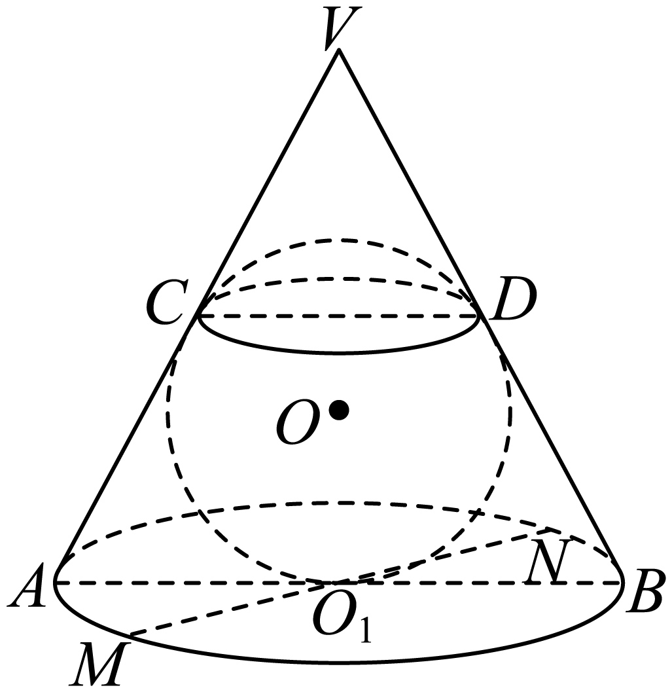

# Mathematics - 题目 2294

**ID**: be01ba148c774a26ae625326db34c919
**年级**: Grade 11
**难度**: Medium-Hard
**题型**: Multiple-select

## 题目
如图，圆锥 $VAB$ 内有一个内切球 $O$ ， $AB$ 为底面圆 $O{{}_{1}}$ 的直径，球 $O$ 与母线 $VA$ ， $VB$ 分别切于点 $C$ ， $D$ .​​​​​​​‌若 $\mathrm{△}VAB$ 是边长为2的等边三角形， $MN$ 为底面圆 $O{{}_{1}}$ 的一条直径（ $MN$ 与 $AB$ 不重合），则下列说法正确的是（      ）

## 解答

1. A选项，连接 $VO{{}_{1}}$ ，等边三角形 $VAB$ 内切圆即为球 $O$ 的截面大圆，球心 $O$ 在线段 $VO{{}_{1}}$ 上，
2. 又等边三角形 $VAB$ 的边长为2，所以 $\left |{AO{{}_{1}}}\right |=1$ ， $\left |{VO{{}_{1}}}\right |=\sqrt {3}$ ，
3. 则球 $O$ 的半径 $r=\left |{OO{{}_{1}}}\right |=\left |{AO{{}_{1}}}\right |{\rm{t}}{\rm{a}}{\rm{n}}30{^{\circ }}=\frac {\sqrt {3}}{3}$ ，
4. 所以球 $O$ 的表面积 $S=4{\rm{π}}r{^{2}}=4{\rm{π}}\times \frac {1}{3}=\frac {4{\rm{π}}}{3}$ ，故A正确；
5. B选项，圆锥的侧面积 $S^{′}={\rm{π}}\times 1\times 2=2{\rm{π}}$ ，故B错误；
6. C选项，由题意可得四面体 $CDMN$ 被平面 $VAB$ 截成体积相等的两部分，
7. 
8. 设 $M$ 到平面 $VAB$ 的距离为 $d\left ({0<d\mathrm{\leqslant }1}\right )$ ，
9. 球 $O$ 的半径 $r=\left |{OO{{}_{1}}}\right |=\frac {\sqrt {3}}{3}$ ，三角形 $CO{{}_{1}}D$ 为等边三角形，设其边长为 $m$ ，
10. 则 $\frac {m}{\sin 60{}\degree }=2r=\frac {2\sqrt {3}}{3}$ ，故 $m=\frac {2\sqrt {3}}{3}\sin 60{}\degree =1$ ，
11. 故三角形 $CO{{}_{1}}D$ 的面积为 $\frac {1}{2}\times 1{^{2}}\sin 60{}\degree =\frac {\sqrt {3}}{4}$ ，
12. 即 $V{{}_{CDMN}}=2V{{}_{M-CDO{{}_{1}}}}=2\times \frac {1}{3}S{{}_{\mathrm{△}CO{{}_{1}}D}}d=2\times \frac {1}{3}\times \frac {\sqrt {3}}{4}d=\frac {\sqrt {3}}{6}d\in \left ({0,\frac {\sqrt {3}}{6}}\right ]$ ，故C正确；
13. D选项，依题意，动点 $P$ 的轨迹是圆，所在平面与圆锥底面平行，令其圆心为 $E$ ，
14. $CD=1$ ，故 $C$ ， $D$ 是边 $AV$ ， $BV$ 的中点，可得 $EP=\frac {1}{2}O{{}_{1}}B=\frac {1}{2}$ ， $EO{{}_{1}}=\frac {1}{2}VO{{}_{1}}=\frac {\sqrt {3}}{2}$ ，
15. $所以O{{}_{1}}P{^{2}}=EO{{}_{1}^{2}}+EP{^{2}}=1$ ，
16. 则有 $PO{{}_{1}}=MO{{}_{1}}=NO{{}_{1}}=1$ ，故 $\angle PMO{{}_{1}}=\angle MPO{{}_{1}},\angle PNO{{}_{1}}=\angle NPO{{}_{1}}$ ，
17. 又 $\angle PMO{{}_{1}}+\angle MPO{{}_{1}}+\angle PNO{{}_{1}}+\angle NPO{{}_{1}}={\rm{π}}$ ，故 $\angle MPO{{}_{1}}+\angle NPO{{}_{1}}=\frac {{\rm{π}}}{2}$ ，
18. 即 $PM\bot PN$ ，因此 $PM{^{2}}+PN{^{2}}=MN{^{2}}=4$ ，
19. 由均值不等式，得 $\frac {PM+PN}{2}\mathrm{\leqslant }\sqrt {\frac {PM{^{2}}+PN{^{2}}}{2}}=\sqrt {2}$ ，即 $PM+PN\mathrm{\leqslant }2\sqrt {2}$ ，
20. 当且仅当 $PM=PN$ 时取“ $=$ ”，故D正确.
21. 故选ACD.

## 知识点

**中文**:
  - 棱柱、棱锥、棱台的表面积（侧面积）
  - 球的表面积
  - 球的切接问题

**English**:
  - Surface Area of Polyhedra
  - Surface Area of a Sphere
  - Tangency and Inscribed/Circumscribed Spheres

---
