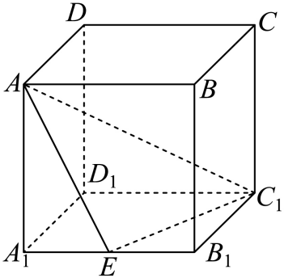

# Mathematics - 题目 1160

**ID**: cd28ec99f5d0443caef144ea7e832a5d
**年级**: Grade 11
**难度**: Medium-Hard
**题型**: Multiple-select

## 题目
如图，在棱长为2的正方体 $ABCD-A{{}_{1}}B{{}_{1}}C{{}_{1}}D{{}_{1}}$ 中，E为线段 $A{{}_{1}}B{{}_{1}}$ 的中点，则下列结论正确的是（      ）​​​​​​​‌

## 解答

1. 依题意，以 $D{{}_{1}}$ 为坐标原点， $D{{}_{1}}A{{}_{1}}$ ， $D{{}_{1}}C{{}_{1}}$ ， $D{{}_{1}}D$ 分别为 $x$ ， $y$ ， $z$ 轴建立空间直角坐标系如图所示，
2. 
3. 则 $C{{}_{1}}\left ({0,2,0}\right )$ ， $D\left ({0,0,2}\right )$ ， $A{{}_{1}}\left ({2,0,0}\right )$ ， $B{{}_{1}}\left ({2,2,0}\right )$ ， $C\left ({0,2,2}\right )$ ， $A\left ({2,0,2}\right )$ ， $E\left ({2,1,0}\right )$ ， $B\left ({2,2,2}\right )$
4. ∴ $\overrightarrow {{C{{}_{1}}D}}=\left ({0{\rm{,}}-2{\rm{,}}2}\right )$ ， $\overrightarrow {{BA}}=\left ({0,-2,0}\right )$ ， $\overrightarrow {{CC{{}_{1}}}}=\left ({0{\rm{,}}0{\rm{,}}-2}\right )$ ，
5. ∴ $\overrightarrow {{BA}}-\overrightarrow {{CC{{}_{1}}}}=\left ({0,-2,2}\right )=\overrightarrow {{C{{}_{1}}D}}$ ，故选项A正确；
6. ∵三棱锥 $B{{}_{1}}-AEC{{}_{1}}$ 的体积 $V{{}_{B{{}_{1}}-AEC{{}_{1}}}}=V{{}_{A-B{{}_{1}}EC{{}_{1}}}}=\frac {1}{3}S{{}_{\vartriangle B{{}_{1}}EC{{}_{1}}}}\cdot AA{{}_{1}}=\frac {1}{3}\times \frac {1}{2}\times 1\times 2\times 2=\frac {2}{3}$ ，故选项B正确；
7. ∵ $\overrightarrow {{AC{{}_{1}}}}=\left ({-2,2,-2}\right )$ ， $\overrightarrow {{AB}}=\left ({0,2,0}\right )$ ，∴ $\frac {\overrightarrow {{AB}}\cdot \overrightarrow {{AC{{}_{1}}}}}{\left |{\overrightarrow {{AC{{}_{1}}}}}\right |}=\frac {4}{2\sqrt {3}}=\frac {2\sqrt {3}}{3}$ ，
8. ∴点B到直线 $AC{{}_{1}}$ 的距离为 $\sqrt {\overrightarrow {{AB}}{^{2}}-{\left({\frac {\overrightarrow {{AB}}\cdot \overrightarrow {{AC{{}_{1}}}}}{\left |{\overrightarrow {{AC{{}_{1}}}}}\right |}}\right)^{2}}}=\sqrt {2{^{2}}-{\left({\frac {2\sqrt {3}}{3}}\right)^{2}}}=\frac {2\sqrt {6}}{3}$ ，故选项C正确；
9. 记 $CD$ 的中点为F，连接 $AF$ ， $C{{}_{1}}F$ ，则 $F\left ({0,1,2}\right )$ ，∴ $\overrightarrow {{C{{}_{1}}F}}=\left ({0,-1,2}\right )$ ， $\overrightarrow {{AE}}=\left ({0,1,-2}\right )$ ，
10. ∴ $\overrightarrow {{C{{}_{1}}F}}=-\overrightarrow {{AE}}$ ，∴ $C{{}_{1}}F//AE$ ， $C{{}_{1}}F=AE$ ，∴ ${\rm \mathit{A}，\mathit{E}，}C{{}_{1}}{\rm ，\mathit{F}}$ 四点共面，
11. 即平行四边形 $AEC{{}_{1}}F$ 为平面 $AEC{{}_{1}}$ 截正方体 $ABCD-A{{}_{1}}B{{}_{1}}C{{}_{1}}D{{}_{1}}$ 的截面.
12. 由勾股定理易得 $AE=EC{{}_{1}}=C{{}_{1}}F=AF=\sqrt {5}$ ，∴平行四边形 $AEC{{}_{1}}F$ 是菱形.
13. 又 $\overrightarrow {{EF}}=\left ({-2,0,2}\right )$ ，∴ $\left |{\overrightarrow {{AC{{}_{1}}}}}\right |=2\sqrt {3}$ ， $\left |{\overrightarrow {{EF}}}\right |=2\sqrt {2}$ ，
14. ∴ $S{{}_{AEC{{}_{1}}F}}=\frac {1}{2}\times 2\sqrt {3}\times 2\sqrt {2}=2\sqrt {6}$ ，故选项D错误.
15. 故选ABC.

## 知识点

**中文**:
  - 向量法求距离-点线距离
  - 棱柱、棱锥、棱台的体积
  - 截面问题
  - 空间向量加减运算与数乘运算的坐标表示

**English**:
  - Point-Line Distance
  - Volume of Polyhedra
  - Cross-section Problems
  - Coordinate Operations (Add/Sub/Scalar Mult)

---
