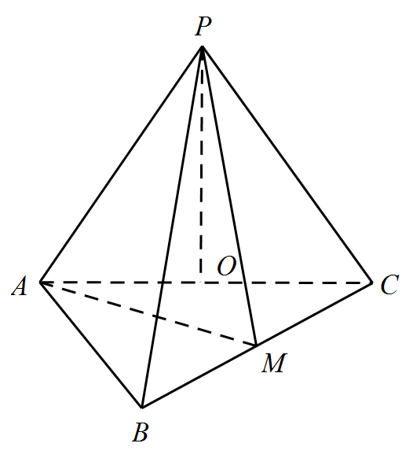

# Mathematics - 题目 3433

**ID**: d43da224fff549f58042ca1e8b3c8fd7
**年级**: Grade 11
**难度**: Medium-Hard
**题型**: Multiple-select

## 题目
如图，在三棱锥 $P-ABC$ 中， $AB=BC=\sqrt {2}$ ， $BA\bot BC$ ， $PA=PB=PC=2$ ， $O$ 为 $AC$ 的中点，点 $M$ 是棱 $BC$ 上一动点，则下列结论正确的是（      ）​​​​​​​‌

## 解答

1. 连结OB.
2. 在三棱锥 $P-ABC$ 中， $AB=BC=\sqrt {2}$ ， $BA\bot BC$ ， $PA=PB=PC=2$ .
3. 所以 $OP\bot AC$ , $OB\bot AC$ ,且 $OP=\sqrt {2{^{2}}-1{^{2}}}=\sqrt {3}$ , $OB=1$ .
4. 所以 $OB{^{2}}+OP{^{2}}=PB{^{2}}$ ，所以 $OB\bot OP$ .
5. 又因为 $OB\bot AC=O$ ，所以 $OP\bot $ 面ABC.
6. 可以以O为原点，以 $\overrightarrow {{OB}},\overrightarrow {{OC}},\overrightarrow {{OP}}$ 分别为x、y、z轴正方向建立空间直角坐标系.
7. 
8. 则 $O\left ({0,0,0}\right )$ ， $A\left ({0,-1,0}\right )$ ， $B\left ({1,0,0}\right )$ ， $C\left ({0,1,0}\right )$ ， $P\left ({0,0,\sqrt {3}}\right )$ ，所以 $\overrightarrow {{PA}}=\left ({0,-1,-\sqrt {3}}\right )$ , $\overrightarrow {{PB}}=\left ({1,0,-\sqrt {3}}\right )$ , $\overrightarrow {{PC}}=\left ({0,1,-\sqrt {3}}\right )$ , $\overrightarrow {{CB}}=\left ({1,-1,0}\right )$ .
9. 对于A：在三棱锥 $P-ABC$ 中， $AB=BC=\sqrt {2}$ ， $BA\bot BC$ ， $PA=PB=PC=2$ ，
10. 所以底面三角形 $ABC$ 为直角三角形，其面积为 $\frac {1}{2}\times \sqrt {2}\times \sqrt {2}=1$ ；
11. $\mathrm{△}APC$ 为边长为2的等边三角形，所以面积为 $\frac {1}{2}\times 2\times 2\times \frac {\sqrt {3}}{2}=\sqrt {3}$ ；
12. $△APB$ 和 $△CPB$ 为腰长为2，底边为 $\sqrt {2}$ 的等腰三角形，所以面积均为 $\frac {1}{2}\times \sqrt {2}\times \sqrt {2{^{2}}-{\left({\frac {\sqrt {2}}{2}}\right)^{2}}}=\frac {\sqrt {7}}{2}$ ；
13. 所以三棱锥 $P-ABC$ 的表面积为 $2\times \frac {\sqrt {7}}{2}+\sqrt {3}+1=\sqrt {7}+\sqrt {3}+1$ .故A正确；
14. 对于B： $M$ 为棱 $BC$ 的中点，所以 $M\left ({\frac {1}{2},\frac {1}{2},0}\right )$ ,所以 $\overrightarrow {{PM}}=\left ({\frac {1}{2},\frac {1}{2},-\sqrt {3}}\right )$ , $\overrightarrow {{AB}}=\left ({1,1,0}\right )$ .
15. 所以异面直线 $PM$ 与 $AB$ 所成角的余弦值为 $\left |{{\cos}\overrightarrow {{PM}},\overrightarrow {{AB}}}\right |=\frac {\left |{\overrightarrow {{PM}}\cdot \overrightarrow {{AB}}}\right |}{\left |{\overrightarrow {{PM}}}\right |\times \left |{\overrightarrow {{AB}}}\right |}=\frac {\left |{\frac {1}{2}+\frac {1}{2}+0}\right |}{\sqrt {\frac {1}{4}+\frac {1}{4}+3}\times \sqrt {1+1+0}}=$  $\frac {\sqrt {7}}{7}$ .故B正确；
16. 对于C：点 $M$ 是棱 $BC$ 上一动点，不妨设 $\overrightarrow {{CM}}=λ\overrightarrow {{CB}}=λ\left ({1,-1,0}\right )=\left ({λ,-λ,0}\right )$ ，（ $0\mathrm{\leqslant }λ\mathrm{\leqslant }1$ ） .
17. 所以 $\overrightarrow {{AM}}=\overrightarrow {{AC}}+\overrightarrow {{CM}}=\left ({0,2,0}\right )+\left ({λ,-λ,0}\right )=\left ({λ,2-λ,0}\right )$ .
18. 设 $\overrightarrow {{n}}=\left ({x,y,z}\right )$ 为面PAM的一个法向量，则 $\begin{cases}\overrightarrow {{n}}\cdot \overrightarrow {{PA}}=0-y-\sqrt {3}z=0\\\overrightarrow {{n}}\cdot \overrightarrow {{AM}}=λx+\left ({2-λ}\right )y=0\end{cases}$ ，
19. 不妨设y=1，则 $\overrightarrow {{n}}=\left ({\frac {λ-2}{λ},1,-\frac {\sqrt {3}}{3}}\right )$
20. $\overrightarrow {{PC}}=\left ({0,1,-\sqrt {3}}\right )$ .因为 $PC$ 与平面 $PAM$ 所成角的正弦值为 $\frac {1}{2}$ ，
21. 所以 $\sin θ=\left |{{\cos}\overrightarrow {{PC}},\overrightarrow n}\right |=\frac {\left |{\overrightarrow {{PC}}\cdot \overrightarrow n}\right |}{\left |{\overrightarrow {{PC}}}\right |\times \left |{\overrightarrow n}\right |}=\frac {\left |{\overrightarrow {{PC}}\cdot \overrightarrow n}\right |}{\left |{\overrightarrow {{PC}}}\right |\times \left |{\overrightarrow n}\right |}=\frac {\left |{0+1+1}\right |}{\sqrt {0+1+3}\times \sqrt {{\left({\frac {λ-2}{λ}}\right)^{2}}+1+\frac {1}{3}}}=\frac {1}{2}$ ，
22. 解得： $\frac {λ-2}{λ}=\pm \frac {2\sqrt {6}}{3}，0\leqslant λ\leqslant 1$ 取 $\frac {λ-2}{λ}=-\frac {2\sqrt {6}}{3}$ ，则 $\overrightarrow n=\left ({-\frac {2\sqrt {6}}{3},1,-\frac {\sqrt {3}}{3}}\right )$
23. 显然，面PAC的一个法向量为 $\overrightarrow {{m}}=\left ({1,0,0}\right )$ .
24. 设二面角 $M-PA-C$ 的平面角为 $β$ ，所以 ${\cos}β=\left |{{\cos}\overrightarrow m,\overrightarrow n}\right |=\frac {\left |{\overrightarrow m\cdot \overrightarrow n}\right |}{\left |{\overrightarrow m}\right |\times \left |{\overrightarrow n}\right |}=\frac {\left |{-\frac {2\sqrt {6}}{3}+0+0}\right |}{\sqrt {1+0+0}\times \sqrt {{\left({\frac {2\sqrt {6}}{3}}\right)^{2}}+1+\frac {1}{3}}}=\frac {\sqrt {6}}{3}$ ，
25. 所以 $\sin β=\sqrt {1-{\cos}{^{2}}β}=\sqrt {1-{\left({\frac {\sqrt {6}}{3}}\right)^{2}}}=\frac {\sqrt {3}}{3}$ .
26. 故C错误；
27. 对于D:
28. 如图示，把平面PBC展开，使A、B、C、P四点共面.
29. 
30. 当M与B重合时， $PM+MA=2+\sqrt {2}<4$ ；
31. 当M与C重合时， $PM+MA=2+2=4$ 最大；
32. 连结AP交BC于M_{1}，由两点之间直线最短可知，当M位于M_{1}时， $PM+MA$ 最小.
33. 此时， $\sin \angle CBP=\frac {\sqrt {2{^{2}}-{\left({\frac {\sqrt {2}}{2}}\right)^{2}}}}{2}=\frac {\sqrt {14}}{4}$ ，所以 ${\cos}\angle ABP={\cos}\left ({\frac {π}{2}+\angle CBP}\right )=-\sin \angle CBP=-\frac {\sqrt {14}}{4}$ .
34. 由余弦定理得： $AP=\sqrt {AB{^{2}}+BP{^{2}}-2AB\cdot BP\cdot {\cos}\angle ABP}$
35. $=\sqrt {\sqrt {2}{^{2}}+2{^{2}}-2\times \sqrt {2}\times 2\times \left ({-\frac {\sqrt {14}}{4}}\right )}$
36. $=\sqrt {6+2\sqrt {7}}$ .
37. 所以 $PM+MA$ 的取值范围为 $\left [\sqrt {6+2\sqrt {7}},4\right ]$ .
38. 故D正确.
39. 故选：ABD

## 知识点

**中文**:
  - 动点问题
  - 棱柱、棱锥、棱台的表面积（侧面积）
  - 向量法求异面直线所成角
  - 向量法求二面角

**English**:
  - Moving Point Problems
  - Surface Area of Polyhedra
  - Angle between Skew Lines
  - Dihedral Angle

---
