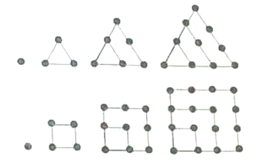

# Mathematics - 题目 1644

**ID**: d4e34bcccb2340e09f269dad3eddf7d7
**年级**: Grade 11
**难度**: Medium-Hard
**题型**: Multiple-select

## 题目
古希腊毕达哥拉斯学派的数学家用沙粒和小石子来研究数，他们根据沙粒或小石子所排列的形状，把数分成许多类，如图中第一行图形中黑色小点个数： ${\rm 1，3，6，10，}\cdots $ 称为三角形数，第二行图形中黑色小点个数： ${\rm 1，4，9，16，}\cdots $ 称为正方形数，记三角形数构成数列 $\left \{a{{}_{n}}\right \}$ ，正方形数构成数列 $\left \{b{{}_{n}}\right \}$ ，则下列说法正确的是（      ）​​​​​​​‌

## 解答

1. 依题意，数列 $\left \{a{{}_{n}}\right \}$ 中， $a{{}_{1}}=1$ ， $a{{}_{2}}-a{{}_{1}}=2,a{{}_{3}}-a{{}_{2}}=3,a{{}_{4}}-a{{}_{3}}=4,\cdots ,a{{}_{n}}-a{{}_{n-1}}=n$ ， $n\mathrm{\geqslant }2$ ，
2. 于是得 $a{{}_{n}}=a{{}_{1}}+(a{{}_{2}}-a{{}_{1}})+(a{{}_{3}}-a{{}_{2}})+\cdots +(a{{}_{n}}-a{{}_{n-1}})=1+2+3+\cdots +n=\frac {n(n+1)}{2}$ ，
3. $a{{}_{1}}=1$ 满足上式，
4. 数列 $\left \{b{{}_{n}}\right \}$ 中， $b{{}_{1}}=1$ ， $b{{}_{2}}-b{{}_{1}}=3,b{{}_{3}}-b{{}_{2}}=5,b{{}_{4}}-b{{}_{3}}=7,\cdots ,b{{}_{n}}-b{{}_{n-1}}=2n-1$ ， $n\mathrm{\geqslant }2$ ，
5. 于是得 $b{{}_{n}}=b{{}_{1}}+(b{{}_{2}}-b{{}_{1}})+(b{{}_{3}}-b{{}_{2}})+\cdots +(b{{}_{n}}-b{{}_{n-1}})=1+3+5+\cdots +(2n-1)=n{^{2}}$ ，
6. $b{{}_{1}}=1$ 满足上式，
7. 因此 $a{{}_{n}}=\frac {n(n+1)}{2},b{{}_{n}}=n{^{2}}$ ，
8. 对于 ${\rm A，}\frac {1}{a{{}_{n}}}=\frac {2}{n(n+1)}=2(\frac {1}{n}-\frac {1}{n+1})$ ，则 $\frac {1}{a{{}_{1}}}+\frac {1}{a{{}_{2}}}+\frac {1}{a{{}_{3}}}+\cdots +\frac {1}{a{{}_{n}}}=2(1-\frac {1}{n+1})=\frac {2n}{n+1}{\rm ，A}$ 不正确；
9. 对于B，∵ $1225=\frac {2450}{2}=\frac {49(49+1)}{2}$ ，则 $a{{}_{49}}=1225$ ，又 $1225=35{^{2}}$ ，则 $b{{}_{35}}=1225{\rm ，B}$ 正确；
10. 对于 ${\rm C，}b{{}_{n}}=n{^{2}}$ ，
11. 当n为偶数时：
12. 设 $n=2k\left ({k\in {\mathbf{N}}{^{{\rm{*}}}}}\right )$ ，则 $b{{}_{1}}-b{{}_{2}}+b{{}_{3}}-\cdots +{\left({-1}\right)^{n-1}}b{{}_{n}}=\left ({b{{}_{1}}-b{{}_{2}}}\right )+\left ({b{{}_{3}}-b{{}_{4}}}\right )+\cdots +\left ({b{{}_{2k-1}}-b{{}_{2k}}}\right )$
13. $=1-2{^{2}}+3{^{2}}-4{^{2}}+…+{\left({2k-1}\right)^{2}}-{\left({2k}\right)^{2}}=-3-7-…-\left ({4k-1}\right )$
14. $=-\frac {k\left ({3+4k-1}\right )}{2}=-k\left ({1+2k}\right )=-\frac {n}{2}\left ({1+2\times \frac {n}{2}}\right )=-\frac {n\left ({1+n}\right )}{2}=\frac {(-1){^{n-1}}n\left ({1+n}\right )}{2}$ ，
15. 当n为奇数时：
16. 设 $n=2k+1\left ({k\in {\mathbf{N}}}\right )$ ，则 $b{{}_{1}}-b{{}_{2}}+b{{}_{3}}-\cdots +{\left({-1}\right)^{n-1}}b{{}_{n}}=b{{}_{1}}-b{{}_{2}}+b{{}_{3}}-b{{}_{4}}+\cdots +b{{}_{2k-1}}-b{{}_{2k}}+b{{}_{2k+1}}$
17. $=1-2{^{2}}+3{^{2}}-4{^{2}}+…+{\left({2k-1}\right)^{2}}-{\left({2k}\right)^{2}}+{\left({2k+1}\right)^{2}}=1+5+9+…+\left ({4k+1}\right )$
18. $=\frac {\left ({k+1}\right )\left ({1+4k+1}\right )}{2}=\left ({k+1}\right )\left ({1+2k}\right )=\frac {\left ({n+1}\right )}{2}n=\frac {(-1){^{n-1}}n\left ({1+n}\right )}{2}$ ，
19. 综上， $b{{}_{1}}-b{{}_{2}}+b{{}_{3}}-\cdots +(-1){^{n-1}}b{{}_{n}}=\frac {(-1){^{n-1}}n\left ({1+n}\right )}{2}{\rm ，C}$ 正确；
20. 对于 ${\rm D，}\forall m\in {\mathbf{N}}{^{{\rm{*}}}}$ ， $m\mathrm{\geqslant }2$ ，取 $p=m,q=m-1$ ，
21. 则 $a{{}_{p}}+a{{}_{q}}=a{{}_{m}}+a{{}_{m-1}}=\frac {m(m+1)}{2}+\frac {m(m-1)}{2}=m{^{2}}=b{{}_{m}}$ ，
22. ∴ $\forall m\in {\mathbf{N}}{^{{\rm{*}}}}$ ， $m\mathrm{\geqslant }2$ ，总存在 $p$ ， $q\in {\mathbf{N}}{^{{\rm{*}}}}$ ，使得 $b{{}_{m}}=a{{}_{p}}+a{{}_{q}}$ 成立，D正确，
23. 故选BCD.

## 知识点

**中文**:
  - 数列求和方法之裂项相消法
  - 数列通项求法之累加法

**English**:
  - Telescoping Series Method
  - Accumulation Method (Telescoping Sums)

---
