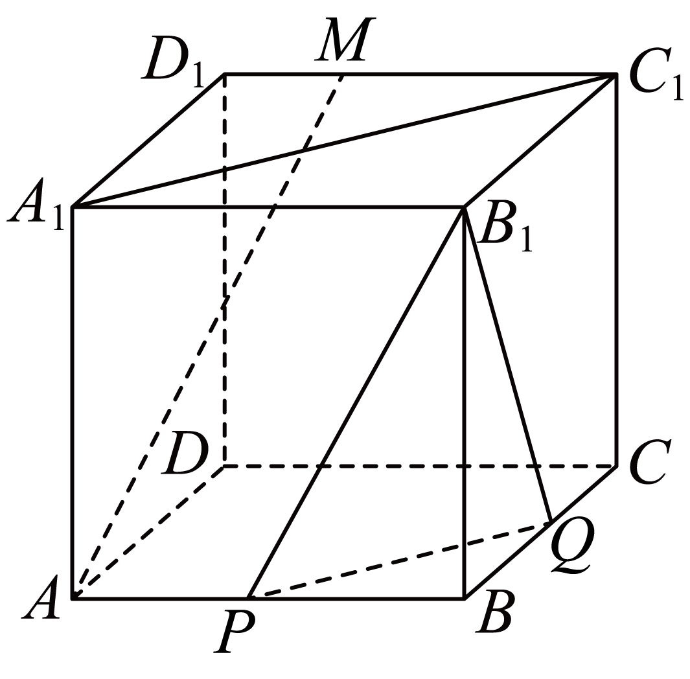

# Mathematics - 题目 1857

**ID**: df4276b2dec64959a01f4651f0d9dd9a
**年级**: Grade 11
**难度**: Medium-Hard
**题型**: Multiple-select

## 题目
如图所示，在棱长为1的正方体 $ABCD-A{{}_{1}}B{{}_{1}}C{{}_{1}}D{{}_{1}}$ 中， $P$ ， $Q$ 分别为棱 $AB$ ， $BC$ 的中点，则以下四个结论正确的是（      ）​​​​​​​‌

## 解答

1. A，在棱长为1的正方体 $ABCD-A{{}_{1}}B{{}_{1}}C{{}_{1}}D{{}_{1}}$ 中，建立如图所示的空间直角坐标系，
2. 
3. 则 $A(1,0,0),P(1,\frac {1}{2},0),Q(\frac {1}{2},1,0),B{{}_{1}}(1,1,1),A{{}_{1}}(1,0,1)$ ， $\overrightarrow {{PQ}}=(-\frac {1}{2},\frac {1}{2},0),\overrightarrow {{PB{{}_{1}}}}=(0,\frac {1}{2},1)$ ，
4. 设平面 $B{{}_{1}}PQ$ 的一个法向量 $\overrightarrow {{n}}=(x,y,z)$ ，则 $\begin{cases}\overrightarrow n\cdot \overrightarrow {{PQ}}=-\frac {1}{2}x+\frac {1}{2}y=0\\\overrightarrow n\cdot \overrightarrow {{PB{{}_{1}}}}=\frac {1}{2}y+z=0\end{cases}$ ，
5. 令 $z=-1$ ，得 $\overrightarrow {{n}}=(2,2,-1)$ ，
6. 设棱 $C{{}_{1}}D{{}_{1}}$ 上点 $M(0,m,1)$ ， $0\leqslant m\leqslant 1$ ，则 $\overrightarrow {{AM}}=(-1,m,1)$ ，
7. 若 $AM//$ 平面 $B{{}_{1}}PQ$ ，则有 $\overrightarrow {{n}}\cdot \overrightarrow {{AM}}=-2+2m-1=0$ ，
8. 解得 $m=\frac {3}{2}$ ，与 $0\leqslant m\leqslant 1$ 矛盾，
9. 即在棱 $C{{}_{1}}D{{}_{1}}$ 上不存在点M，使得 $AM//$ 平面 $B{{}_{1}}PQ{\rm ，A}$ 不正确；
10. B，点 $C{{}_{1}}$ 到平面 $B{{}_{1}}PQ$ 的距离h，因 $\overrightarrow {{B{{}_{1}}C{{}_{1}}}}=(-1,0,0)$ ，
11. 则 $h=\frac {|\overrightarrow {{B{{}_{1}}C{{}_{1}}}}\cdot \overrightarrow {{n}}|}{|\overrightarrow {{n}}|}=\frac {|-1\times 2|}{\sqrt {2{^{2}}+2{^{2}}+(-1){^{2}}}}=\frac {2}{3}{\rm ，B}$ 正确；
12. C，取AD，CD的中点E，F，连接 $A{{}_{1}}E,EF,C{{}_{1}}F,EQ$ ，
13. 则 $EF//AC//A{{}_{1}}C{{}_{1}}$ ，即 $EF,A{{}_{1}}C{{}_{1}}$ 确定一个平面，如图，
14. 
15. 依题意， $EQ//AB//A{{}_{1}}B{{}_{1}}$ ， $EQ=AB=A{{}_{1}}B{{}_{1}}$ ，即四边形 $A{{}_{1}}B{{}_{1}}QE$ 是平行四边形， $A{{}_{1}}E//B{{}_{1}}Q$ ，
16. $A{{}_{1}}E\not\subset $ 平面 $B{{}_{1}}PQ$ ， $B{{}_{1}}Q\subset $ 平面 $B{{}_{1}}PQ$ ，于是得 $A{{}_{1}}E//$ 平面 $B{{}_{1}}PQ$ ，
17. 显然 $EF//PQ$ ， $EF\not\subset $ 平面 $B{{}_{1}}PQ$ ， $PQ\subset $ 平面 $B{{}_{1}}PQ$ ，于是得 $EF//$ 平面 $B{{}_{1}}PQ$ ，
18. 而 $A{{}_{1}}E\cap EF=E$ ， $A{{}_{1}}E,EF\subset $ 平面 $A{{}_{1}}C{{}_{1}}FE$ ，因此，平面 $A{{}_{1}}C{{}_{1}}FE//$ 平面 $B{{}_{1}}PQ$ ，
19. 即梯形 $A{{}_{1}}C{{}_{1}}FE$ 是过 $A{{}_{1}}C{{}_{1}}$ 与平面 $B{{}_{1}}PQ$ 平行的正方体的截面，
20. 而 $A{{}_{1}}E=C{{}_{1}}F=\frac {\sqrt {5}}{2},EF=\frac {\sqrt {2}}{2},A{{}_{1}}C{{}_{1}}=\sqrt {2}$ ，
21. 则此等腰梯形的高 $h^{′}=\sqrt {A{{}_{1}}E{^{2}}-(\frac {A{{}_{1}}C{{}_{1}}-EF}{2}){^{2}}}=\sqrt {\frac {5}{4}-\frac {2}{16}}=\frac {3\sqrt {2}}{4}$ ，
22. 所以过 $A{{}_{1}}C{{}_{1}}$ 与平面 $B{{}_{1}}PQ$ 平行的正方体的截面面积为 $\frac {A{{}_{1}}C{{}_{1}}+EF}{2}\cdot h^{′}=(\frac {3\sqrt {2}}{4}){^{2}}=\frac {9}{8}{\rm ，C}$ 正确；
23. D，过PQ的平面截正方体的外接球所得截面小圆最小时，
24. 该小圆直径是直线PQ被正方体的外接球所截弦，
25. 由对称性知线段PQ中点N是这个小圆的圆心，
26. 令正方体 $ABCD-A{{}_{1}}B{{}_{1}}C{{}_{1}}D{{}_{1}}$ 的外接球球心为O，连接ON，OP，
27. 则 $ON\bot PQ$ ，而 $OP=\frac {\sqrt {2}}{2},PN=\frac {\sqrt {2}}{4},ON=\sqrt {OP{^{2}}-PN{^{2}}}=\frac {\sqrt {6}}{4}$ ，而球半径 $R=\frac {\sqrt {3}}{2}$ ，
28. 则这个小圆半径 $r=\sqrt {R{^{2}}-ON{^{2}}}=\sqrt {\frac {3}{4}-\frac {6}{16}}=\frac {\sqrt {6}}{4}$ ，此圆面积为 ${\rm{π}}r{^{2}}=\frac {3{\rm{π}}}{8}{\rm ，D}$ 正确.
29. 故选BCD

## 知识点

**中文**:
  - 向量法求距离-点面距离
  - 截面问题
  - 用向量证明平行问题

**English**:
  - Point-Plane Distance
  - Cross-section Problems
  - Proving Parallelism

---
