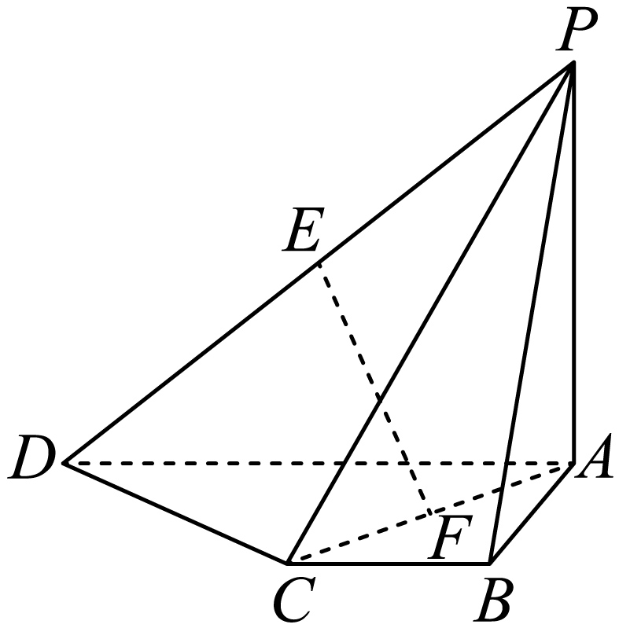

# Mathematics - 题目 3489

**ID**: e8424d5bab6540999aa379a40fb22421
**年级**: Grade 11
**难度**: Medium-Hard
**题型**: Multiple-select

## 题目
在四棱锥 $P-ABCD$ 中， $PA\bot $ 面 $ABCD,AD//BC,AB\bot AD,AD=AP=2$ ， $AB=BC=1$ ，点 $E$ 为 $PD$ 的中点，点 $F$ 为 $AC$ 的中点，则下列说法正确的是（      ）​​​​​​​‌

## 解答

1. 
2. 因为 $PA\bot $ 面 $ABCD,AB\bot AD,$ 所以以 $\mathrm{A}$ 为原点，以 $AB,AD,AP$ 所在直线为 $x,y,z$ 轴建立空间直角坐标系，
3. 又 $PA\bot $ 面 $AD//BC,AD=AP=2$ ， $AB=BC=1$ ，点 $E$ 为 $PD$ 的中点，点 $F$ 为 $AC$ 的中点，
4. 则 $A\left ({0,0,0}\right ),B\left ({1,0,0}\right ),C\left ({1,1,0}\right ),D\left ({0,2,0}\right ),P\left ({0,0,2}\right )$ ，
5. 由中点坐标公式可得 $E\left ({0,1,1}\right ),F\left ({\frac {1}{2},\frac {1}{2},0}\right )$ ，
6. 对于 ${\rm A，}\overrightarrow {{AC}}=\left ({1,1,0}\right ),\overrightarrow {{EF}}=\left ({\frac {1}{2},-\frac {1}{2},-1}\right )$ ， $\overrightarrow {{AC}}\cdot \overrightarrow {{EF}}=\left ({1,1,0}\right )\cdot \left ({\frac {1}{2},-\frac {1}{2},-1}\right )=0$ ，
7. 所以 $\overrightarrow {{AC}}\bot \overrightarrow {{EF}}$ ，即 $AC\bot EF$ ，故A正确；
8. 对于B，设平面 $PAC$ 的法向量为 $\overrightarrow n=\left ({x,y,z}\right )$ ，
9. 由 $\begin{cases}\overrightarrow {{AP}}\cdot \overrightarrow n=0\\\overrightarrow {{AC}}\cdot \overrightarrow n=0\end{cases}$ 可得 $\begin{cases}2z=0\\x+y=0\end{cases}$ ，
10. 令 $x=1$ ，可得 $\overrightarrow n=\left ({1,-1,0}\right )$ ，
11. 又 $\overrightarrow {{AD}}=\left ({0,2,0}\right )$ ，
12. 所以点 $D$ 到平面 $PAC$ 的距离为 $\frac {\left |{\overrightarrow {{AD}}\cdot \overrightarrow n}\right |}{\left |{\overrightarrow n}\right |}=\frac {\left |{-2}\right |}{\sqrt {2}}=\sqrt {2}$ ，故B正确；
13. 对于C，因为 $PA\bot $ 面 $ABCD,$  $\angle ABC=90{}\degree $ ，所以三棱锥 $P-ABC$ 的外接球的球心为 $PC$ 中点，
14. 又 $PC=\sqrt {PA{^{2}}+AB{^{2}}+BC{^{2}}}=\sqrt {4+1+1}=\sqrt {6}$ ，所以其外接球半径为 $\frac {\sqrt {6}}{2}$ ；
15. 因为 $AC=\sqrt {AB{^{2}}+BC{^{2}}}=\sqrt {2}$ ， $CD=\sqrt {{\left({1-0}\right)^{2}}+{\left({1-2}\right)^{2}}}=\sqrt {2}$ ， $AC{^{2}}+CD{^{2}}=AD{^{2}}$ ，
16. 所以 $∠ACD{\rm{=}}{{9}}{{0}}{}\degree $ ，
17. 又 $PA\bot $ 面 $ABCD,$ 所以三棱锥 $P-ADC$ 的外接球的球心为 $PD$ 的中点，
18. $PD=\sqrt {PA{^{2}}+AD{^{2}}}=2\sqrt {2}$ ，所以其外接球半径为 $\sqrt {2}$ ，
19. 所以外接球半径之比为 $2:\sqrt {3}$ ，故C错误；
20. 对于D，设 $\overrightarrow {{PQ}}=λ\overrightarrow {{PC}}$ ， $\overrightarrow {{PC}}=\left ({1,1,-2}\right )$ ，则 $\overrightarrow {{PQ}}=\left ({λ,λ,-2λ}\right )$ ， $\overrightarrow {{AQ}}=\overrightarrow {{AP}}+\overrightarrow {{PQ}}=\left ({λ,λ,2-2λ}\right )$ ，
21. 设平面 $ABE$ 的法向量为 $\overrightarrow m=\left ({a,b,c}\right )$ ，
22. $\overrightarrow {{AB}}=\left ({1,0,0}\right ),\overrightarrow {{AE}}=\left ({0,1,1}\right )$ ，
23. 由 $\begin{cases}\overrightarrow m\cdot \overrightarrow {{AB}}=0\\\overrightarrow m\cdot \overrightarrow {{AE}}=0\end{cases}$ 可得 $\begin{cases}a=0\\b+c=0\end{cases}$ ，
24. 令 $b=1$ ，则 $\overrightarrow m=\left ({0,1,-1}\right )$ ，
25. 因为 $\overrightarrow {{AQ}}\cdot \overrightarrow m=0\times λ+1\times λ+\left ({-1}\right )\times \left ({2-2λ}\right )=0$ ，解得 $λ=\frac {2}{3}$ ，
26. 所以 $PQ=\frac {2}{3}PC$ ，故D正确.
27. 故选ABD

## 知识点

**中文**:
  - 向量法求距离-点面距离
  - 球的切接问题
  - 用向量证明垂直问题

**English**:
  - Point-Plane Distance
  - Tangency and Inscribed/Circumscribed Spheres
  - Proving Perpendicularity

---
