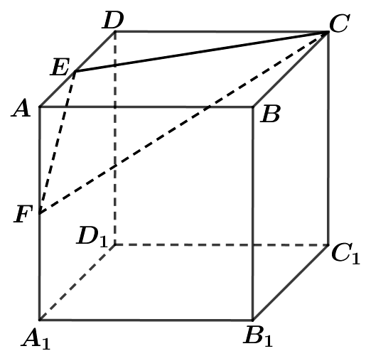

# Mathematics - 题目 3806

**ID**: f4f30995d06643c2bdb0bc617a431407
**年级**: Grade 11
**难度**: Medium-Hard
**题型**: Multiple-select

## 题目
如图，正方体 $ABCD-A{{}_{1}}B{{}_{1}}C{{}_{1}}D{{}_{1}}$ 的棱长为2，E，F分别为 $AD$ ， $AA{{}_{1}}$ 的中点，则以下说法正确的是（      ）​​​​​​​‌

## 解答

1. 对于B选项，建立如图所示的空间直角坐标系，
2. 
3. 则 $E\left ({1,0,2}\right )$ ， $F\left ({2,0,1}\right )$ ， $C\left ({0,2,2}\right )$ ， $C{{}_{1}}\left ({0,2,0}\right )$ ，
4. 设 $P(2,2,z{{}_{p}})$ ，所以 $\overrightarrow {{C{{}_{1}}P}}=(2,0,z{{}_{p}})$ ， $\overrightarrow {{EC}}=(-1,2,0)$ ，
5. 若 $C{{}_{1}}P\bot $ 平面 $EFC$ ，则 $\overrightarrow {{C{{}_{1}}P}}\bot \overrightarrow {{EC}}$ ，而 $-2=0$ 显然不成立，
6. 所以 $C{{}_{1}}P$ 与 $EC$ 不垂直，所以 $BB{{}_{1}}$ 上不存在点P，使得 $C{{}_{1}}P\bot $ 面 $EFC$ ，
7. 所以B选项错误；
8. 对于A选项，连接 $B{{}_{1}}C$ ， $B{{}_{1}}F$ ， $A{{}_{1}}D$
9. 
10. ∵E，F分别为 $AD$ ， $AA{{}_{1}}$ 的中点，故 $EF{\rm{/}}{\rm{/}}A{{}_{1}}D$ ，而 $A{{}_{1}}D{\rm{/}}{\rm{/}}BC$ ，故 $EF{\rm{/}}{\rm{/}}B{{}_{1}}C$ ，
11. ∴E﹐ ${\rm \mathit{F}，}B{{}_{1}}{\rm ，\mathit{C}}$ 四点共线，
12. ∴平面 $EFC$ 截正方体所得的截面为梯形 $EFB{{}_{1}}C$ ，
13. ∴截面周长 $L=EF+FB{{}_{1}}+B{{}_{1}}C+EC=\sqrt {2}+\sqrt {5}+2\sqrt {2}+\sqrt {5}=2\sqrt {5}+3\sqrt {2}$ ，
14. 故A正确；
15. 对于C选项，连接 $EB,DB{{}_{1}},FD$ ，
16. 故 $V{{}_{B-EFC}}=V{{}_{F-BEC}}=\frac {1}{3}\times \frac {1}{2}\times 2\times 2\times 1=\frac {2}{3}$ ，
17. 而平面 $B{{}_{1}}CD$ 即为平面 $A{{}_{1}}B{{}_{1}}CD$ ，因 $AF=FA{{}_{1}}$ ，
18. 故 $F$ 到平面 $B{{}_{1}}CD$ 的距离为 $A$ 到平面 $B{{}_{1}}CD$ 的距离的 $\frac {1}{2}$ ，
19. 而 $A$ 到平面 $B{{}_{1}}CD$ 为 $\frac {1}{2}AD{{}_{1}}=\sqrt {2}$ ，故 $F$ 到平面 $B{{}_{1}}CD$ 的距离为 $\frac {\sqrt {2}}{2}$ ，
20. 故 $V{{}_{D-FB{{}_{1}}C}}=V{{}_{F-DB{{}_{1}}C}}=\frac {1}{3}\times \frac {1}{2}\times 2\times 2\sqrt {2}\times \frac {\sqrt {2}}{2}=\frac {2}{3}$ ，
21. 所以 $V{{}_{B-EFC}}=V{{}_{D-FB{{}_{1}}C}}$ 成立，C正确；
22. 对于D选项，取 $B{{}_{1}}C$ 的中点 ${\rm \mathit{M}，}BB{{}_{1}}$ 的中点N，连接 $EM$ ， $AN$ ， $MN$ ，
23. ∵ $AE{\rm{/}}{\rm{/}}MN$ 且 $AE=MN$ ，
24. ∴四边形 $AEMN$ 为平行四边形，∴ $EM{\rm{/}}{\rm{/}}B{{}_{1}}F$ ，
25. ∴ $AN{\rm{/}}{\rm{/}}M$ ，∵ $EM\subset $ 平面 $EFC$ ， $AN\not\subset $ 平面 $EFC$
26. ∴ $AN{\rm{/}}{\rm{/}}$ 平面 $EFC$ ，∴点P为 $BB{{}_{1}}$ 的中点，
27. ∴ $BB{{}_{1}}$ 上存在一点Р使得 $AP//$ 平面 $EFC$ ，故D正确．
28. 故选ACD.

## 知识点

**中文**:
  - 截面问题
  - 棱柱、棱锥、棱台的体积
  - 直线与平面平行的判定
  - 直线与平面垂直的判定

**English**:
  - Cross-section Problems
  - Volume of Polyhedra
  - Line-Plane Parallelism Determination
  - Line-Plane Perpendicularity Determination

---
