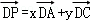
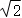
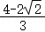

# Mathematics - 题目 3957

**ID**: fbf339458c814d11be2647d4fa406973
**年级**: Grade 11
**难度**: Medium-Hard
**题型**: Multiple-select

## 题目
已知正方体ABCD﹣A${\rm _{1}}$B${\rm _{1}}$C${\rm _{1}}$D${\rm _{1}}$ 的棱长为2，点P满足，其中x∈[0，1]，y∈[0，1]，则（      ）A．存在唯一点P，使得C${\rm _{1}}$P⊥平面B${\rm _{1}}$D${\rm _{1}}$CB．存在唯一点P，使得A${\rm _{1}}$P∥平面B${\rm _{1}}$D${\rm _{1}}$CC．当x+y＝1时，点B${\rm _{1}}$ 到平面PA${\rm _{1}}$D${\rm _{1}}$ 的距离的最小值为D．当时，三棱锥P﹣ACB${\rm _{1}}$ 的体积的最小值为​​​​​​​‌

## 解答

1. 以D为原点，所在方向分别为x轴、y轴、z轴的正方向，建立空间坐标系，如图所示：
2. 
3. 则D（0，0，0），A（2，0，0），B（2，2，0），C（0，2，0），D${\rm _{1}}$  ${\rm （0，0，2），\mathit{A}}$  ${\rm _{1}}$  ${\rm （2，0，2），\mathit{B}}$  ${\rm _{1}}$  ${\rm （2，2，2），\mathit{C}}$  ${\rm _{1}}$ （0，2，2），
4. 对于A，因为，
5. 所以，P（2x，2y，0），
6. 所以，
7. 又因为，，
8. 设平面B${\rm _{1}}$D${\rm _{1}}$C的法向量为，
9. 则，则，
10. 所以，
11. 取x＝﹣1，则，
12. 又因为C${\rm _{1}}$P⊥平面B${\rm _{1}}$D${\rm _{1}}$C，
13. 所以，
14. 所以x＝1，y＝0，
15. 所以P（2，0，0），唯一确定，故正确；
16. 对于B，因为，
17. 要使A${\rm _{1}}$P∥平面B${\rm _{1}}$D${\rm _{1}}$C，
18. 则，
19. 所以，
20. 所以x＝y，
21. 故点P不唯一，故错误；
22. 对于C，因为x+y＝1，所以A，C，P三点共线，
23. 
24. 因为，
25. 设点B${\rm _{1}}$ 到平面PA${\rm _{1}}$D${\rm _{1}}$ 的距离为d，
26. 则有，
27. 所以，
28. 设P到A${\rm _{1}}$D${\rm _{1}}$ 的距离为h，
29. 则，
30. 当P与C重合时，，
31. 所以，故C正确；
32. 对于D，因为，所以点P在以D为圆心，为半径的圆弧上，
33. 
34. 设P到AC的距离为h′
35. 因为，
36. 当点P位于圆弧中点时，．
37. 所以，故D错误．
38. 故选：AC．

## 知识点

**中文**:
  - 向量法求距离-点面距离
  - 棱柱、棱锥、棱台的体积
  - 用向量证明平行问题
  - 用向量证明垂直问题

**English**:
  - Point-Plane Distance
  - Volume of Polyhedra
  - Proving Parallelism
  - Proving Perpendicularity

---
