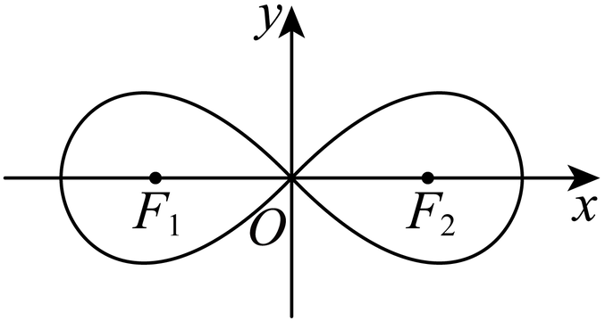

# Mathematics - 题目 1243

**ID**: 02b625aa448d43bc8f5970f89e5f5a1d
**年级**: Grade 11
**难度**: Medium
**题型**: Multiple-choice

## 题目
如图所示的曲线 $C$ 过坐标原点 $O,C$ 上的点到两定点 $F{{}_{1}}\left ({-a,0}\right ),F{{}_{2}}\left ({a,0}\right )\left ({a>0}\right )$ 的距离之积为定值.​​​​​​​‌当 $a=3$ 时， $C$ 上第一象限内的点 $P$ 满足 $\vartriangle PF{{}_{1}}F{{}_{2}}$ 的面积为 $\frac {9}{2}$ ，则 $\left |{PF{{}_{1}}}\right |{^{2}}-\left |{PF{{}_{2}}}\right |{^{2}}=$ （      ）

## 解答

1. 令 $P(m,n)$ 且 $m,n>0$ ，由题设有 $\frac {1}{2}\times 2a\times n=3n=\frac {9}{2}$ ，可得 $n=\frac {3}{2}$ ，
2. 又 $d=\sqrt {(x+a){^{2}}+y{^{2}}}\cdot \sqrt {(x-a){^{2}}+y{^{2}}}$ 为定值，且曲线过原点，则 $d=a{^{2}}$ ，
3. 所以 $a=3$ 时， $F{{}_{1}}\left ({-3,0}\right ),F{{}_{2}}\left ({3,0}\right )$ ，则 $\sqrt {(x+3){^{2}}+y{^{2}}}\cdot \sqrt {(x-3){^{2}}+y{^{2}}}=9$ ，
4. 代入 $y=\frac {3}{2}$ ，可得 $(x{^{2}}-9){^{2}}+\frac {9}{2}\cdot (x{^{2}}+9)+\frac {81}{16}=81$ ，即 $(x{^{2}}-9){^{2}}+\frac {9}{2}\cdot (x{^{2}}-9)+\frac {81}{16}=0$ ，
5. 所以 $x{^{2}}-9=-\frac {9}{4}$ ，可得 $x=\pm \frac {3\sqrt {3}}{2}$ ，故 $m=\frac {3\sqrt {3}}{2}$ ，故 $P(\frac {3\sqrt {3}}{2},\frac {3}{2})$ ，
6. 所以 $\left |{PF{{}_{1}}}\right |{^{2}}-\left |{PF{{}_{2}}}\right |{^{2}}=(\frac {3\sqrt {3}}{2}+3){^{2}}+\frac {9}{4}-(\frac {3\sqrt {3}}{2}-3){^{2}}-\frac {9}{4}=18\sqrt {3}$ .
7. 故选B.

## 知识点

**中文**:
  - 曲线与方程

**English**:
  - Curves and Equations

---
