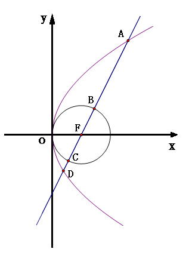

# Mathematics - 题目 650

**ID**: 0a8f914bbffb43a89d3d35fb59341ff9
**年级**: Grade 11
**难度**: Medium
**题型**: Multiple-choice

## 题目
如图，圆F： $(x-1){^{2}}+y{^{2}}=1$ 和抛物线 $x=\frac {y{^{2}}}{4}$ ，过F的直线与抛物线和圆依次交于A、B、C、D四点，求 $\left |{AB}\right |\cdot \left |{CD}\right |$ 的值是​​​​​​​‌

## 解答

1. 解：若直线的斜率不存在，则直线方程为x=1，代入抛物线方程和圆的方程，可直接得到ABCD四个点的坐标为（1，2）（1，1）（1，-1）（1，-2），所以|AB|=1，|CD|=1，从而|AB||CD|=1．若直线的斜率存在，设为k，因为直线过抛物线的焦点（1，0），则直线方程为y=k（x-1），不妨设A（x_{1}，y_{1}），D（x_{2}，y_{2}），过A、D分别作抛物线准线的垂线，由抛物线的定义，|AF|=x_{1}+1，|DF|=x_{2}+1，把直线方程与抛物线方程联立，消去y可得k^{2}x^{2}-（2k^{2}+4）x+k^{2}=0，由韦达定理有x_{1}x_{2}=1而抛物线的焦点F同时是已知圆的圆心，所以|BF|=|CF|=R=1
2. 从而有|AB|=|AF|-|BF|=x_{1}，|CD|=|DF|-|CF|=x_{2}．
3. 所以|AB||CD|=x_{1}x_{2}=1
4. 故选A．

## 知识点

**中文**:
  - 弦长面积问题

**English**:
  - Chord Length and Area Problems

---
