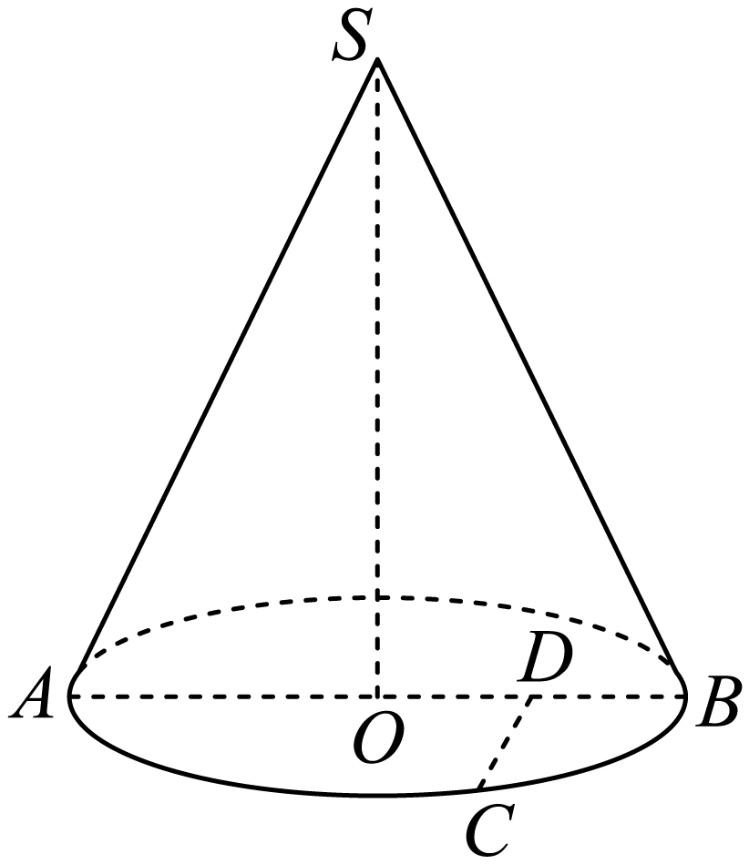

# Mathematics - 题目 2982

**ID**: 11f973f5aeb146c7aaa934b801714a9c
**年级**: Grade 11
**难度**: Medium
**题型**: Multiple-choice

## 题目
如图， $△SAB$ 是圆锥 $SO$ 的轴截面， $SA=\sqrt {2}AB,C$ 是半圆弧 $\overset{\frown}{{AB}}$ 的中点， $D$ 是线段 $OB$ 的中点，则异面直线 $SA$ 与 $CD$ 所成角的余弦值是（      ）​​​​​​​‌

## 解答

1. 
2. 如图，连接 $OC$ ， $\because C$ 是半圆弧 $\overset{\frown}{{AB}}$ 的中点， $\therefore OC\bot OB$ ，
3. 又 $SO\bot $ 平面 $ABC$ ， $\therefore OC,OB,OS$ 两两垂直，
4. 则以 $O$ 为坐标原点， $\overrightarrow {{OC}},\overrightarrow {{OB}},\overrightarrow {{OS}}$ 的方向分别为 $x,y,z$ 轴的正方向，建立空间直角坐标系.
5. 设 $AB=4$ ， $\therefore SA=\sqrt {2}AB=4\sqrt {2}$ ， $\therefore SO=2\sqrt {7}$ ，
6. 则 $A\left ({0,-2,0}\right )$ ， $C\left ({2,0,0}\right )$ ， $D\left ({0,1,0}\right )$ ， $S\left ({0,0,2\sqrt {7}}\right )$ ，
7. 则 $\overrightarrow {{SA}}=\left ({0,-2,-2\sqrt {7}}\right ),\overrightarrow {{CD}}=\left ({-2,1,0}\right )$ ，
8. 设异面直线 $SA$ 与 $CD$ 所成的角为 $θ$ ，
9. 则 ${\rm{c}}{\rm{o}}{\rm{s}}θ=\left |{{\rm{c}}{\rm{o}}{\rm{s}}\left \langle {\overrightarrow {{SA}},\overrightarrow {{CD}}}\right \rangle }\right |=\frac {\left |{\overrightarrow {{SA}}\cdot \overrightarrow {{CD}}}\right |}{\left |{\overrightarrow {{SA}}}\right |\left |{\overrightarrow {{CD}}}\right |}=\frac {2}{4\sqrt {2}\times \sqrt {5}}=\frac {\sqrt {10}}{20}$ .
10. 故选B.

## 知识点

**中文**:
  - 向量法求异面直线所成角

**English**:
  - Angle between Skew Lines

---
