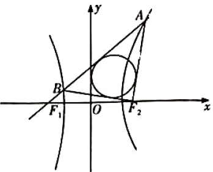

# Mathematics - 题目 2164

**ID**: 33bf7f67097c40fbb7f24b68aaa03e29
**年级**: Grade 11
**难度**: Medium
**题型**: Multiple-choice

## 题目
如图，已知双曲线 $C:\frac {x{^{2}}}{a{^{2}}}-\frac {y{^{2}}}{b{^{2}}}=1(a,b>0)$ 的左､右焦点分别为 $F{{}_{1}}$ ， $F{{}_{2}}$ ，过 $F{{}_{1}}$ 的直线与 $C$ 分别在第一､二象限交于 $A,B$ 两点， $△ABF{{}_{2}}$ 内切圆半径为 $r$ ，若 $\left |{BF{{}_{1}}}\right |=r=a$ ，则 $C$ 的离心率为（      ）​​​​​​​‌

## 解答

1. 
2. 设 $\left |{AB}\right |=x$ ，内切圆圆心为 $I$ ，内切圆在 $BF{{}_{2}},AF{{}_{2}},AB$ 上的切点分别为 $U,V,W$ ，
3. 则 $\left |{BU}\right |=\left |{BW}\right |,\left |{AV}\right |=\left |{AW}\right |,\left |{F{{}_{2}}U}\right |=\left |{F{{}_{2}}V}\right |$ ，
4. 由 $\left |{BF{{}_{1}}}\right |=a$ 及双曲线的定义可知， $\left |{BF{{}_{2}}}\right |=3a,\left |{AF{{}_{2}}}\right |=x-a,\left |{F{{}_{2}}U}\right |=\left |{F{{}_{2}}V}\right |=\frac {1}{2}\left ({\left |{BF{{}_{2}}}\right |+\left |{AF{{}_{2}}}\right |-\left |{AB}\right |}\right )=a=r$ ，
5. 故四边形 $IUF{{}_{2}}V$ 是正方形，
6. 得 $AF{{}_{2}}\bot BF{{}_{2}}$ ，于是 $\left |{BF{{}_{2}}}\right |{^{2}}+\left |{AF{{}_{2}}}\right |{^{2}}=|AB|{^{2}}$ ，
7. 故 $x{^{2}}=9a{^{2}}+(x-a){^{2}}$ ，所以 $x=5a$ ，
8. 于是 ${\rm{c}}{\rm{o}}{\rm{s}}\angle F{{}_{1}}BF{{}_{2}}={\cos}\left ({{\rm{π}}-\angle ABF{{}_{2}}}\right )=-\frac {3}{5}$ ，在 $\vartriangle F{{}_{1}}BF{{}_{2}}$ 中，
9. 由余弦定理可得 $\left |{F{{}_{1}}F{{}_{2}}}\right |{^{2}}=\left |{BF{{}_{1}}}\right |{^{2}}+\left |{BF{{}_{2}}}\right |{^{2}}-2\left |{BF{{}_{1}}}\right |\cdot \left |{BF{{}_{2}}}\right |\cdot {\rm{c}}{\rm{o}}{\rm{s}}∠F{{}_{1}}BF{{}_{2}}=\frac {68}{5}a{^{2}}$ ，
10. 从而 $4c{^{2}}=\frac {68}{5}a{^{2}}$ ，所以 $e=\frac {c}{a}=\frac {\sqrt {85}}{5}$ .
11. 故选：D.

## 知识点

**中文**:
  - 双曲线的定义
  - 双曲线的离心率

**English**:
  - Definition of Hyperbola
  - Eccentricity

---
