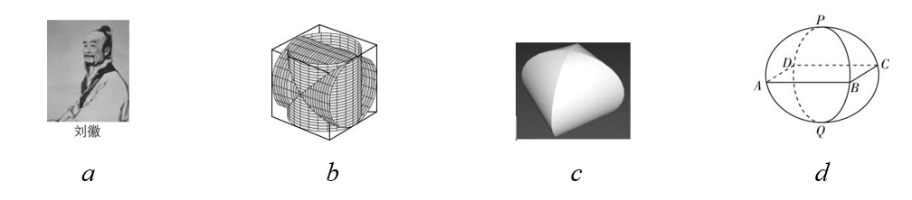

# Mathematics - 题目 965

**ID**: 3e155ab0f3da49aaaa81a22ef5f7e25e
**年级**: Grade 11
**难度**: Medium
**题型**: Multiple-choice

## 题目
魏晋时期数学家刘徽(图a)为研究球体的体积公式，创造了一个独特的立体图形“牟合方盖”，它由完全相同的四个曲面构成，相对的两个曲面在同一圆柱的侧面上.​​​​​​​‌如图，将两个底面半径为1的圆柱分别从纵横两个方向嵌入棱长为2的正方体时(如图b)，两圆柱公共部分形成的几何体(如图c)即得一个“牟合方盖”，图d是该“牟合方盖”的直观图(图中标出的各点 $A$ ， $B$ ， $C$ ， $D$ ， $P$ ， $Q$ 均在原正方体的表面上).由“牟合方盖”产生的过程可知，图d中的曲线 $PBQD$ 为一个椭圆，则此椭圆的离心率为（      ）A． $\frac{\sqrt{2}}{2}$

## 解答

1. 由“牟合方盖”产生的过程可知，题图中的曲线 $PBQD$ 所对应的椭圆的长轴长 $2a=BD=2\sqrt{2}$ ，短轴长 $2b=PQ=2$ ，于是可得此椭圆的半焦距 $c=\sqrt{{a}^{2}-{b}^{2}}=1$ ，因此离心率 $e=\frac{c}{a}=\frac{\sqrt{2}}{2}$ .故选A.

## 知识点

**中文**:
  - 椭圆的离心率

**English**:
  - Eccentricity

---
