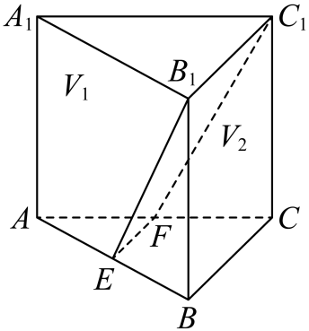

# Mathematics - 题目 635

**ID**: 4a4744142a16476880364783ce186cd1
**年级**: Grade 11
**难度**: Medium
**题型**: Multiple-choice

## 题目
如图，三棱柱 $ABC-A{{}_{1}}B{{}_{1}}C{{}_{1}}$ 中， $E,F$ 分别是 $AB、AC$ 的中点，平面 $EFC{{}_{1}}B{{}_{1}}$ 将三棱柱分成体积为 $V{{}_{1}},V{{}_{2}}$ （左为 $V{{}_{1}}$ ，右为 $V{{}_{2}}$ ）两部分，则 $V{{}_{1}}:V{{}_{2}}=$ （      ）​​​​​​​‌

## 解答

1. 解：设三角形 $AEF$ 的面积为 $S{{}_{1}}$ ，三角形 $ABC$ 与三角形 $A{{}_{1}}B{{}_{1}}C{{}_{1}}$ 的面积为 $S$ ，三棱柱的高为 $h$ ，
2. 则有 $V{{}_{AEF-A{{}_{1}}B{{}_{1}}C{{}_{1}}}}=V{{}_{1}}$ ， $V{{}_{BCEF-B{{}_{1}}C{{}_{1}}}}=V{{}_{2}}$ ，设三棱柱 $ABC-A{{}_{1}}B{{}_{1}}C{{}_{1}}$ 的体积为 $V$ ，
3. 又因为 $V{{}_{1}}=\frac {1}{3}h(S{{}_{1}}+S+\sqrt {S{{}_{1}}S})$ ①， $V=Sh$ ②，
4. 所以 $V{{}_{2}}=V-V{{}_{1}}$ ③，
5. 由题意可知 $S{{}_{1}}=\frac {1}{4}S$ ④，
6. 由①②③④可得 $V{{}_{1}}=\frac {7}{12}Sh=\frac {7}{12}V$ ，
7. 所以 $V{{}_{2}}=V-V{{}_{1}}=\frac {5}{12}V$ ，
8. 所以 $V{{}_{1}}:V{{}_{2}}=7:5$ .
9. 故选A.

## 知识点

**中文**:
  - 棱柱、棱锥、棱台的体积

**English**:
  - Volume of Polyhedra

---
