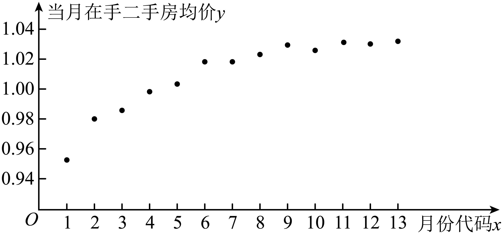

# Mathematics - 题目 654

**ID**: 6cd6750306884558a3b9607ec1f66cbc
**年级**: Grade 11
**难度**: Medium
**题型**: Multiple-choice

## 题目
2020年的“金九银十”变成“铜九铁十”，全国各地房价“跳水”严重，但某地二手房交易却“逆市”而行．下图是该地某小区2019年11月至2020年11月间，当月在售二手房均价（单位：万元/平方米）的散点图．（图中月份代码1至13分别对应2019年11月至2020年11月）（      ）根据散点图选择 $y=a+b\sqrt {x}$ 和 $y=c+d{\ln}x$ 两个模型进行拟合，经过数据处理得到的两个回归方程分别为 $\widehat {y}=0.​​​​​​​‌9369+0.0285\sqrt {x}$ 和 $\widehat {y}=0.9554+0.0306{\ln}x$ ，并得到以下一些统计量的值：$\widehat {y}=0.9369+0.0285\sqrt {x}$$\widehat {y}=0.9554+0.0306{\ln}x$$R{^{2}}$0.9230.973注： ${\overline{x}}$ 是样本数据中 $x$ 的平均数， ${\overline{y}}$ 是样本数据中 $y$ 的平均数，则下列说法不一定成立的是（      ）

## 解答

1. 对于A，散点从左下到右上分布，所以当月在售二手房均价 $y$ 与月份代码 $x$ 呈正相关关系,故A正确；
2. 对于B，令 $x=16$ ，由 $\hat y=0.9369+0.0285\sqrt {16}=1.0509$ ，所以可以预测2021年2月在售二手房均价约为1.0509万元/平方米，故B正确；
3. 对于C，非线性回归方程不一定经过 $(\bar x,\bar y)$ ，故 ${\rm{C}}$ 错误；
4. 对于 ${\rm D，}R{^{2}}$ 越大，拟合效果越好，故D正确.
5. 故选C.

## 知识点

**中文**:
  - 变量间的相关关系
  - 非线性回归问题

**English**:
  - Correlation Relationship
  - Non-linear Regression

---
