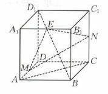

# Mathematics - 题目 49

**ID**: 9b08d51ba1364058ab1be99b22a66f82
**年级**: Grade 11
**难度**: Medium
**题型**: Multiple-choice

## 题目
已知圆 $O:{x}^{2}+{y}^{2}{=9}$ ,下列说法正确的是（      ）​​​​​​​‌

## 解答

1. 圆 $O$ 的圆心为 $O({0,0})$ ,半径 $R{=3}$ .
2. 对于 $\text{A}$ ,因为 $\left|{OP}\right|=\sqrt{{\left(\sqrt{2}\right)^{2}}+{\left(-\sqrt{3}\right)^{2}}}=\sqrt{5}{<3}$ ,可知点 $P$ 在圆 $O$ 内，
3. 可得圆心 $O$ 到过点 $P$ 的直线的距离 $d∈[{0,}\sqrt{5}]$ ,
4. 所以 $\left|{AB}\right|{=2}\sqrt{{R}^{2}-{d}^{2}}{=2}\sqrt{{9-}{d}^{2}}∈[{4,6}]$ ,故  A  正确.
5. 对于 $\text{B}$ ,因为圆心 $O$ 到直线 $l:\sqrt{3}x-y{-2=0}$ 的距离 $d=\frac{\left|{0-0-2}\right|}{\sqrt{{1}^{2}+{\left(-\sqrt{3}\right)^{2}}}}{=1}$ ,
6. 且圆 $O$ 的半径为3，所以圆 $O$ 上有4个点到直线 $l:\sqrt{3}x-y{-2=0}$ 的距离为1.9，故B正确.
7. 对于 $\text{C}$ ,圆 $C:{\left(x{-5}\right)^{2}}+{\left(y{-12}\right)^{2}}={r}^{2}$ 的圆心为 $C({5,12})$ ,半径为 $r$ ,则 $\left|{OC}\right|=\sqrt{{5}^{2}{+1}{2}^{2}}={\rm 13}$ ,若圆 $O$ 与圆 $C$ 没有公切线，则两圆内含，所以 $\left|{OC}\right|<\left|R-r\right|$ ,即 ${13<}\left|{3-}r\right|$ ,解得 $r>{\rm 16}$ ,又 $r{>0}$ ,所以 $r$ 的取值范围为 $({16,+∞})$ ,故 $\text{C}$ 错误.对于 $\text{D}$ ,设 $Q(a{,6+}a)$ ,以 ${OQ}$ 为直径的圆为 $x(x-a)+y(y{-6-}a){=0}$ ,
8. 整理得 ${x}^{2}+{y}^{2}-{ax}-(a{+6})y{=0}$ ,
9. 由题意可知，直线 ${CD}$ 为圆 $Q$ 与圆 $O$ 的公共弦所在的直线，
10. 可得 ${-9+}{ax}+({6+}a)y{=0}$ ,整理得 $a(x+y){+6}y{-9=0}$ ,
11. 令 $\begin{cases}x+y{=0,}\\6y{-9=0,}\end{cases}$ 解得 $\begin{cases}x{=-}\frac{3}{2},\\y=\frac{3}{2},\end{cases}$ 所以直线 ${CD}$ 必过定点 $(-\frac{3}{2},\frac{3}{2}),$ 故  D  错误

## 知识点

**中文**:
  - 圆的公共弦
  - 直线与圆的位置关系的判断
  - 弦长与弦心距
  - 圆的公切线

**English**:
  - Common Chord
  - Determining Line-Circle Relationship
  - Chord Length and Apothem
  - Common Tangents

---
