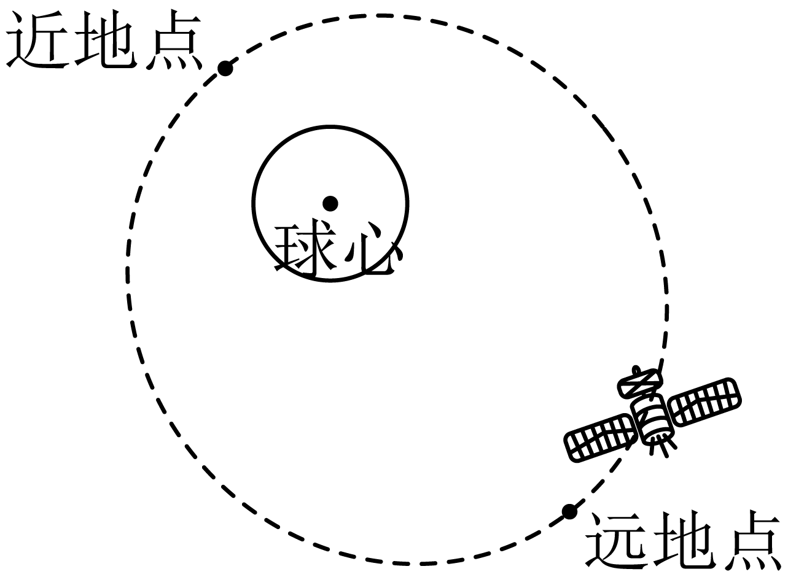

# Mathematics - 题目 2675

**ID**: 9b6fe56164ab4cfb97123c28fefee41f
**年级**: Grade 11
**难度**: Medium
**题型**: Multiple-choice

## 题目
2024年10月22日，我国在太原卫星发射中心使用长征六号运载火箭，成功将天链三号 ${\rm{A}}(01)$ 、 ${\rm{B}}(01)$ 、 ${\rm{B}}(02)$ 卫星发射升空，卫星顺利进入预定轨道，发射任务获得圆满成功．如图，假设天链三号 ${\rm{A}}(01)$ 卫星运动的轨道是以地球的球心为一个焦点的椭圆，已知地球的直径约为1.​​​​​​​‌3万千米，卫星运动至近地点距离地球表面高度约1.35万千米，运动至远地点距离地球表面高度约3.35万千米，则天链三号 ${\rm{A}}(01)$ 卫星运行的轨迹的长半轴长为（      ）

## 解答

1. 根据椭圆的定义，设长轴长为2a，
2. 由题可知， $1.35+1.3+3.35=2a$ ，即 $a=3$ 万千米，
3. 故选C.

## 知识点

**中文**:
  - 椭圆的定义
  - 椭圆的实际应用

**English**:
  - Definition of Ellipse
  - Real-world Applications

---
