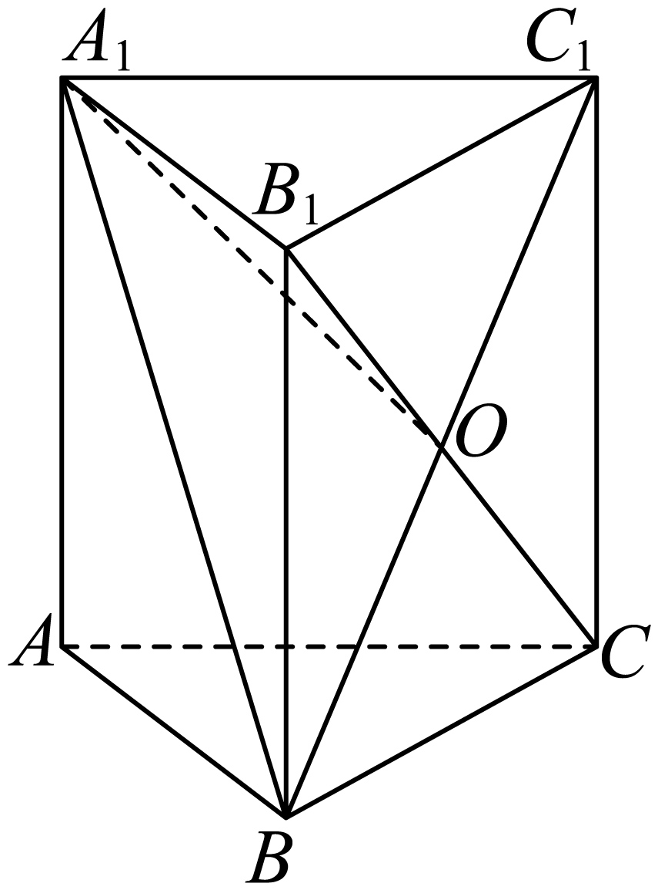

# Mathematics - 题目 2197

**ID**: de923aadc1b44e89b444e86a997d2154
**年级**: Grade 11
**难度**: Medium
**题型**: Multiple-choice

## 题目
如图，在三棱柱 $ABC-A{{}_{1}}B{{}_{1}}C{{}_{1}}$ 中， $\overrightarrow {{A{{}_{1}}A}}=\overrightarrow a$ ， $\overrightarrow {{AB}}=\overrightarrow b$ ， $\overrightarrow {{AC}}=\overrightarrow c$ ，点 $O$ 为 $B{{}_{1}}C$ 与 $C{{}_{1}}B$ 的交点，则 $\overrightarrow {{A{{}_{1}}O}}=$ （      ）​​​​​​​‌

## 解答

1. 因为 $BCC{{}_{1}}B{{}_{1}}$ 是平行四边形，所以点 $O$ 为 $B{{}_{1}}C$ 与 $C{{}_{1}}B$ 的中点，
2. 则 $\overrightarrow {{A{{}_{1}}O}}=\frac {1}{2}\overrightarrow {{A{{}_{1}}B{{}_{1}}}}+\frac {1}{2}\overrightarrow {{A{{}_{1}}C}}=\frac {1}{2}\overrightarrow {{AB}}+\frac {1}{2}\left ({\overrightarrow {{A{{}_{1}}A}}+\overrightarrow {{AC}}}\right )=\frac {1}{2}\overrightarrow b+\frac {1}{2}\overrightarrow a+\frac {1}{2}\overrightarrow c$ .
3. 故选A.

## 知识点

**中文**:
  - 空间向量的加减运算
  - 空间向量的数乘运算

**English**:
  - Vector Addition and Subtraction
  - Scalar Multiplication

---
