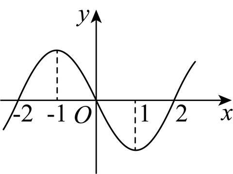

# Mathematics - 题目 114

**ID**: e267c09fe13f4309847b29a6e87763a8
**年级**: Grade 11
**难度**: Medium
**题型**: Multiple-choice

## 题目
已知R上的可导函数 $f\left ({x}\right )$ 的图象如图所示，则不等式 $\left ({x-2}\right )f^{′}{\left ({x}\right )}>0$ 的解集为（      ）​​​​​​​‌

## 解答

1. 由图象知 $f^{′}(x)>0$ 的解集为 $(-∞,-1)$  $\cup (1,+\infty )$ ， $f^{′}(x)<0$ 的解集为 $(-1,1)$ ，
2. $(x-2)f^{′}(x)>0$  $\Leftrightarrow \begin{cases}x-2>0\\f^{′}(x)>0\end{cases}$ 或 $\begin{cases}x-2<0\\f^{′}(x)<0\end{cases}$ ，
3. 所以 $x>2$ 或 $-1<x<1$ ，解集即为 $\left ({-1,1}\right )\cup \left ({2,+\infty }\right )$ ．
4. 故选D．

## 知识点

**中文**:
  - 利用导数研究函数的图象

**English**:
  - Studying Function Graphs

---
