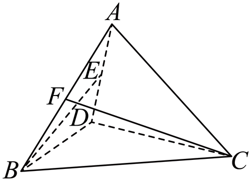

# Mathematics - 题目 1570

**ID**: faf6a6588ba8426ab720da50199de2a6
**年级**: Grade 11
**难度**: Medium
**题型**: Multiple-choice

## 题目
如图，在棱长为6的正四面体 $ABCD$ 中，E，F分别为棱 $AD$ ， $AB$ 的中点，则异面直线 $BE$ ， $CF$ 所成角的余弦值为（      ）​​​​​​​‌

## 解答

1. 作 $AO\bot $ 平面 $BCD$ ，垂足为 $O$ ，连接 $OC$ ，则 $O$ 为 $\mathrm{△}BCD$ 的中心，
2. 以 $O$ 为坐标原点，直线 $OC$ ， $OA$ 分别为 $y$ 轴， $z$ 轴，过点 $O$ 平行 $BD$ 为 $x$ 轴，
3. 建立如图所示的空间直角坐标系，
4. 
5. 因为正四面体的棱长为6，求得 $OC=\frac {2}{3}\times 6\times \frac {\sqrt {3}}{2}=2\sqrt {3}$ ， $OA=\sqrt {AC{^{2}}-OC{^{2}}}=2\sqrt {6}$ ，
6. 可得 $A(0,0,2\sqrt {6})$ ， $B(3,-\sqrt {3},0),C(0,2\sqrt {3},0),D(-3,-\sqrt {3},0)$ ，
7. 所以 $E\left ({-\frac {3}{2},-\frac {\sqrt {3}}{2},\sqrt {6}}\right ),F\left ({\frac {3}{2},-\frac {\sqrt {3}}{2},\sqrt {6}}\right ),\overrightarrow {{BE}}=\left ({-\frac {9}{2},\frac {\sqrt {3}}{2},\sqrt {6}}\right ),\overrightarrow {{CF}}=\left ({\frac {3}{2},-\frac {5\sqrt {3}}{2},\sqrt {6}}\right )$ ，
8. 设 $BE$ ， $CF$ 所成的角为 $θ$ ，所以 ${\cos}θ=\left |{{\cos}\langle \overrightarrow {{BE}},\overrightarrow {{CF}}\rangle }\right |=\frac {\left |{\overrightarrow {{BE}}\cdot \overrightarrow {{CF}}}\right |}{\left |{\overrightarrow {{BE}}}\right |\left |{\overrightarrow {{CF}}}\right |}=\frac {\frac {9}{2}}{3\sqrt {3}\times 3\sqrt {3}}=\frac {1}{6}$ ．
9. 故选A.

## 知识点

**中文**:
  - 向量法求异面直线所成角

**English**:
  - Angle between Skew Lines

---
