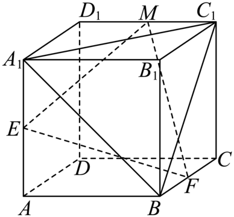

# Mathematics - 题目 1392

**ID**: 5f1804f8d971435e873a9eb1e4d71ffd
**年级**: Grade 11
**难度**: Medium
**题型**: Multiple-select

## 题目
如图，在正方体 $ABCD-A{{}_{1}}B{{}_{1}}C{{}_{1}}D{{}_{1}}$ 中， $E$ ， $F$ ， $M$ 分别为棱 $A{{}_{1}}A$ ， $BC$ ， $C{{}_{1}}D{{}_{1}}$ 的中点，则下列结论正确的是（      ）​​​​​​​‌

## 解答

1. 对于A，分别取 $AB$ ， $A{{}_{1}}D{{}_{1}}$ ， $CC{{}_{1}}$ 的中点为 $P$ ， $G$ ， $N$ ，连接各中点，如下图所示：
2. 
3. 因为 $GM//A{{}_{1}}C{{}_{1}},PF//AC,AC//A{{}_{1}}C{{}_{1}}$ ，所以 $GM//PF$ ，同理  $EG//FN$ ， $EP//MN$ ，
4. 即可知 $M,G,E,P.F,N$ 在同一平面内，
5. 所以平面 $EFM$ 截该正方体所得截面即为六边形 $MGEPFN$ ，即A错误；
6. 对于B，因为点 $M,G$ 分别为 $C{{}_{1}}D{{}_{1}}$ ， $D{{}_{1}}A{{}_{1}}$ 的中点，所以 $MG//A{{}_{1}}C{{}_{1}}$ ，
7. 又 $MG\not\subset $ 平面 $A{{}_{1}}BC{{}_{1}}$ ， $A{{}_{1}}C{{}_{1}}\subset $ 平面 $A{{}_{1}}BC{{}_{1}}$ ，所以 $MG//$ 平面 $A{{}_{1}}BC{{}_{1}}$ ，
8. 因为点 $M,N$ 分别为 $C{{}_{1}}D{{}_{1}}$ ， $CC{{}_{1}}$ 的中点，所以 $MN//D{{}_{1}}C$ ，
9. 又 $D{{}_{1}}C//A{{}_{1}}B$ ，所以 $MN//A{{}_{1}}B$ ， $MN\not\subset $ 平面 $A{{}_{1}}BC{{}_{1}}$ ， $A{{}_{1}}B\subset $ 平面 $A{{}_{1}}BC{{}_{1}}$ ，
10. 所以 $MN//$ 平面 $A{{}_{1}}BC{{}_{1}}$ ，
11. 又 $MN\cap MG=M$ ， $MN\subset $ 平面 $MGEPFN$ ， $MG\subset $ 平面 $MGEPFN$ ，
12. 所以平面 $A{{}_{1}}BC{{}_{1}}//$ 平面 $MGEPFN$ ，即平面 $EFM$  $//$ 平面 $A{{}_{1}}BC{{}_{1}}$ ，故B正确；
13. 对于C，建立以 $D$ 为原点的空间直角坐标系 $D-xyz$ ，如图所示：
14. 
15. 不妨取正方体 $ABCD-A{{}_{1}}B{{}_{1}}C{{}_{1}}D{{}_{1}}$ 的棱长为2，
16. 则 $M\left ({0,1,2}\right )$ ， $F\left ({1,2,0}\right )$ ， $E\left ({2,0,1}\right )$ ， $B\left ({2,2,0}\right )$ ， $C{{}_{1}}\left ({0,2,2}\right )$ ，
17. 所以 $\overrightarrow {{BC{{}_{1}}}}=\left ({-2,0,2}\right )$ ， $\overrightarrow {{ME}}=\left ({2,-1,-1}\right )$ ，
18. 所以直线ME与 $BC{{}_{1}}$ 所成的角的余弦值为 $\left |{{\rm{c}}{\rm{o}}{\rm{s}}\left \langle {\overrightarrow {{BC{{}_{1}}}},\overrightarrow {{ME}}}\right \rangle }\right |=\frac {\left |{\overrightarrow {{BC{{}_{1}}}}\cdot \overrightarrow {{ME}}}\right |}{\left |{\overrightarrow {{BC{{}_{1}}}}}\right |\cdot \left |{\overrightarrow {{ME}}}\right |}=\frac {\left |{-6}\right |}{2\sqrt {2}\times \sqrt {6}}=\frac {\sqrt {3}}{2}$ ，
19. 所以直线ME与 $BC{{}_{1}}$ 所成的角为 $\frac {{\rm{\mathrm{π}}}}{6}$ ，故C正确；
20. 对于D，由选项C可知， $\overrightarrow {{ME}}=\left ({2,-1,-1}\right )$ ， $\overrightarrow {{MF}}=\left ({1,1,-2}\right )$ ，
21. 设平面EFM的一个法向量为 $\overrightarrow n=\left ({x,y,z}\right )$ ，
22. 则 $\begin{cases}\overrightarrow n\cdot \overrightarrow {{ME}}=2x-y-z=0\\\overrightarrow n\cdot \overrightarrow {{MF}}=x+y-2z=0\end{cases}$ ，取 $z=1$ ，则 $x=1$ ， $y=1$ ，
23. 所以平面EFM的一个法向量为 $\overrightarrow n=\left ({1,1,1}\right )$ ， $\overrightarrow {{BB{{}_{1}}}}=\left ({0,0,2}\right )$
24. 设直线 $BB{{}_{1}}$ 与平面 $EFM$ 所成角为 $α$ ，
25. 则 ${\rm{s}}{\rm{i}}{\rm{n}}α=\frac {\left |{\overrightarrow {{BB{{}_{1}}}}\cdot \overrightarrow n}\right |}{\left |{\overrightarrow {{BB{{}_{1}}}}}\right |\left |{\overrightarrow n}\right |}=\frac {2}{2\times \sqrt {3}}=\frac {\sqrt {3}}{3}$ ，
26. 即直线 $BB{{}_{1}}$ 与平面 $EFM$ 所成角的正弦值为 $\frac {\sqrt {3}}{3}$ ，故D错误．
27. 故选BC.

## 知识点

**中文**:
  - 平面与平面平行的判定
  - 异面直线所成角
  - 直线与平面所成的角
  - 截面问题

**English**:
  - Plane-Plane Parallelism Determination
  - Angle between Skew Lines
  - Line-Plane Angle
  - Cross-section Problems

---
