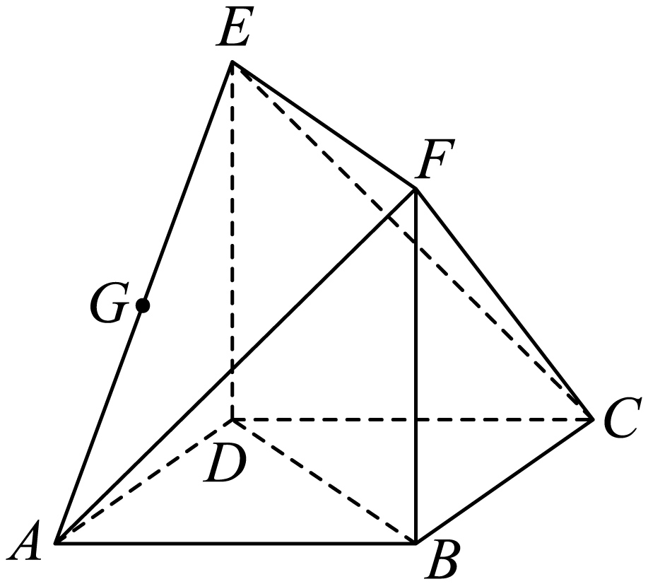

# Mathematics - 题目 666

**ID**: 936d506406f0419ebe38ffea8014dce6
**年级**: Grade 11
**难度**: Medium
**题型**: Multiple-select

## 题目
如图，矩形 $BDEF$ 所在平面与正方形 $ABCD$ 所在平面互相垂直， $AD=DE=4$ ，G为线段AE上的动点，则（      ）​​​​​​​‌

## 解答

1. 因为矩形 $BDEF$ 所在平面与正方形 $ABCD$ 所在平面互相垂直，且两个平面的交线为 $BD$ ， $DE\bot BD$ ，
2. 所以 $DE⊥$ 平面 $ABCD$ ；以 $D$ 为原点， $\overrightarrow {{DA}},\overrightarrow {{DC}},\overrightarrow {{DE}}$ 分别为 $x,y,z$ 轴的正方向，建系如图，
3. 
4. $A\left ({4,0,0}\right ),E\left ({0,0,4}\right ),B\left ({4,4,0}\right ),C\left ({0,4,0}\right ),F\left ({4,4,4}\right )$ .
5. 对于A，G为线段AE的中点， $G\left ({2,0,2}\right )$ ， $\overrightarrow {{BG}}=\left ({-2,-4,2}\right )$ ;
6. $\overrightarrow {{CE}}=\left ({0,-4,4}\right ),\overrightarrow {{EF}}=\left ({4,4,0}\right )$ ，设 $\overrightarrow n=\left ({x,y,z}\right )$ 是平面 $CEF$ 的一个法向量，
7. 则 $\begin{cases}\overrightarrow n\cdot \overrightarrow {{CE}}=0\\\overrightarrow n\cdot \overrightarrow {{EF}}=0\end{cases}$ ， $\begin{cases}-4y+4z=0\\4x+4y=0\end{cases}$ ，令 $y=1$ ，则 $x=-1,z=1$ ，即 $\overrightarrow n=\left ({-1,1,1}\right )$ .
8. 因为 $\overrightarrow {{BG}}\cdot \overrightarrow {{n}}=0$ ，所以 $\overrightarrow {{BG}}\bot \overrightarrow {{n}}$ ，又 $BG\not\subset $ 平面 $CEF$ ，所以 $GB{\rm{/}}{\rm{/}}$ 平面 $CEF$ ，A正确.
9. 对于C， $\overrightarrow {{AE}}=\left ({-4,0,4}\right ),\overrightarrow {{CF}}=\left ({4,0,4}\right )$ ，因为 $\overrightarrow {{AE}}\cdot \overrightarrow {{CF}}=0$ ，所以 $AE\mathrm{⊥}CF$ ，C正确.
10. 对于D，设 $\overrightarrow {{AG}}=λ\overrightarrow {{AE}}=\left ({-4λ,0,4λ}\right )$ ， $\overrightarrow {{BG}}=\overrightarrow {{BA}}+\overrightarrow {{AG}}=\left ({-4λ,-4,4λ}\right )$ ，
11. $\overrightarrow {{CG}}=\overrightarrow {{CA}}+\overrightarrow {{AG}}=\left ({4-4λ,-4,4λ}\right )$ ，
12. $BG{^{2}}+CG{^{2}}=64λ{^{2}}-32λ+48={\left({8λ-2}\right)^{2}}+44$ ，
13. 所以当 $λ=\frac {1}{4}$ 时， $BG{^{2}}+CG{^{2}}$ 取到最小值44，D正确.
14. 对于B，由正方形的性质可得 $AC⊥BD$ ，由题设条件可知 $AC\bot $ 平面 $BDEF$ ，
15. 由 $AD=4$ 可得 $AC=4\sqrt {2}$ ，
16. 所以四棱锥 $A-BDEF$ 和四棱锥 $C-BDEF$ 的高均为 $2\sqrt {2}$ .
17. 其体积 $V{{}_{A-BDEF}}=V{{}_{C-BDEF}}=\frac {1}{3}\times 4\times 4\sqrt {2}\times 2\sqrt {2}=\frac {64}{3}$ ，
18. 所以多面体 $ABCDEF$ 的体积为 $\frac {128}{3}$ ，B不正确.
19. 故选：ACD

## 知识点

**中文**:
  - 棱柱、棱锥、棱台的体积
  - 用向量证明平行问题
  - 用向量证明垂直问题

**English**:
  - Volume of Polyhedra
  - Proving Parallelism
  - Proving Perpendicularity

---
