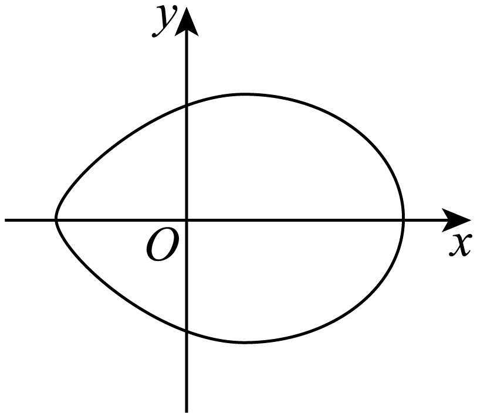

# Mathematics - 题目 2323

**ID**: d2899a251f094a46adadf00b5363e082
**年级**: Grade 11
**难度**: Medium
**题型**: Multiple-select

## 题目
如图，已知笛卡尔“鸡蛋”曲线 $C$ 过点 $F{{}_{1}}\left ({-1,0}\right )$ ，且曲线 $C$ 上任意一点 $P$ 到 $F{{}_{1}}$ 和 $F{{}_{2}}\left ({1,0}\right )$ 的距离满足 $\left |{PF{{}_{1}}}\right |+2\left |{PF{{}_{2}}}\right |=a$ ，则（      ）​​​​​​​‌

## 解答

1. 对于A，曲线 $C$ 过点 $F{{}_{1}}\left ({-1,0}\right )$ ，此时 $\left |{PF{{}_{1}}}\right |+2\left |{PF{{}_{2}}}\right |=a=0+2\times 2=4$ ，故A正确；
2. 对于B，曲线 $C$ 的方程为 $\sqrt {{\left({x+1}\right)^{2}}+y{^{2}}}+2\sqrt {{\left({x-1}\right)^{2}}+y{^{2}}}=4$ ，联立单位圆 $x{^{2}}+y{^{2}}=1$ ，
3. 即 $\sqrt {2+2x}+2\sqrt {2-2x}=4$ ，平方得 $10-6x+4\sqrt {4-4x{^{2}}}=16\Rightarrow 2\sqrt {4-4x{^{2}}}=3+3x$ ，
4. 即 $4\left ({4-4x{^{2}}}\right )=9+12x+9x{^{2}}\Rightarrow 25x{^{2}}+18x-7$ ，解得 $x=-1$ 或 $x=\frac {7}{25}$ ，
5. 由图可知 $x=-1$ 时，曲线 $C$ 的点为 $F{{}_{1}}\left ({-1,0}\right )$ ，当 $x=\frac {7}{25}$ 时，曲线 $C$ 上有2个点，
6. 所以曲线 $C$ 与单位圆有3个交点，故B正确；
7. 设 $\left |{PF{{}_{1}}}\right |=m,\left |{PF{{}_{2}}}\right |=n，\angle PF{{}_{2}}F{{}_{1}}=θ$ ，则 $m+2n=4,m=4-2n$ ， $\left |{F{{}_{1}}F{{}_{2}}}\right |=2$ ，
8. 
9. 在 $\vartriangle PF{{}_{1}}F{{}_{2}}$ 中， ${\cos}θ=\frac {n{^{2}}+4-m{^{2}}}{4n}=\frac {n{^{2}}+4-{\left({4-2n}\right)^{2}}}{4n}=-\left ({\frac {3n}{4}+\frac {3}{n}}\right )+4$ ，
10. $\therefore {\cos}θ=-1$ ，即 $\angle PF{{}_{2}}F{{}_{1}}=θ={\rm{π}}$ 时， $\left |{PF{{}_{2}}}\right |=n$ 取得最小值 $\frac {2}{3}$ ，
11. 又 $\left |{PF{{}_{1}}}\right |=m\geqslant 0$ ，所以 $n\leqslant 2$ ，即 $n\in \left [\frac {2}{3},2\right ]$ ，
12. $\because O$ 是 $F{{}_{1}}F{{}_{2}}$ 的中点， $\therefore \overrightarrow {{PO}}=\frac {1}{2}\left ({\overrightarrow {{PF{{}_{1}}}}+\overrightarrow {{PF{{}_{2}}}}}\right )$ ，
13. $\therefore \left |{\overrightarrow {{PO}}}\right |{^{2}}=\frac {1}{4}{\left({\overrightarrow {{PF{{}_{1}}}}+\overrightarrow {{PF{{}_{2}}}}}\right)^{2}}=\frac {1}{4}\left ({m{^{2}}+n{^{2}}+2mn{\cos}\angle F{{}_{1}}PF{{}_{2}}}\right )$
14. $=\frac {1}{2}\left ({m{^{2}}+n{^{2}}}\right )-1=\frac {5}{2}n{^{2}}-8n+7=\frac {5}{2}{\left({n-\frac {8}{5}}\right)^{2}}+\frac {3}{5}$ ，
15. $\because n\in \left [\frac {2}{3},2\right ]$ ，所以 $y=\frac {5}{2}{\left({n-\frac {8}{5}}\right)^{2}}+\frac {3}{5}$ 的最小值为 $\frac {3}{5}$ ，最大值为 $\frac {25}{9}$ ，
16. 即 $\left |{OP}\right |$ 的最小值为 $\frac {\sqrt {15}}{5}$ ，最大值为 $\frac {5}{3}$ ，故C错误，D正确；
17. 故选ABD.

## 知识点

**中文**:
  - 曲线与方程
  - 范围最值问题

**English**:
  - Curves and Equations
  - Range and Extrema Problems

---
