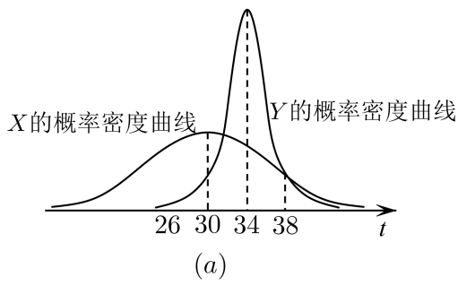
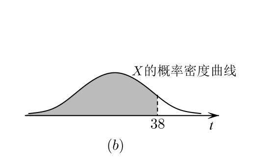

# Mathematics - 题目 141

**ID**: 5227cc19e17c48d3a01e7aec7f733525
**年级**: Grade 11
**难度**: Medium
**题型**: 温故而知新

## 题目
李明上学有时坐公交车，有时骑自行车，他各记录了50次坐公交车和骑自行车所花的时间（样本数据），经数据分析得到如下结果：坐公交车：平均用时30min，方差为36骑自行车：平均用时34min，方差为4(1)根据以上数据，李明平时选择哪种交通方式更稳妥？试说明理由.​​​​​​​‌(2)分别用X和Y表示坐公交车和骑自行车上学所用的时间，X和Y的概率密度曲线如图 ${\rm （\mathit{a}）}$ 所示，如果某天有38min可用，你应选择哪种交通方式？如果仅有34min可用，又应该选择哪种交通方式？试说明理由.（提示：（2）中X和Y的概率密度曲线分别反映的是X和Y的取值落在某个区间的随机事件的概率，例如，图 ${\rm （\mathit{b}）}$ 中阴影部分的面积表示的就是X取值不大于38min时的概率.）

## 解答

1. （1）李明平时选择骑自行车更稳妥，
2. 由已知得坐公交车平均用时30min，骑自行车平均用时34min，差距不大；但是坐公交车的方差为36，骑自行车的方差为4，由于方差越小，取值越集中，稳定性越高，波动性越小，则坐公交车所花费的时间不稳定，即李明平时选择骑自行车更稳妥.
3. （2）由图 ${\rm （\mathit{a}）}$ 中可知，X和Y的概率密度曲线可知
4. $P\left ({X>38}\right )>P\left ({Y>38}\right )$ ，
5. 由此可知，如果某天有38min可用，那么李明坐公交车迟到的概率大于骑自行车迟到的概率，应选骑自行车；
6. 由图 ${\rm （\mathit{a}）}$ 中可知，X和Y的概率密度曲线可知
7. $P\left ({X>34}\right )<P\left ({Y>34}\right )$ ，
8. 由此可知，如果某天有34min可用，那么李明坐公交车迟到的概率小于骑自行车迟到的概率，应选坐公交车.

## 知识点

**中文**:
  - 正态曲线及其特点

**English**:
  - Normal Curve and Characteristics

---
