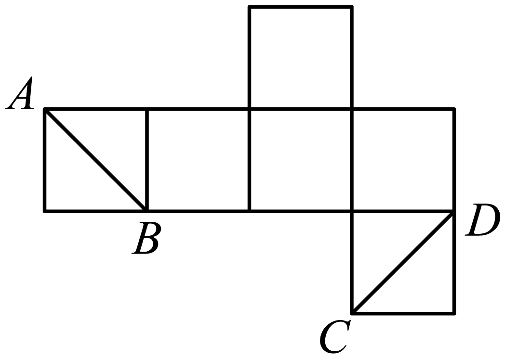

# Mathematics - 题目 3315

**ID**: a97738d8ea6f417c89c7c77bd27a37e8
**年级**: Grade 12
**难度**: Easy
**题型**: Fill-in-the-blank

## 题目
如图是正方体的平面展开图，则在这个正方体中，异面直线AB与CD的夹角为．​​​​​​​‌

## 解答

1. 
2. 如图所示，把展开图恢复到原正方体．
3. 连接AE，BE．由正方体可得 $CE{\rm{/}}{\rm{/}}AD$ 且 $CE=AD$ ，
4. ∴四边形ADCE是平行四边形，∴AE${\rm{/}}{\rm{/}}$DC．
5. ∴ $∠BAE$ 或其补角是异面直线AB与CD所成的角．
6. 由正方体可得： $AB=AE=BE$ ，∴ $\vartriangle ABE$ 是等边三角形，∴ $\mathrm{∠}BAE=60{}^\circ $ ．
7. ∴异面直线AB与CD所成的角是60°．
8. 故答案为：60°

## 知识点

**中文**:
  - 异面直线所成角

**English**:
  - Angle between Skew Lines

---
