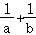

# Mathematics - 题目 3018

**ID**: 421f0449a13f4706beafbcfc9032e99a
**年级**: Grade 12
**难度**: Easy
**题型**: Multiple-choice

## 题目
已知a＞0，b＞0，且a+b＝1，则的最小值是（      ）A．2B． →​​​​​​​‌

## 解答

1. ∵a+b＝1
2. ∴＝（）（a+b）＝2++⩾2+2＝4
3. 故最小值为：4
4. 故选C．

## 知识点

**中文**:
  - 基本不等式在最值问题中的应用

**English**:
  - Application in Extremum Problems

---
