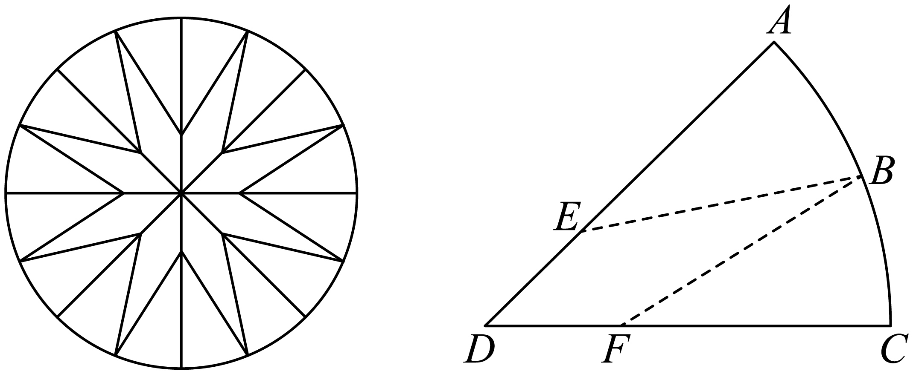

# Mathematics - 题目 458

**ID**: 58f84c4ec9b14e15b64cc1be51644662
**年级**: Grade 12
**难度**: Easy
**题型**: Multiple-choice

## 题目
某烘焙店制作了一个圆柱形状的蛋糕，顾客要求均分成24块，店家计划将蛋糕按左图方式切割．先将蛋糕均分成8块，再按照右图将每个 $\frac {1}{8}$ 角蛋糕近似的均分成三块，从弧 $AC$ 的中点B出发，左右对称各切1刀，已知右图中 $DE=DF,EB=FB,AD=CD=r$ ，则 $DE$ 的长度约为（      ）（其中 ${\rm{s}}{\rm{i}}{\rm{n}}\frac {{\rm{π}}}{8}\approx 0.​​​​​​​‌383,{\rm{π}}\approx 3.142$ ，计算结果小数点请保留到 $0.01$ ）

## 解答

1. 设 $DC=DB=AD,DE=DF=x$ ，
2. $S{{}_{扇形ADC}}=\frac {1}{8}{\rm{π}}r{^{2}}$
3. $S{{}_{DEFB}}=\frac {1}{3}\times S{{}_{扇形ADC}}=\frac {1}{24}{\rm{π}}r{^{2}}$
4. $S{{}_{DEFB}}=S{{}_{\mathrm{△}EDB}}+S{{}_{\mathrm{△}DFB}}=\frac {1}{2}\times \sin \frac {{\rm{π}}}{{{8}}}\times ED\times DB\times 2=rx\sin \frac {{\rm{π}}}{{{8}}}$
5. 即 $rx\sin \frac {{\rm{π}}}{{{8}}}=\frac {1}{24}{\rm{π}}r{^{2}},x\approx 0.34r$
6. 故选B.

## 知识点

**中文**:
  - 弧长公式与扇形面积公式

**English**:
  - Arc Length and Sector Area Formulas

---
