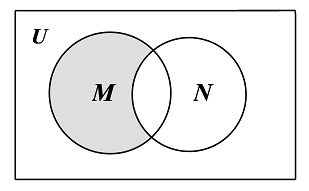

# Mathematics - 题目 2541

**ID**: 5a91d57967304b048599f2595f5fa976
**年级**: Grade 12
**难度**: Easy
**题型**: Multiple-choice

## 题目
设全集 $U=\mathbf{R}$ ，集合 $M=\left \{x|y={\ln}\left ({x-1}\right )\right \}$ ， $\mathbf{N}=\{x|y=\sqrt {x{^{2}}-4}\}$ ，则下面Venn图中阴影部分表示的集合是（      ）​​​​​​​‌

## 解答

1. 由题意 $M=\{x|x-1>0\}=\{x|x>1\}$ ， $N=\{x|x{^{2}}\geqslant 4\}=\{x|x\leqslant -2$ 或 $x\geqslant 2\}$ ，
2. $\mathrm{∁}{{}_{U}}N=\{x|-2<x<2\}$ ，
3. Venn图中阴影部分为 $M\cap (\mathrm{∁}{{}_{U}}N)=\{x|1<x<2\}$ ．
4. 故选：A．

## 知识点

**中文**:
  - Venn图表达集合的关系与运算
  - 函数的定义域

**English**:
  - Venn Diagrams for Set Relations and Operations
  - Domain of Functions

---
