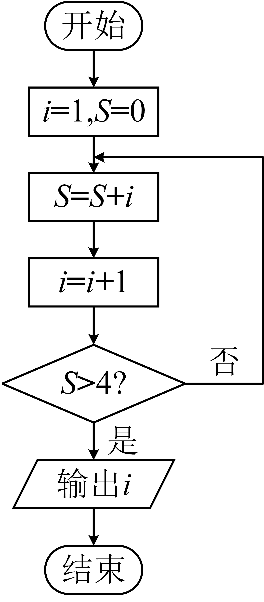

# Mathematics - 题目 174

**ID**: dae20314866546fa80b0d99a5d7916ab
**年级**: Grade 12
**难度**: Easy
**题型**: Multiple-choice

## 题目
执行如图所示的算法框图，则输出 $\mathrm{i}$ 的值为（      ）​​​​​​​‌

## 解答

1. 根据给定的程序框图，可得：
2. 第1次循环： $S=1,i=2$ ，不满足判断条件，执行循环；
3. 第2次循环： $S=3,i=3$ ，不满足判断条件，执行循环；
4. 第3次循环： $S=6,i=4$ ，满足判断条件，输出结果.
5. 故选：C.

## 知识点

**中文**:

**English**:

---
