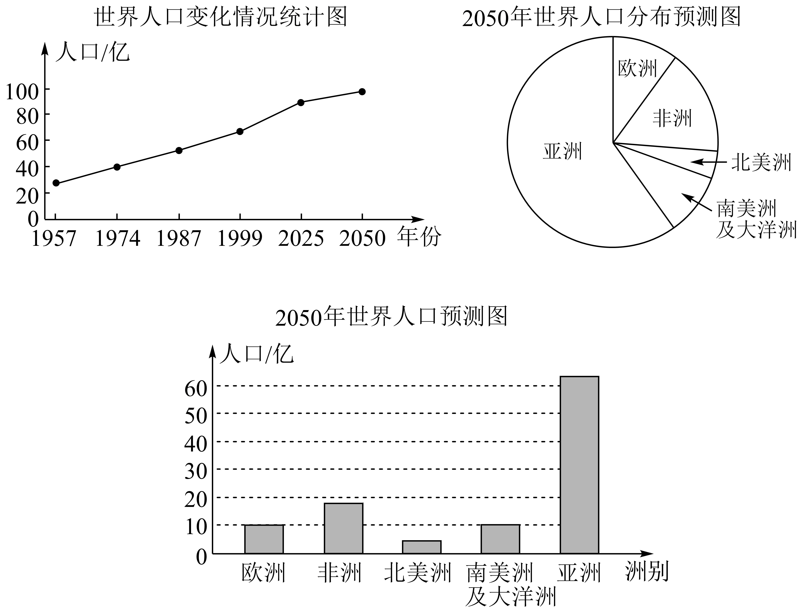

# Mathematics - 题目 3061

**ID**: f2a531346cae49318188d2a9b1ee5dc1
**年级**: Grade 12
**难度**: Easy
**题型**: Multiple-choice

## 题目
世界人口变化情况的三幅统计图如图所示．下列结论中错误的是（      ）​​​​​​​‌

## 解答

1. 由折线图可以看出世界人口的总量随着年份的增加而增加，故A正确：
2. 由扇形统计图可知2050年亚洲人口比其他各洲人口的总和还要多，故B正确：
3. 由条形统计图可知2050年欧洲人口与南美洲及大洋洲人口之和基本持平，故D正确：
4. 三幅统计图并不能得到各个洲人口增长速度的快慢，故C错误．
5. 故选：C．

## 知识点

**中文**:
  - 扇形图
  - 柱形图
  - 折线图

**English**:
  - Pie Chart
  - Bar Chart
  - Line Chart

---
