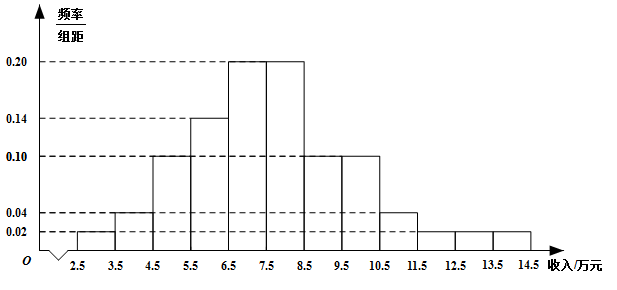

# Mathematics - 题目 2782

**ID**: f755d8f9d91b4e26993e3126c84f4f00
**年级**: Grade 12
**难度**: Easy
**题型**: Multiple-choice

## 题目
为了解某地农村经济情况，对该地农户家庭年收入进行抽样调查，将农户家庭年收入的调查数据整理得到如下频率分布直方图：根据此频率分布直方图，下面结论中不正确的是（      ）​​​​​​​‌

## 解答

1. 因为频率直方图中的组距为 $1$ ，
2. 所以各小组的矩形的高度等于频率，
3. 该地农户家庭年收入低于 $4.5$ 万元的农户的比率估计值为 $0.02+0.04=0.06=6{\rm{\%}}$ ,
4. 故A正确，
5. 该地农户家庭年收入不低于 $10.5$ 万元的农户比率估计值为 $0.04+0.02\times 3=0.10=10{\rm{\%}}$ ,
6. 故B正确，
7. 该地农户家庭年收入介于 $4.5$ 万元至 $8.5$ 万元之间的比例估计值为 $0.10+0.14+0.20\times 2=0.64=64{\rm{\%}}>50{\rm{\%}}$ ,
8. 故D正确，
9. 该地农户家庭年收入的平均值的估计值为 $3\times 0.02+4\times 0.04+5\times 0.10+6\times 0.14+7\times 0.20+8\times 0.20+9\times 0.10+10\times 0.10+11\times 0.04+12\times 0.02+13\times 0.02+14\times 0.02=7.68$ (万元)，超过 $6.5$ 万元，
10. 故C错误.
11. 故选：C.

## 知识点

**中文**:
  - 平均数
  - 频率分布直方图

**English**:
  - Mean
  - Frequency Distribution Histogram

---
