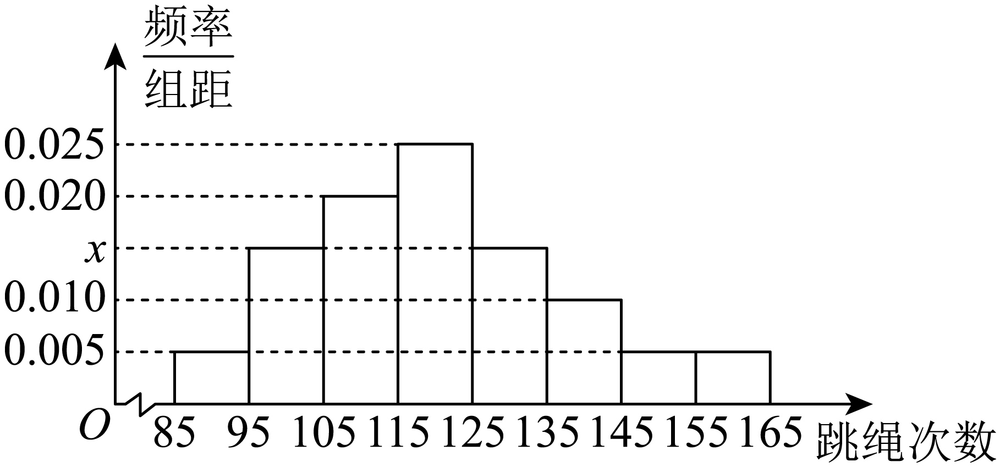

# Mathematics - 题目 739

**ID**: 2df195e63c2e468ea9697a4718a209d2
**年级**: Grade 12
**难度**: Easy
**题型**: Multiple-select

## 题目
为了了解小学生的体能情况，抽取了某小学四年级100名学生进行一分钟跳绳次数测试，将所得数据整理后，绘制如下频率分布直方图.​​​​​​​‌根据此图，下列结论中正确的是（      ）

## 解答

1. $\left ({0.005\times 3+0.01+2x+0.02+0.025}\right )\times 10=1$ ，可得 $x=0.015$ ，故A正确；
2. 根据频率分布直方图可得其平均数为
3. $90\times 0.05+100\times 0.15+110\times 0.2+120\times 0.25+130\times 0.15+140\times 0.1+150\times 0.05+160\times 0.05=120.5$ ，所以B错误；
4. 由频率分布直方图可知， $\left ({0.005+0.015+0.02}\right )\times 10=0.4$ ，而 $0.4+0.25\mathrm{>}0.5$ ，
5. 所以中位数落在区间 $\left [{115,125}\right )$ 内，设中位数为 $a$ ，则 $\left ({a-115}\right )\times 0.025=0.5-0.4$ ，可得 $a=119$ ，所以C正确；
6. 由图可知，超过125次以上的频率为 $\left ({0.015+0.01+0.005+0.005}\right )\times 10=0.35$ ，所以优秀率为 $35{\rm{\%}}$ ，即D正确.
7. 故选：ACD

## 知识点

**中文**:
  - 中位数
  - 频率分布直方图
  - 平均数

**English**:
  - Median
  - Frequency Distribution Histogram
  - Mean

---
