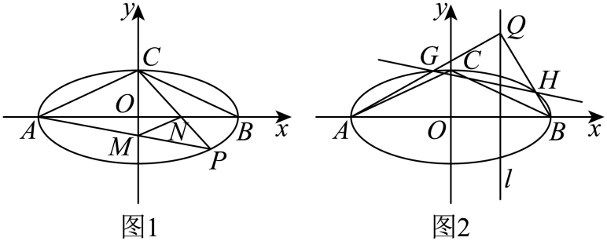

# Mathematics - 题目 2622

**ID**: 258abc9ef8954259926522bf800ee201
**年级**: Grade 12
**难度**: Hard
**题型**: Calculation

## 题目
已知椭圆E: $\frac {x{^{2}}}{a{^{2}}}{\rm +}$  $\frac {y{^{2}}}{b{^{2}}}{\rm =1}$  $\left ({a>b>0}\right )$ 的离心率为 $\frac {\sqrt {3}}{2}{\rm ，\mathit{A}}$ 、B分别是椭圆的左、右顶点，C是椭圆的上顶点， $△ABC$ 的面积为2.​​​​​​​‌（1）求椭圆E的方程；（2）如图1，设P为第四象限内一点且在椭圆E上，直线PA与y轴交于点M，直线PC与x轴交于点N，求证:四边形 $ACNM$ 的面积为定值；（3）如图2，若Q是直线 $l:x=1$ 上一动点，连接AQ交椭圆E于点G，连接BQ交椭圆E于点H，连接GH.试探讨直线GH是否过定点，若过定点，求出该定点的坐标；若不过定点，请说明理由.

## 解答

1. （1）由题意得 $\begin{cases}\frac {c}{a}=\frac {\sqrt {3}}{2},\quad \quad \\ab=2,\quad \quad \quad \\a{^{2}}=b{^{2}}+c{^{2}},\end{cases}$ 解得 $a=2,b=1$ ，
2. 所以椭圆E的方程为 $\frac {x{^{2}}}{4}+y{^{2}}=1$ ；
3. （2）设 $P\left ({x{{}_{0}},y{{}_{0}}}\right )\left ({x{{}_{0}}>0,y{{}_{0}}<0}\right )$  ，则 $x{{}_{0}^{2}}+4y{{}_{0}^{2}}=4$ ，
4. 又因为 $A\left ({-2,0}\right ),C\left ({0,1}\right )$ ，所以直线PA的方程为 $y=\frac {y{{}_{0}}}{x{{}_{0}}+2}\left ({x+2}\right )$ ，
5. 令 $x=0$ ，得 $y{{}_{M}}=\frac {2y{{}_{0}}}{x{{}_{0}}+2}$ ，则 $\left |{CM}\right |=1-y{{}_{M}}=1-\frac {2y{{}_{0}}}{x{{}_{0}}+2}=\frac {x{{}_{0}}-2y{{}_{0}}+2}{x{{}_{0}}+2}$ ，
6. 直线PC的方程为 $y=\frac {y{{}_{0}}-1}{x{{}_{0}}}x+1$ ，
7. 令 $y=0$ ，得 $x{{}_{N}}=-\frac {x{{}_{0}}}{y{{}_{0}}-1}$ ，则 $\left |{AN}\right |=x{{}_{N}}-\left ({-2}\right )=2-\frac {x{{}_{0}}}{y{{}_{0}}-1}=\frac {x{{}_{0}}-2y{{}_{0}}+2}{1-y{{}_{0}}}$ ，
8. 所以四边形 $ACNM$ 的面积
9. $S=\frac {1}{2}\left |{AN}\right |·\left |{CM}\right |=\frac {1}{2}\times \frac {x{{}_{0}}-2y{{}_{0}}+2}{1-y{{}_{0}}}\times \frac {x{{}_{0}}-2y{{}_{0}}+2}{x{{}_{0}}+2}$  $=\frac {x{{}_{0}^{2}}+4y{{}_{0}^{2}}-4x{{}_{0}}y{{}_{0}}+4x{{}_{0}}-8y{{}_{0}}+4}{2\left ({-x{{}_{0}}y{{}_{0}}+x{{}_{0}}-2y{{}_{0}}+2}\right )}=\frac {-2x{{}_{0}}y{{}_{0}}+2x{{}_{0}}-4y{{}_{0}}+4}{-x{{}_{0}}y{{}_{0}}+x{{}_{0}}-2y{{}_{0}}+2}{\rm =2}$ ，
10. 所以四边形 $ACNM$ 的面积为定值；
11. （3）直线GH过定点 $\left ({4,0}\right )$ ，理由如下：
12. ①当点Q在x轴上时，直线GH为x轴，过点 $\left ({4,0}\right )$ ，
13. ②当点Q不在x轴上时，由题意可设 $Q（1,m）$ ， $G（x{{}_{1}},y{{}_{1}}）$ ， $H（x{{}_{2}},y{{}_{2}}）$ ，直线 $AG:y=k{{}_{1}}（x+2）$ ，
14. 将直线 $AG$ 方程代入椭圆E的方程得 $\left ({4k{{}_{1}^{2}}+1}\right )x{^{2}}+16k{{}_{1}^{2}}x+\left ({16k{{}_{1}^{2}}-4}\right )=0$ ，
15. 则 $x{{}_{G}}=\frac {-16k{{}_{1}^{2}}}{4k{{}_{1}^{2}}+1}+2=\frac {2-8k{{}_{1}^{2}}}{4k{{}_{1}^{2}}+1},y{{}_{G}}=k{{}_{1}}\left ({\frac {2-8k{{}_{1}^{2}}}{4k{{}_{1}^{2}}+1}+2}\right )=\frac {4{\rm{k}}{{}_{1}}}{4{\rm{k}}{{}_{1}^{2}}+1}$ ，则点 $G\left ({\frac {2-8k{{}_{1}^{2}}}{4k{{}_{1}^{2}}+1}，\frac {4k{{}_{1}}}{4k{{}_{1}^{2}}+1}}\right )$ ，
16. 设直线 $BH:y=k{{}_{2}}（x-2）$  ，同理得点 $H\left ({\frac {8k{{}_{2}^{2}}-2}{4k{{}_{2}^{2}}+1}，\frac {-4k{{}_{2}}}{4k{{}_{2}^{2}}+1}}\right )$ ，
17. 又因为点 $Q（1,m）$ 为直线AG与直线BH的交点，所以 $m=3k{{}_{1}}=-k{{}_{2}}$ ，
18. 由两点式得直线GH的方程为 $\frac {y-y{{}_{1}}}{y{{}_{2}}-y{{}_{1}}}=\frac {x-x{{}_{1}}}{x{{}_{2}}-x{{}_{1}}}$ ，
19. 令 $y=0$ ，得 $x=\frac {x{{}_{2}}y{{}_{1}}-x{{}_{1}}y{{}_{2}}}{y{{}_{1}}-y{{}_{2}}}=\frac {\frac {8k{{}_{2}^{2}}-2}{4k{{}_{2}^{2}}+1}\times \frac {4k{{}_{1}}}{4k{{}_{1}^{2}}+1}-\frac {2-8k{{}_{1}^{2}}}{4k{{}_{1}^{2}}+1}\times \frac {-4k{{}_{2}}}{4k{{}_{2}^{2}}+1}}{\frac {4k{{}_{1}}}{4k{{}_{1}^{2}}+1}-\frac {-4k{{}_{2}}}{4k{{}_{2}^{2}}+1}}$  $=\frac {\left ({8k{{}_{2}^{2}}-2}\right )\times 4k{{}_{1}}-\left ({2-8{\rm{k}}{{}_{1}^{2}}}\right )\left ({-4k{{}_{2}}}\right )}{4k{{}_{1}}\times \left ({4k{{}_{2}^{2}}+1}\right )+4k{{}_{2}}\left ({4k{{}_{1}^{2}}+1}\right )}=\frac {2\left ({k{{}_{2}}-k{{}_{1}}}\right )}{k{{}_{2}}+k{{}_{1}}}=\frac {-8k{{}_{1}}}{-2k{{}_{1}}}=4$ ，
20. 故直线GH过定点 $\left ({4,0}\right )$ .

## 知识点

**中文**:
  - 定点定值定直线问题
  - 由椭圆的几何性质求方程
  - 直线与椭圆的位置关系
  - 弦长面积问题
  - 范围最值问题

**English**:
  - Fixed Point, Value, Line Problems
  - Finding Equation from Properties
  - Line-Ellipse Relationship
  - Chord Length and Area Problems
  - Range and Extrema Problems

---
