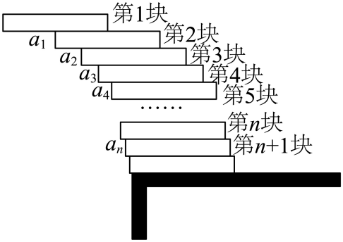

# Mathematics - 题目 3285

**ID**: 5073d50f2efa40b0b2c3b82d2817be8d
**年级**: Grade 12
**难度**: Hard
**题型**: Calculation

## 题目
将足够多的一批规格相同、质地均匀的长方体薄铁块叠放于水平桌面上，每个铁块总比其下层铁块向外伸出一定的长度，如下图，那么最上层的铁块最多可向桌缘外伸出多远而不掉下呢？这就是著名的“里拉斜塔”问题．将铁块从上往下依次标记为第1块，第2块，第3块，……，第n块，将前 ${\rm }{\rm i}({\rm i}=1,2,3,\cdot \cdot \cdot ,n)$ 块铁块视为整体，若这部分的重心在第 $i+1$ 块的上方，且全部铁块整体的重心在桌面的上方，整批铁块就保持不倒．设这批铁块的长度均为1，若记第n块比第 $n+1$ 块向桌缘外多伸出的部分的最大长度为 $a{{}_{n}}{\rm }$ ，则根据力学原理，可得 $a{{}_{2}}=\frac {1}{4}$ ，且 $\{\frac {1}{a{{}_{n}}}\}$ 为等差数列．(1)求 $\left \{a{{}_{n}}\right \}$ 的通项公式；​​​​​​​‌(2)记数列 $\left \{a{{}_{n}}\right \}$ 的前 $n$ 项和为 $S{{}_{n}}$ ．①比较 $S{{}_{n}}$ 与 $\frac {1}{2}{\ln}(n+1)$ 的大小；②对于无穷数列 $\left \{x{{}_{n}}\right \}$ ，如果存在常数 $A$ ，对任意的正数 $ε$ ，总存在正整数 $N{{}_{0}}$ ，使得 $\forall n>N{{}_{0}}$ ， $\left |{x{{}_{n}}-A}\right |<ε$ ，则称数列 $\left \{x{{}_{n}}\right \}$ 收敛于 $A$ ，也称数列 $\left \{x{{}_{n}}\right \}$ 的极限为 $A$ ，记为 ${\mathop {{\rm \lim }}\limits_{n\to +\infty }^{}}x{{}_{n}}=A$ ；反之，则称 $\left \{x{{}_{n}}\right \}$ 不收敛．请根据数列收敛的定义判断 $\left \{S{{}_{n}}\right \}$ 是否收敛？并据此回答“里拉斜塔”问题．

## 解答

1. （1）依题意，第1块铁块比第2块铁块向桌外伸出部分的最大长度为第1块铁块自身长度的一半，则 $a{{}_{1}}=\frac {1}{2}$ ，
2. 由 $\{\frac {1}{a{{}_{n}}}\}$ 为等差数列，得其首项为 $\frac {1}{a{{}_{1}}}=2$ ，公差 $d=\frac {1}{a{{}_{2}}}-\frac {1}{a{{}_{1}}}=4-2=2$ ，
3. 因此 $\frac {1}{a{{}_{n}}}=\frac {1}{a{{}_{1}}}+(n-1)d=2+2(n-1)=2n$ ，即 $a{{}_{n}}=\frac {1}{2n}$ ，
4. 所以 $\left \{a{{}_{n}}\right \}$ 的通项公式是 $a{{}_{n}}=\frac {1}{2n}$ .
5. （2）①由（1）知， $S{{}_{n}}=\frac {1}{2}+\frac {1}{4}+\frac {1}{6}+\cdots +\frac {1}{2n}=\frac {1}{2}(1+\frac {1}{2}+\frac {1}{3}+\cdots +\frac {1}{n})$ ，
6. 令函数 $f(x)={\ln}(1+x)-x,x>0$ ，求导得 $f^{′}(x)=\frac {1}{1+x}-1<0$ ，即函数 $f(x)$ 在 $(0,+\infty )$ 上单调递减，则 $f(x)<f(0)=0$ ，即 ${\ln}(1+x)<x$ ，取 $x=\frac {1}{n}$ ，于是 $\frac {1}{n}>{\ln}(1+\frac {1}{n})={\ln}(n+1)-{\ln}n$ ，
7. 则 $1+\frac {1}{2}+\frac {1}{3}+\cdots +\frac {1}{n}>{\ln}2-{\ln}1+{\ln}3-{\ln}2+{\ln}4-{\ln}3+\cdots +{\ln}(n+1)-{\ln}n={\ln}(n+1)$ ，
8. 所以 $S{{}_{n}}>\frac {1}{2}{\ln}(n+1)$ .
9. ② $\left \{S{{}_{n}}\right \}$ 不收敛.
10. 给定正数 $A$ ，对 $\forall ε>0$ ，令 $|\frac {1}{2}{\ln}(n+1)-A|<ε$ ，则 $A-ε<\frac {1}{2}{\ln}(n+1)<A+ε$ ，
11. 解得 ${\rm{e}}{^{2(A-ε)}}-1<n<{\rm{e}}{^{2(A+ε)}}-1$ ，取 $N{{}_{0}}{\rm{=}}{\rm{[}}{\rm{e}}{^{2(A+ε)}}-1]$ （ $[x]$ 表示不超过 $x$ 的最大整数），
12. 显然当 $n>N{{}_{0}}$ 时，不等式 $|\frac {1}{2}{\ln}(n+1)-A|<ε$ 不成立，即有 $\frac {1}{2}{\ln}(n+1)>A+ε$ ，
13. 因此数列 $\{\frac {1}{2}{\ln}(n+1)\}$ 不收敛；
14. 取 $A=ε+1$ ，则当 $n>N{{}_{0}}$ 时， $S{{}_{n}}-A>\frac {1}{2}{\ln}(n+1)-A>1+ε>1$ ，
15. 因此当 $n>N{{}_{0}}$ 时， $|S{{}_{n}}-A|>1$ 成立，
16. 所以 $\left \{S{{}_{n}}\right \}$ 不收敛.
17. $\left \{S{{}_{n}}\right \}$ 的意义是 $n$ 块叠放的铁块最上层的最多可向桌缘外伸的长度，因为 $\left \{S{{}_{n}}\right \}$ 不收敛于任意正数 $A$ ，所以只要铁块足够多，最上层的铁块最多可向桌缘外伸出的长度可以大于任意正数.

## 知识点

**中文**:
  - 数列新定义问题
  - 等差数列的概念及通项公式
  - 数列极限

**English**:
  - New Definition Problems
  - Concept and Formula
  - Limit of Sequences

---
