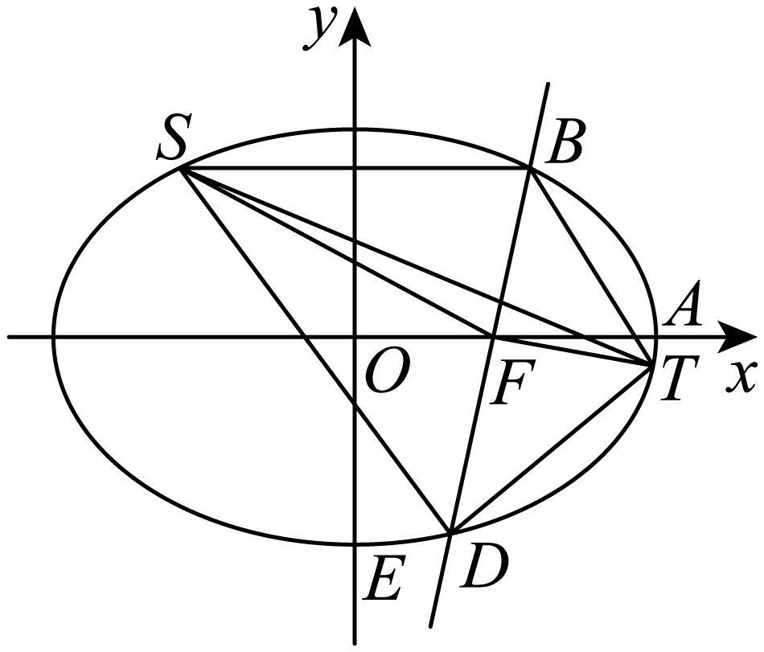

# Mathematics - 题目 2359

**ID**: c2484d0d9a2c4638b2c224913c59c553
**年级**: Grade 12
**难度**: Hard
**题型**: Calculation

## 题目
阿波罗尼斯是古希腊著名数学家，他的主要研究成果集中在他的代表作《圆锥曲线》一书中．阿波罗尼斯圆是他的研究成果之一，阿波罗尼斯圆指的是已知动点 $M$ 与两定点 $\mathbf{Q}$ ， $P$ 的距离之比 $\frac {\left |{MQ}\right |}{\left |{MP}\right |}=λ$ ( $λ>0$ 且 $λ\ne 1$ )， $λ$ 是一个常数，那么动点 $M$ 的轨迹就是阿波罗尼斯圆，圆心在直线 $PQ$ 上．已知动点 $M$ 的轨迹是阿波罗尼斯圆，其方程为 $x{^{2}}+y{^{2}}=4$ ，定点分别为椭圆 $C$ ： $\frac {x{^{2}}}{a{^{2}}}+\frac {y{^{2}}}{b{^{2}}}=1\left ({a>b>0}\right )$ 的右焦点 $F$ 与右顶点 $A$ ，且椭圆 $C$ 的离心率为 $e=\frac {1}{2}$ .​​​​​​​‌(1)求椭圆 $C$ 的标准方程；(2)如图，过右焦点 $F$ 斜率为 $k\left ({k>0}\right )$ 的直线 $l$ 与椭圆 $C$ 相交于 $B$ ， $D$ (点 $B$ 在x轴上方)，点 $S$ ， $T$ 是椭圆 $C$ 上异于 $B$ ， $D$ 的两点， $SF$ 平分 $\angle BSD$ ， $TF$ 平分 $\angle BTD$ .①求 $\frac {\left |{BS}\right |}{\left |{DS}\right |}$ 的取值范围；②设 $\mathrm{△}BFT$ 、 $\mathrm{△}DFT$ 的面积分别为 $S{{}_{1}}$ ， $S{{}_{2}}$ ，当 $\frac {S{{}_{1}}}{S{{}_{2}}}=\frac {1}{2}$ 时，求直线 $l$ 的方程.

## 解答

1. (1)设 $M(x,y)$ ， $F(c,0)$ 由题意知 $\frac {\left |{MF}\right |}{\left |{MA}\right |}=\frac {\sqrt {(x-c){^{2}}+y{^{2}}}}{\sqrt {(x-a){^{2}}+y{^{2}}}}=λ$ (常数)，
2. 整理得 $x{^{2}}+y{^{2}}+\frac {2c-2aλ{^{2}}}{λ{^{2}}-1}x+\frac {a{^{2}}λ{^{2}}-c{^{2}}}{λ{^{2}}-1}=0$ ，所以 $\begin{cases}\frac {2c-2aλ{^{2}}}{λ{^{2}}-1}=0,\\\frac {a{^{2}}λ{^{2}}-c{^{2}}}{λ{^{2}}-1}=-4,\end{cases}$
3. 又 $\frac {c}{a}=\frac {1}{2}$ ，解得 $a=2\sqrt {2}$ ， $c=\sqrt {2}$ ， $b{^{2}}=6$ ，
4. 所以椭圆 $C$ 的标准方程为 $\frac {x{^{2}}}{8}+\frac {y{^{2}}}{6}=1$ .
5. (2)①根据 $SF$ 平分 $\angle BSD$ ,
6. 则 $\frac {S{{}_{\mathrm{△}SBF}}}{S{{}_{\mathrm{△}SDF}}}=\frac {\frac {1}{2}\left |{SB}\right |\left |{SF}\right |{\sin}\angle BSF}{\frac {1}{2}\left |{SD}\right |\left |{SF}\right |{\sin}\angle DSF}=\frac {\left |{SB}\right |}{\left |{SD}\right |}$ ，又 $\frac {S{{}_{\mathrm{△}SBF}}}{S{{}_{\mathrm{△}SDF}}}=\frac {\left |{BF}\right |}{\left |{DF}\right |}$ (高相同)，
7. 故 $\frac {\left |{BS}\right |}{\left |{DS}\right |}=\frac {\left |{BF}\right |}{\left |{DF}\right |}$ (或由内角平分线定理得)，由 $F(\sqrt {2},0)$ ，设 $D(x{{}_{0}},y{{}_{0}})$ ， $B(x{{}_{B}},y{{}_{B}})$ ，
8. 则 $\overrightarrow {{BF}}=(\sqrt {2}-x{{}_{B}},-y{{}_{B}})$ ， $\overrightarrow {{FD}}=(x{{}_{0}}-\sqrt {2},y{{}_{0}})$ ，设 $\overrightarrow {{BF}}=μ\overrightarrow {{FD}}$ ，
9. 所以 $\begin{cases}\sqrt {2}-x{{}_{B}}=μ(x{{}_{0}}-\sqrt {2}),\\-y{{}_{B}}=μy{{}_{0}},\end{cases}$ 即 $\begin{cases}x{{}_{B}}=\sqrt {2}(μ+1)-μx{{}_{0}},\\y{{}_{B}}=-μy{{}_{0}},\end{cases}$
10. 因为直线 $l$ 斜率为 $k\left ({k>0}\right )$ ，得 $x{{}_{0}}\in (-2\sqrt {2},\sqrt {2})$ ，将 $B$ ， $D$ 坐标代入椭圆方程得
11. $3[\sqrt {2}(μ+1)-μx{{}_{0}}]{^{2}}+4(-μy{{}_{0}}){^{2}}=24$ 和 $4y{{}_{0}^{2}}=24-3x{{}_{0}^{2}}$ ，
12. 即 $3[\sqrt {2}(μ+1)-μx{{}_{0}}]{^{2}}+μ{^{2}}(24-3x{{}_{0}^{2}})=24$ ，
13. 化简得 $(μ+1){^{2}}-\sqrt {2}μ(μ+1)x{{}_{0}}+4(μ{^{2}}-1)=0$ ，
14. 整理得 $(μ+1)(5μ-3-\sqrt {2}μx{{}_{0}})=0$ ，因为 $μ>0$ ，故 $μ=\frac {3}{5-\sqrt {2}x{{}_{0}}}\in (\frac {1}{3},1)$ ，
15. 所以 $\frac {\left |{BS}\right |}{\left |{DS}\right |}$ 的取值范围为 $(\frac {1}{3},1)$ .
16. ②由题意知， $\frac {S{{}_{\mathrm{△}BFT}}}{S{{}_{\mathrm{△}DFT}}}=\frac {S{{}_{1}}}{S{{}_{2}}}=\frac {1}{2}$ ，根据 $TF$ 平分 $\angle BTD$ ， $\frac {S{{}_{\mathrm{△}BFT}}}{S{{}_{\mathrm{△}DFT}}}=\frac {\left |{BF}\right |}{\left |{FD}\right |}$ ，故 $\frac {\left |{BF}\right |}{\left |{DF}\right |}=\frac {1}{2}$ ，
17. 即 $μ=\frac {3}{5-\sqrt {2}x{{}_{0}}}=\frac {1}{2}$ ， $x{{}_{0}}=-\frac {\sqrt {2}}{2}$ ，故 $D(-\frac {\sqrt {2}}{2},-\frac {3\sqrt {10}}{4})$ ，
18. 所以 $k=\frac {0+\frac {3\sqrt {10}}{4}}{\sqrt {2}+\frac {\sqrt {2}}{2}}=\frac {\sqrt {5}}{2}$ ，
19. 直线 $l$ 的方程为 $y=\frac {\sqrt {5}}{2}x-\frac {\sqrt {10}}{2}$ .

## 知识点

**中文**:
  - 弦长面积问题
  - 椭圆的标准方程及应用
  - 直线与椭圆的位置关系
  - 范围最值问题

**English**:
  - Chord Length and Area Problems
  - Standard Equation and Applications
  - Line-Ellipse Relationship
  - Range and Extrema Problems

---
