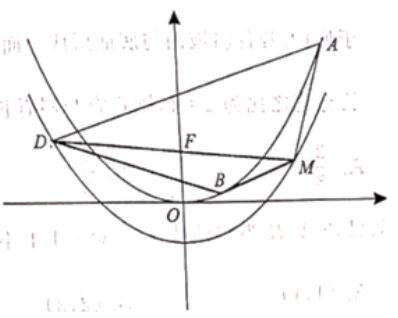

# Mathematics - 题目 1186

**ID**: c846dc43fae34b6883b9114872cce2e9
**年级**: Grade 12
**难度**: Hard
**题型**: Calculation

## 题目
已知抛物线 $C{{}_{1}}:x{^{2}}=4y$ 的焦点为F，M为抛物线 $C{{}_{2}}:x{^{2}}=4(y+1)$ 上一点，且在第一象限内.​​​​​​​‌过 $M$ 作抛物线 $C{{}_{1}}$ 的两条切线 $MA$ ， $MB{\rm ，\mathit{A}，\mathit{B}}$ 是切点；射线 $MF$ 交抛物线 $C{{}_{2}}$ 于 $D$ .(1)求直线 $AB$ 的方程（用M点横坐标 $x{{}_{0}}$ 表示）；(2)求四边形 $MADB$ 面积的最小值.

## 解答

1. （1） $M\left ({x{{}_{0}},y{{}_{0}}}\right )$ ， $A\left ({x{{}_{1}},y{{}_{1}}}\right )$ ， $B\left ({x{{}_{2}},y{{}_{2}}}\right )$ ，
2. 抛物线 $C{{}_{1}}:x{^{2}}=4y$ ，即 $y=\frac {x{^{2}}}{4}$ ，则 $y^{′}=\frac {x}{2}$ ，抛物线在点 $A\left ({x{{}_{1}},y{{}_{1}}}\right )$ 处切线斜率为 $\frac {x{{}_{1}}}{2}$ ，
3. 则切线 $MA$ 方程为 $y-y{{}_{1}}=\frac {x{{}_{1}}}{2}\left ({x-x{{}_{1}}}\right )$ ，整理得 $x{{}_{1}}x=2\left ({y+y{{}_{1}}}\right )$ ，
4. 同理， $MB$ 方程为 $x{{}_{2}}x=2\left ({y+y{{}_{2}}}\right )$ ，
5. 又 $M$ 在 $MA$ ， $MB$ 上，有 $\begin{cases}x{{}_{1}}x{{}_{0}}=2\left ({y{{}_{0}}+y{{}_{1}}}\right )，\\x{{}_{2}}x{{}_{0}}=2\left ({y{{}_{0}}+y{{}_{2}}}\right )，\end{cases}$
6. 直线 $AB$ 的方程为 $x{{}_{0}}x=2\left ({y{{}_{0}}+y}\right )$ ，
7. 又 $M\left ({x{{}_{0}},y{{}_{0}}}\right )$ 在 $x{^{2}}=4(y+1)$ 上，有 $y{{}_{0}}=\frac {x{{}_{0}}{^{2}}}{4}-1$ ，
8. $\therefore $ 直线 $AB$ 的方程为 $x{{}_{0}}x=2\left ({y+\frac {x{{}_{0}}{^{2}}}{4}-1}\right )$ ;
9. 
10. （2）设 $l{{}_{MF}}:y=kx+1$ ， $D\left ({x{{}_{3}},y{{}_{3}}}\right )$ ，
11. 联立 $\begin{cases}y=kx+1，\\x{^{2}}=4(y+1)，\end{cases}$  $\therefore x{^{2}}-4kx-8=0$ ， $\therefore \begin{cases}x{{}_{0}}+x{{}_{3}}=4k，\\x{{}_{0}}x{{}_{3}}=-8，\end{cases}$
12. $\therefore |MD|=\sqrt {1+k{^{2}}}\left |{x{{}_{0}}-x{{}_{3}}}\right |=\sqrt {1+k{^{2}}}\sqrt {16k{^{2}}+32}=4\sqrt {1+k{^{2}}}\sqrt {k{^{2}}+2}$ .
13. 设A、B到 $l{{}_{MF}}$ 的距离为 $d{{}_{1}}$ 、 $d{{}_{2}}$ .
14. 则 $d{{}_{1}}+d{{}_{2}}=\frac {\left |{kx{{}_{1}}-y{{}_{1}}+1}\right |}{\sqrt {1+k{^{2}}}}+\frac {\left |{kx{{}_{2}}-y{{}_{2}}+1}\right |}{\sqrt {1+k{^{2}}}}=\frac {\left |{k\left ({x{{}_{1}}-x{{}_{2}}}\right )-\left ({y{{}_{1}}-y{{}_{2}}}\right )}\right |}{\sqrt {1+k{^{2}}}}$
15. $=\frac {\left |{k\left ({x{{}_{1}}-x{{}_{2}}}\right )-\frac {x{{}_{1}^{2}}-x{{}_{2}^{2}}}{4}}\right |}{\sqrt {1+k{^{2}}}}=\frac {\left |{x{{}_{1}}-x{{}_{2}}}\right |}{4\sqrt {1+k{^{2}}}}\cdot \left |{4k-\left ({x{{}_{1}}+x{{}_{2}}}\right )}\right |$
16. 联立 $\begin{cases}x{^{2}}=4y，\\x{{}_{0}}x=2\left ({y{{}_{0}}+y}\right )，\end{cases}$  $\therefore x{^{2}}-2x{{}_{0}}x+4y{{}_{0}}=0$ ， $\therefore \begin{cases}x{{}_{1}}+x{{}_{2}}=2x{{}_{0}}，\\x{{}_{1}}x{{}_{2}}=4y{{}_{0}}，\end{cases}$
17. $\therefore d{{}_{1}}+d{{}_{2}}=\frac {\sqrt {4x{{}_{0}^{2}}-16y{{}_{0}}}}{4\sqrt {1+k{^{2}}}}\cdot \left |{4k-2x{{}_{0}}}\right |=\frac {2\left |{2k-x{{}_{0}}}\right |}{\sqrt {1+k{^{2}}}}$ ，
18. （其中 $\sqrt {4x{{}_{0}^{2}}-16y{{}_{0}}}=\sqrt {4\times 4\left ({y{{}_{0}}+1}\right )-16y{{}_{0}}}=2$ ）
19. $\therefore S{{}_{四边形MADB}}=\frac {1}{2}\cdot |MD|\left ({d{{}_{1}}+d{{}_{2}}}\right )=2\sqrt {1+k{^{2}}}\sqrt {2+k{^{2}}}\cdot \frac {2\left |{2k-x{{}_{0}}}\right |}{\sqrt {1+k{^{2}}}}=4\sqrt {2+k{^{2}}}\left |{2k-x{{}_{0}}}\right |$ ，
20. 又 $\begin{cases}x{{}_{0}}{^{2}}=4\left ({y{{}_{0}}+1}\right )\left ({y{{}_{0}}>0}\right )，\\k=\frac {y{{}_{0}}-1}{x{{}_{0}}}，\end{cases}$  $\therefore k=\frac {x{{}_{0}}{^{2}}-8}{4x{{}_{0}}}$ 代入得
21. $\therefore S{{}_{{\rm{四}}{\rm{边}}{\rm{形}}MADB}}=4\sqrt {2+\frac {1}{16}{\left({x{{}_{0}}-\frac {8}{x{{}_{0}}}}\right)^{2}}}\left |{\frac {x{{}_{0}}{^{2}}-8}{2x{{}_{0}}}-x{{}_{0}}}\right |=\frac {1}{2}\sqrt {{\left({x{{}_{0}}-\frac {8}{x{{}_{0}}}}\right)^{2}}+32}\cdot \left |{x{{}_{0}}+\frac {8}{x{{}_{0}}}}\right |$  $=\frac {1}{2}{\left({x{{}_{0}}+\frac {8}{x{{}_{0}}}}\right)^{2}}\geqslant \frac {1}{2}\cdot (2\sqrt {8}){^{2}}=16$ ，
22. 当且仅当 $x{{}_{0}}=2\sqrt {2}$ ，即 $M(2\sqrt {2},1)$ 取最小值.
23. $\therefore $ 四边形 $MADB$ 面积的最小值为16.

## 知识点

**中文**:
  - 弦长面积问题
  - 直线与抛物线的位置关系
  - 范围最值问题

**English**:
  - Chord Length and Area Problems
  - Line-Parabola Relationship
  - Range and Extrema Problems

---
