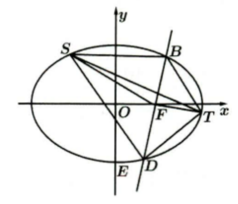

# Mathematics - 题目 3172

**ID**: f501e09ce7d24770a7bbb3905c322570
**年级**: Grade 12
**难度**: Hard
**题型**: Calculation

## 题目
古希腊数学家阿波罗尼斯在他的代表作《圆锥曲线》一书中指出：平面内动点 $M$ 与两定点 $Q,P$ 的距离之比 $\frac {\left |{MQ}\right |}{\left |{MP}\right |}=λ(λ>0,λ\ne 1),λ$ 是一个常数，那么动点 $M$ 的轨迹是一个圆，且圆心在直线 $PQ$ 上，我们把由此产生的圆叫做阿波罗尼斯圆．已知阿波罗尼斯圆 $x{^{2}}+y{^{2}}=2$ 的两个定点分别为椭圆 $C:\frac {x{^{2}}}{a{^{2}}}+\frac {y{^{2}}}{b{^{2}}}=1(a>b>0)$ 的右焦点 $F$ 与右顶点 $A$ ，且椭圆 $C$ 的离心率为 $e=\frac {1}{2}$ ．（1）求椭圆 $C$ 的标准方程；​​​​​​​‌（2）如图，过右焦点 $F$ 斜率为 $k(k>0)$ 的直线 $l$ 与椭圆 $C$ 相交于 $B,D$ （点 $B$ 在 $x$ 轴上方），点 $S,T$ 是椭圆 $C$ 上异于 $B,D$ 的两点， $SF$ 平分 $\angle BSD,TF$ 平分 $\angle BTD$ ．①求 $\frac {\left |{BS}\right |}{\left |{DS}\right |}$ 的取值范围；②若 $△SFT$ 外接圆的周长为 $9{\rm{π}}$ ，求直线 $l$ 的方程．

## 解答

1. （1）令 $M\left ({\pm \sqrt {2},0}\right )$ ，由阿波罗尼斯圆的定义知 $\frac {\left |{c-\sqrt {2}}\right |}{\left |{a-\sqrt {2}}\right |}=\frac {c+\sqrt {2}}{a+\sqrt {2}}$ ，且 $a=2c$ ，解得 $c{^{2}}=1$ ，
2. $\therefore a{^{2}}=4,b{^{2}}=a{^{2}}-c{^{2}}=3$ ，椭圆 $C$ 的方程为 $\frac {x{^{2}}}{4}+\frac {y{^{2}}}{3}=1$ ；
3. （2）① $\frac {S{{}_{△SBF}}}{S{{}_{△SDF}}}=\frac {\frac {1}{2}\left |{SB}\right |\cdot \left |{SF}\right |\cdot {\rm{s}}{\rm{i}}{\rm{n}}\angle BSF}{\frac {1}{2}\left |{SD}\right |\cdot \left |{SF}\right |\cdot {\rm{s}}{\rm{i}}{\rm{n}}\angle DSF}=\frac {\left |{SB}\right |}{\left |{SD}\right |}$ ，又 $\frac {S{{}_{△SBF}}}{S{{}_{△SDF}}}=\frac {\left |{BF}\right |}{\left |{DF}\right |}$ ，
4. $\therefore \frac {\left |{BS}\right |}{\left |{DS}\right |}=\frac {\left |{BF}\right |}{\left |{DF}\right |}$ （或由角平分线定理得），
5. 令 $\frac {\left |{BF}\right |}{\left |{DF}\right |}=λ$ ，设 $l:x=ty+1,B\left ({x{{}_{1}},y{{}_{1}}}\right ),D\left ({x{{}_{2}},y{{}_{2}}}\right )$ ，
6. 联立 $\begin{cases}x=ty+1\\\frac {x{^{2}}}{4}+\frac {y{^{2}}}{3}=1\end{cases}$ ，解得 $\left ({3t{^{2}}+4}\right )y{^{2}}+6ty-9=0$ ，
7. 则 $y{{}_{1}}+y{{}_{2}}=-\frac {6t}{3t{^{2}}+4},y{{}_{1}}y{{}_{2}}=-\frac {9}{3t{^{2}}+4}$ ，
8. $\therefore \frac {\left |{BS}\right |}{\left |{DS}\right |}=-\frac {y{{}_{1}}}{y{{}_{2}}}=λ,y{{}_{1}}=-λy{{}_{2}},\therefore -λ+\left ({-\frac {1}{λ}}\right )+2=\frac {{\left({y{{}_{1}}+y{{}_{2}}}\right)^{2}}}{y{{}_{1}}y{{}_{2}}}=-\frac {4t{^{2}}}{3t{^{2}}+4}$ ，
9. 又 $\frac {4t{^{2}}}{3t{^{2}}+4}=\frac {4}{3+\frac {4}{t{^{2}}}}\in \left ({0,\frac {4}{3}}\right )$ ，所以 $λ+\frac {1}{λ}=2+\frac {4t{^{2}}}{3t{^{2}}+4}\in \left ({2,\frac {10}{3}}\right )$ ，解得 $λ\in \left ({\frac {1}{3},3}\right )$ ，
10. 又 $y{{}_{1}}+y{{}_{2}}=-\frac {6t}{3t{^{2}}+4}<0$ ，所以 $λ=-\frac {y{{}_{1}}}{y{{}_{2}}}<1$ ，综上 $λ\in \left ({\frac {1}{3},1}\right )$ ；
11. ②由①知， $\frac {\left |{SB}\right |}{\left |{SD}\right |}=\frac {\left |{TB}\right |}{\left |{TD}\right |}=\frac {\left |{BF}\right |}{\left |{DF}\right |}$ ，由阿波罗尼斯圆定义知，
12. $S,T,F$ 在以 $B,D$ 为定点得阿波罗尼斯圆上，设该圆圆心为 $C{{}_{1}}$ ，半径为 $r$ ，与直线 $l$ 的另一个交点为 $N$ ，
13. 则有 $\frac {\left |{BF}\right |}{\left |{DF}\right |}=\frac {\left |{NB}\right |}{\left |{ND}\right |}$ ，即 $\frac {\left |{BF}\right |}{\left |{DF}\right |}=\frac {2r-\left |{BF}\right |}{2r+\left |{DF}\right |}$ ，解得： $r=\frac {1}{\frac {1}{\left |{BF}\right |}-\frac {1}{\left |{DF}\right |}}$ ．
14. 又 $C{{}_{\odot C{{}_{1}}}}=2πr=9{\rm{π}}$ ，故 $r=\frac {9}{2},\therefore \frac {1}{\left |{BF}\right |}-\frac {1}{\left |{DF}\right |}=\frac {2}{9}$ ，
15. 又 $\left |{BF}\right |=\sqrt {1+t{^{2}}}y{{}_{1}},\left |{DF}\right |=\sqrt {1+t{^{2}}}\left ({-y{{}_{2}}}\right )$ ，
16. $\therefore \frac {1}{\left |{BF}\right |}-\frac {1}{\left |{DF}\right |}=\frac {1}{\sqrt {1+t{^{2}}}y{{}_{1}}}-\frac {1}{\sqrt {1+t{^{2}}}\left ({-y{{}_{2}}}\right )}=\frac {1}{\sqrt {1+t{^{2}}}}\left ({\frac {1}{y{{}_{1}}}+\frac {1}{y{{}_{2}}}}\right )$
17. $=\frac {1}{\sqrt {1+t{^{2}}}}\frac {y{{}_{1}}+y{{}_{2}}}{y{{}_{1}}y{{}_{2}}}=\frac {1}{\sqrt {1+t{^{2}}}}\frac {-6t}{-9}=\frac {2}{3}\frac {t}{\sqrt {1+t{^{2}}}}$ ，
18. $\therefore \frac {2}{9}=\frac {1}{\left |{BF}\right |}-\frac {1}{\left |{DF}\right |}=\frac {2}{3}\frac {t}{\sqrt {1+t{^{2}}}},\therefore t=\frac {\sqrt {2}}{4}$ ，
19. $\therefore k=\frac {1}{t}=2\sqrt {2},\therefore $ 直线 $l$ 的方程为 $y=2\sqrt {2}x-2\sqrt {2}$ ．
20. 

## 知识点

**中文**:
  - 椭圆的标准方程及应用
  - 直线与椭圆的位置关系
  - 范围最值问题

**English**:
  - Standard Equation and Applications
  - Line-Ellipse Relationship
  - Range and Extrema Problems

---
