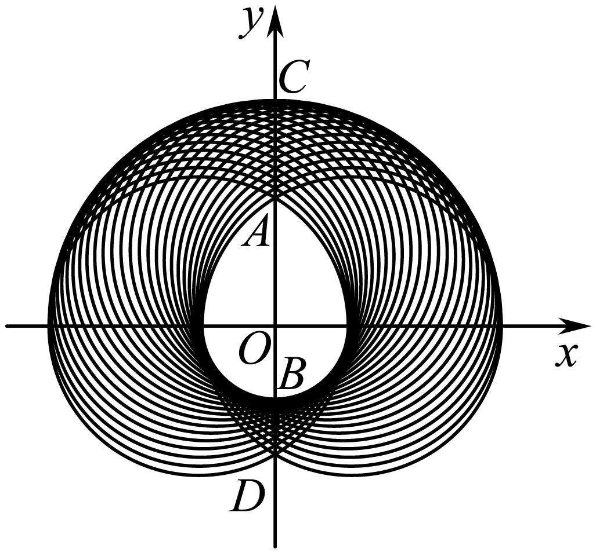

# Mathematics - 题目 449

**ID**: 64e91eff067f4d668c0c0558b5718dc1
**年级**: Grade 12
**难度**: Hard
**题型**: Fill-in-the-blank

## 题目
已知集合 $P=\left \{\left ({x,y}\right )∣(x-{\rm{c}}{\rm{o}}{\rm{s}}θ){^{2}}+(y-{\rm{s}}{\rm{i}}{\rm{n}}θ){^{2}}=4,0\leqslant θ\leqslant {\rm{π}}\right \}$ .​​​​​​​‌由集合 $P$ 中所有的点组成的图形如图中阴影部分所示，中间白色部分形如美丽的“水滴”.给出下列结论：①白色“水滴”区域（含边界）任意两点间距离的最大值为 $1+\sqrt {3}$ ；②在阴影部分任取一点 $M$ ，则 $M$ 到坐标轴的距离小于等于3；③阴影部分的面积为 $8{\rm{π}}$ ；④阴影部分的内外边界曲线长为 $8{\rm{π}}$ .其中正确的有.

## 解答

1. 对于①，由于 $(x-{\cos}θ){^{2}}+(y-{\sin}θ){^{2}}=4$ ，令 $x=0$ 时，整理得 $2{\sin}θ=y-\frac {3}{y}\in \left [0,2\right ]$ ，
2. 解得 $y\in [-\sqrt {3},-1]\cup [\sqrt {3},3]$ ，“水滴”图形与 $y$ 轴相交，最高点记为A，
3. 则点A的坐标为 $(0,\sqrt {3})$ ，点 $B(0,-1)$ ，
4. 白色“水滴”区域（含边界）任意两点间距离的最大值为 $|AB|=1+\sqrt {3}$ ,故①正确；
5. 对于②，由于 $(x-{\cos}θ){^{2}}+(y-{\sin}θ){^{2}}=4$ ，整理得： $\left \{\hspace{-0.5em}\begin{array}{l}x=2{\cos}α+{\cos}θ\\y=2{\sin}α+{\sin}θ\end{array}\hspace{-0.5em}\right.$ ，
6. 所以 $M(2{\cos}α+{\cos}θ,2{\sin}α+{\sin}θ)$ ，所以 $M$ 到坐标轴的距离为 $|2{\cos}α+{\cos}θ|$ 或 $|2{\sin}α+{\sin}θ|$ ，
7. 因为 ${\cos}θ\in [-1,1],{\sin}θ\in [0,1]$ ，
8. 所以 $|2{\cos}α+{\cos}θ|\leqslant |2{\cos}α|+|{\cos}θ|\leqslant 2+1=3$ ， $|2{\sin}α+{\sin}θ|\leqslant |2{\sin}α|+|{\sin}θ|\leqslant 2+1=3$ ，
9. 所以 $M$ 到坐标轴的距离小于等于3，故②正确；
10. 对于③，由于 $(x-{\cos}θ){^{2}}+(y-{\sin}θ){^{2}}=4$ ，令 $y=0$ 时，整理得 $2{\cos}θ=y-\frac {3}{y}\in \left [-2,2\right ]$ ，
11. 解得 $x\in [-3,-1]\cup [1,3]$ ，
12. 因为 $(x-{\rm{c}}{\rm{o}}{\rm{s}}θ){^{2}}+(y-{\rm{s}}{\rm{i}}{\rm{n}}θ){^{2}}=4$ 表示以 $Q\left ({{\cos}θ,{\sin}θ}\right )$ 为圆心，半径为 $r=2$ 的圆，
13. 则 $1=r-\left |{OQ}\right |\leqslant \left |{OP}\right |\leqslant \left |{OQ}\right |+r=3$ ，
14. 且 $0\leqslant θ\leqslant {\rm{π}}$ ，则 $Q\left ({{\cos}θ,{\sin}θ}\right )$ 在x轴上以及x轴上方，
15. 故白色“水滴”的下半部分的边界为以 $O$ 为圆心，半径为1的半圆，阴影的上半部分的外边界是以 $O$ 为圆心，半径为3的半圆，
16. 根据对称可知：白色“水滴”在第一象限的边界是以 $M\left ({-1,0}\right )$ 为圆心，半径为2的圆弧，
17. 设 $N\left ({1,0}\right )$ ，则 $\left |{AN}\right |=\left |{AM}\right |=\left |{MN}\right |=2$ ，即 $\overset ⌢{{AN}}$ 所对的圆心角为 $\frac {{\rm{π}}}{3}$ ，
18. 同理 $\overset ⌢{{AM}}$ 所在圆的半径为2，所对的圆心角为 $\frac {{\rm{π}}}{3}$ ，
19. 阴影部分在第四象限的外边界为以 $N\left ({1,0}\right )$ 为圆心，半径为2的圆弧，
20. 设 $G\left ({3,0}\right ),H\left ({-3,0}\right )$ ，可得 $\left |{ON}\right |=1,\left |{OD}\right |=\sqrt {3},\angle OND=\frac {{\rm{π}}}{3}$ ， $\overset ⌢{{DG}}$ 所对的圆心角为 $\frac {{\rm{2}}{\rm{π}}}{3}$ ，
21. 同理 $\overset ⌢{{DH}}$ 所在圆的半径为2，所对的圆心角为 $\frac {{\rm{2}}{\rm{π}}}{3}$ ，
22. 
23. 故白色“水滴”图形由一个等腰三角形，两个全等的弓形，和一个半圆组成，
24. 所以它的面积是 $S=S{{}_{半圆}}+2S{{}_{弓形}}+S{{}_{\vartriangle }}=\frac {1}{2}\times {\rm{π}}\times 1{^{2}}+2\times \left ({\frac {2{\rm{π}}}{3}-\sqrt {3}}\right )+\frac {1}{2}\times 2\times \sqrt {3}=\frac {11{\rm{π}}}{6}-\sqrt {3}$ .
25. $x$ 轴上方的半圆（包含阴影和水滴的上半部分）的面积为 $\frac {1}{2}{\rm{π}}\times 3{^{2}}=\frac {9}{2}{\rm{π}}$ ,
26. 第四象限的阴影和水滴部分面积可以看作是一个直角三角形和一个扇形的面积的和，
27. 且等于 $\frac {1}{3}\times {\rm{π}}\times 2{^{2}}+\frac {1}{2}\times \sqrt {3}\times 1=\frac {4}{3}{\rm{π}}+\frac {\sqrt {3}}{2}$ ，
28. 所以阴影部分的面积为 $\frac {9}{2}{\rm{π}}+2(\frac {4}{3}{\rm{π}}+\frac {\sqrt {3}}{2})-\frac {11}{6}{\rm{π}}+\sqrt {3}=\frac {16}{3}{\rm{π}}+2\sqrt {3}$ ，故③错误；
29. 对于④， $x$ 轴上方的阴影部分的内外边界曲线长为 $\frac {1}{2}\times 2{\rm{π}}\times 3+\frac {{\rm{π}}}{3}\times 2\times 2=3{\rm{π}}+\frac {4}{3}{\rm{π}}=\frac {13}{3}{\rm{π}}$ ，
30. $x$ 轴下方的阴影部分的内外边界曲线长为 $\frac {1}{2}\times 2{\rm{π}}\times 1+(\frac {1}{2}\times 2{\rm{π}}\times 2-\frac {1}{3}{\rm{π}}\times 2)\times 2=\frac {11}{3}{\rm{π}}$ ，
31. 所以阴影部分的内外边界曲线长为 $\frac {13{\rm{π}}}{3}+\frac {11{\rm{π}}}{3}=8{\rm{π}}$ ，故④正确.
32. 故答案为：①②④.
33. 【点睛】关键点睛：解答本题有三个关键，其一是写出圆的参数方程，设出点的坐标，其二是利用割补法求不规则图形的面积，其三是利用三角函数的值域求出图形与坐标轴的交点的坐标.

## 知识点

**中文**:
  - 曲线与方程

**English**:
  - Curves and Equations

---
