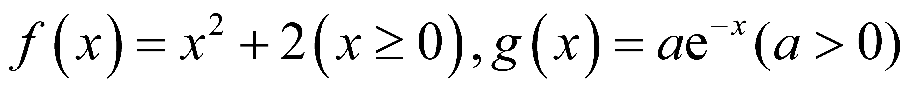

# Mathematics - 题目 2857

**ID**: 24f04c42da49461db4235f904dd309df
**年级**: Grade 12
**难度**: Hard
**题型**: Multiple-select

## 题目
已知函数，点分別在函数的的图像上，为坐标原点，则下列命题正确的是（      ）​​​​​​​‌

## 解答

1. 函数，
2. 对于A，方程在上有解，
3. 显然函数在上单调递增，则有，解得，
4. 因此关于的方程在上无解，则或，A错误；
5. 对于B，设点，依题意，点Q关于直线对称点在函数的图象上，
6. 即关于t的方程有解，即有解，此时，令函数，
7. ，即函数在上单调递增，，
8. 而函数在上都单调递增，它们的取值集合分别为，
9. 因此函数的值域为，又，于是在有解，
10. 所以存在关于直线对称，B正确；
11. 对于C，设点，则点P关于y轴对称点在函数的图象上，
12. 即，令，，
13. 即函数在上单调递减，，又，恒有，因此，C正确；
14. 对于D，令，由得，
15. 显然，且，，令，，
16. 当时，函数单调递增，当时，，函数单调递减，
17. 因此，即有，，
18. 而，当且仅当时取等号，所以，即，D正确.
19. 故选：BCD

## 知识点

**中文**:
  - 函数单调性的应用
  - 利用导数研究函数的单调性与单调区间
  - 利用导数研究方程的根

**English**:
  - Applications of Monotonicity
  - Monotonicity and Monotonic Intervals
  - Studying Equation Roots

---
