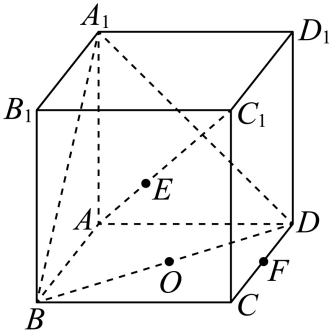

# Mathematics - 题目 286

**ID**: 27cbfcf1dd3c45f1b2a5b1fa35181df6
**年级**: Grade 12
**难度**: Hard
**题型**: Multiple-select

## 题目
如图，已知正方体 $ABCD-A{{}_{1}}B{{}_{1}}C{{}_{1}}D{{}_{1}}$ 的棱长为 $4,O$ 为底面 $ABCD$ 的中心， $AC{{}_{1}}$ 交平面 $A{{}_{1}}BD$ 于点 $E$ ，点 $F$ 为棱 $CD$ 的中点，则（      ）​​​​​​​‌

## 解答

1. 对于A，由已知 $O\in AC\subset $ 平面 $ACC{{}_{1}}A{{}_{1}},E\in AC{{}_{1}}\subset $ 平面 $ACC{{}_{1}}A{{}_{1}},A{{}_{1}}\in $ 平面 $ACC{{}_{1}}A{{}_{1}}$ ，
2. 又 $O\in BD\subset $ 平面 $A{{}_{1}}BD,E\in $ 平面 $A{{}_{1}}BD,A{{}_{1}}\in $ 平面 $A{{}_{1}}BD$ ，
3. 所以 $A{{}_{1}},E,O$ 三点都在平面 $A{{}_{1}}BD$ 与平面 $ACC{{}_{1}}A{{}_{1}}$ 的交线上，即 $A{{}_{1}},E,O$ 三点共线，故A正确；
4. 
5. 对于B，因为 $C{{}_{1}}C\bot $ 平面 $ABCD,BD\subset $ 平面 $ABCD$ ，
6. 所以 $BD\bot C{{}_{1}}C$ ，又 $BD\bot AC,AC\cap C{{}_{1}}C=C,AC,C{{}_{1}}C\subset $ 平面 $ACC{{}_{1}}A{{}_{1}}$ ，
7. 所以 $BD\mathrm{⊥}$ 平面 $ACC{{}_{1}}A{{}_{1}}$ ，
8. 又 $AC{{}_{1}}\subset $ 平面 $ACC{{}_{1}}A{{}_{1}}$ ，
9. 所以 $BD\bot AC{{}_{1}}$ ，
10. 同理可得 $AC{{}_{1}}\bot A{{}_{1}}B$ ，
11. 因为 $BD\cap A{{}_{1}}B=B,BD$ ， $A{{}_{1}}B\subset $ 平面 $A{{}_{1}}BD$ ，
12. 所以 $AC{{}_{1}}\bot $ 平面 $A{{}_{1}}BD$ ，则 $C{{}_{1}}E$ 的长度就是点 $C{{}_{1}}$ 到平面 $A{{}_{1}}BD$ 的距离，
13. 显然 $E$ 为正三角形 $A{{}_{1}}BD$ 的中心，
14. 因为正方体 $ABCD-A{{}_{1}}B{{}_{1}}C{{}_{1}}D{{}_{1}}$ 的棱长为4，
15. 所以正三角形 $A{{}_{1}}BD$ 的边长为 $4\sqrt {2}$ ，所以 $A{{}_{1}}E=\frac {2}{3}\times \frac {\sqrt {3}}{2}\times 4\sqrt {2}=\frac {4\sqrt {6}}{3}$ ，
16. 又 $A{{}_{1}}C{{}_{1}}=4\sqrt {2}$ ，所以 $C{{}_{1}}E=\sqrt {A{{}_{1}}{\rm C}{_{1}^{2}}-A{{}_{1}}E{^{2}}}=\sqrt {(4\sqrt {2}){^{2}}-{\left({\frac {4\sqrt {6}}{3}}\right)^{2}}}=\frac {8\sqrt {3}}{3}$ ，
17. 即点 $C{{}_{1}}$ 到平面 $A{{}_{1}}BD$ 的距离为 $\frac {8\sqrt {3}}{3}$ ，故B错误；
18. 对于C，取 $D{{}_{1}}D$ 的中点 $G$ ，连接 $FG,GA{{}_{1}},BF$ ，因为 $FG$  $/\mskip-4mu/$  $CD{{}_{1}}$  $/\mskip-4mu/$  $A{{}_{1}}B$ ，
19. 所以等腰梯形 $A{{}_{1}}BFG$ 就是过点 $A{{}_{1}},B,F$ 的平面截该正方体所得的截面，
20. 如图：
21. 
22. 所以过点 $A{{}_{1}},B,F$ 的平面截该正方体所得的较小部分为三棱台 $DFG-ABA{{}_{1}}$ ，
23. 其体积为 $V=\frac {1}{3}\left ({S{{}_{\vartriangle DFG}}+S{{}_{\vartriangle ABA{{}_{1}}}}+\sqrt {S{{}_{\vartriangle DFG}}S{{}_{\vartriangle ABA{{}_{1}}}}}}\right )\cdot AD=\frac {1}{3}\left ({2+8+\sqrt {2\times 8}}\right )\times 4=\frac {56}{3}$ ，故C正确；
24. 对于D，过点 $F$ 且平行平面 $BDA{{}_{1}}$ 的平面截该正方体，所截得的两个多面体全等，如下图所示，
25. 
26. 该七面体能容纳的最大球亦为正三棱锥 $A{{}_{2}}-B{{}_{2}}C{{}_{2}}D{{}_{2}}$ 的内切球（如下图所示），
27. $B{{}_{2}}D{{}_{2}}=6\sqrt {2},A{{}_{2}}D{{}_{2}}=\sqrt {(3\sqrt {2}){^{2}}+(3\sqrt {2}){^{2}}}=6$ ，
28. 设 $O{{}_{1}}$ 为 $\mathrm{△}B{{}_{2}}C{{}_{2}}D{{}_{2}}$ 的中心，则 $D{{}_{2}}O{{}_{1}}=\frac {2}{3}\times \frac {\sqrt {3}}{2}\times 6\sqrt {2}=2\sqrt {6}$ ，高 $A{{}_{2}}O{{}_{1}}=\sqrt {A{{}_{2}}D{{}_{2}^{2}}-D{{}_{2}}O{{}_{1}}{^{2}}}=2\sqrt {3}$ ，
29. 设正三棱锥 $A{{}_{2}}-B{{}_{2}}C{{}_{2}}D{{}_{2}}$ 的内切球的半径为 $r$ ，
30. 则 $V{{}_{A{{}_{2}}-B{{}_{2}}C{{}_{2}}D{{}_{2}}}}=\frac {1}{3}A{{}_{2}}O{{}_{1}}\cdot S{{}_{\vartriangle B{{}_{2}}C{{}_{2}}D{{}_{2}}}}=\frac {1}{3}r\left ({S{{}_{\vartriangle A{{}_{2}}C{{}_{2}}D{{}_{2}}}}+S{{}_{\vartriangle A{{}_{2}}B{{}_{2}}D{{}_{2}}}}+S{{}_{\vartriangle A{{}_{2}}B{{}_{2}}C{{}_{2}}}}+S{{}_{\vartriangle B{{}_{2}}C{{}_{2}}D{{}_{2}}}}}\right )$ ，①
31. 在 $\mathrm{△}A{{}_{2}}C{{}_{2}}D{{}_{2}}$ 中， $A{{}_{2}}D{{}_{2}}=A{{}_{2}}C{{}_{2}}=6,C{{}_{2}}D{{}_{2}}=6\sqrt {2}$ ，
32. 得 $S{{}_{\vartriangle A{{}_{2}}C{{}_{2}}D{{}_{2}}}}=18=S{{}_{\vartriangle A{{}_{2}}B{{}_{2}}D{{}_{2}}}}=S{{}_{\vartriangle A{{}_{2}}B{{}_{2}}C{{}_{2}}}}$ ， $S{{}_{\vartriangle B{{}_{2}}C{{}_{2}}D{{}_{2}}}}=\frac {1}{2}\times 6\sqrt {2}\times 6\sqrt {2}\times \frac {\sqrt {3}}{2}=18\sqrt {3}$ ，
33. 代入①，得 $r=\frac {6}{3+\sqrt {3}}=3-\sqrt {3}$ ，故D正确.
34. 故选ACD.

## 知识点

**中文**:
  - 截面问题
  - 球的切接问题
  - 点与面之间的距离

**English**:
  - Cross-section Problems
  - Tangency and Inscribed/Circumscribed Spheres
  - Point-Plane Distance

---
