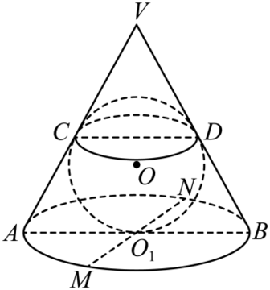

# Mathematics - 题目 1382

**ID**: 3d73ae0f6d164fd99af685ae1bab15ca
**年级**: Grade 12
**难度**: Hard
**题型**: Multiple-select

## 题目
如图，圆锥 $VAB$ 内有一个内切球 $O$ ，球 $O$ 与母线 $VA,VB$ 分别切于点 $C,D$ ，若 $\vartriangle VAB$ 是边长为2的等边三角形， $O{{}_{1}}$ 为圆锥底面圆的中心， $MN$ 为圆 $O{{}_{1}}$ 的一条直径（ $MN$ 与 $AB$ 不重合），则下列说法正确的是（      ）​​​​​​​‌

## 解答

1. 对选项A，设圆锥的底面半径为 $r$ ，球的半径为 $R$ ，圆锥的母线长为 $l$ ，
2. 因为 $\vartriangle VAB$ 是边长为2的等边三角形，则 $r=1$ ， $l=2$ ，
3. 连接 $OC$ ， $OO{{}_{1}}$ ， $OA$ ，由条件可知， $OC\bot CA$ ， $OO{{}_{1}}\bot O{{}_{1}}A$ ，且 $OC=OO{{}_{1}}=R$ ，
4. 则 $\vartriangle OCA≌\vartriangle OO{{}_{1}}A$ ，所以 $\angle OAO{{}_{1}}=30{^{\circ }}$ ，
5. 则 $OO{{}_{1}}=O{{}_{1}}A\cdot {\tan}30{^{\circ }}=\frac {\sqrt {3}}{3}$ ，即 $R=\frac {\sqrt {3}}{3}$ ，
6. 所以球的表面积 $S{{}_{1}}=4πR{{}^{2}}=\frac {4π}{3}$ ，圆锥的侧面积 $S{{}_{2}}={\rm{π}}rl=2{\rm{π}}$ ，
7. 所以球的表面积与圆锥的侧面积之比为 $2:3$ ，故选项A正确；
8. 
9. 对选项B，因为平面 $CMN$ 与母线VB平行，所以截得圆锥侧面的交线形状为抛物线，故选项B正确；
10. 对选项C，由题意 $O{{}_{1}}$ 是 $MN$ 的中点，所以四面体 $CDMN$ 的体积等于 $2V{{}_{M-DCO{{}_{1}}}}$ ，
11. 设点 $M$ 到平面 $CDO{{}_{1}}$ 的距离为 $d$ ，当 $M$ ， $N$ 处于 $A,B$ 时， $d=0$ ，
12. 当 $M$ ， $N$ 处于弧 $AB$ 中点时， $d$ 最大，为1，所以 $d\in (0,1]$ ，
13. 如图作 $CQ\bot AB$ 交 $AB$ 于 $Q$ ，由对选项A可知， $CA=AO{{}_{1}}=1$ ，
14. 则 $CQ=CA\cdot \sin 60{^{\circ }}=\frac {\sqrt {3}}{2}$ ， $AQ=\frac {1}{2}$ ，所以 $O{{}_{1}}Q=\frac {1}{2}$ ，从而 $CD=1$ ，
15. 所以 $\mathrm{△}CDO{{}_{1}}$ 的面积 $S=\frac {1}{2}\times 1\times \frac {\sqrt {3}}{2}=\frac {\sqrt {3}}{4}$ ，
16. 所以 $V{{}_{M-DCO{{}_{1}}}}=\frac {1}{3}S{{}_{\vartriangle DCO{{}_{1}}}}\cdot d=\frac {1}{3}\times \frac {\sqrt {3}}{4}d=\frac {\sqrt {3}}{12}d$ ，
17. 因为 $d\in (0,1]$ ，所以 $V{{}_{M-DCO{{}_{1}}}}\in (0,\frac {\sqrt {3}}{12}]$ ，故 $2V{{}_{M-DCO{{}_{1}}}}\in (0,\frac {\sqrt {3}}{6}]$ ，
18. 所以四面体 $CDMN$ 的体积的取值范围是 $\left ({0,\frac {\sqrt {3}}{6}}\right ]$ ，故选项C不正确；
19. 
20. 对选项D，由题意得球面和圆锥侧面的交线为以 $CD$ 为直径的圆，
21. 以 $O{{}_{1}}$ 为坐标原点， $O{{}_{1}}M$ 所在直线为 $x$ 轴， $OO{{}_{1}}$ 为 $z$ 轴，建立空间直角坐标系，
22. 则 $M(1,0,0)$ ， $N(-1,0,0)$ ，设 $P(\frac {1}{2}{\cos}θ,\frac {1}{2}\sin θ,\frac {\sqrt {3}}{2})$ ，
23. 则 $PM=\sqrt {(\frac {1}{2}{\cos}θ-1){^{2}}+(\frac {1}{2}\sin θ){^{2}}+1}=\sqrt {2-{\cos}θ}$ ，
24. $PM=\sqrt {(\frac {1}{2}{\cos}θ+1){^{2}}+(\frac {1}{2}\sin θ){^{2}}+1}=\sqrt {2+{\cos}θ}$ ，
25. 所以 $PM+PN=\sqrt {2+{\cos}θ}+\sqrt {2-{\cos}θ}$ ，
26. 所以 $(PM+PN){^{2}}=2+{\cos}θ+2-{\cos}θ+2\sqrt {(2+{\cos}θ)(2+{\cos}θ)}$ ，
27. 即 $(PM+PN){^{2}}=4+2\sqrt {4-{\cos}{^{2}}θ}$ ，
28. 所以当 ${\cos}θ=0$ 时， $(PM+PN){^{2}}$ 有最大值 $2\sqrt {2}$ ，故选项D正确.
29. 故选：ABD.
30. 

## 知识点

**中文**:
  - 圆柱、圆锥、圆台的表面积（侧面积）
  - 棱柱、棱锥、棱台的体积
  - 球的表面积
  - 球的切接问题

**English**:
  - Surface Area of Revolving Solids
  - Volume of Polyhedra
  - Surface Area of a Sphere
  - Tangency and Inscribed/Circumscribed Spheres

---
