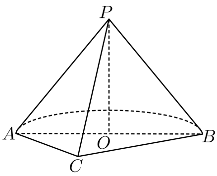

# Mathematics - 题目 709

**ID**: 00b5d0582bcd4c978d01a85e78190bb5
**年级**: Grade 12
**难度**: Medium
**题型**: Calculation

## 题目
如图所示的几何体是圆锥的一半和一个三棱锥组成，圆锥底面圆O的半径为1，圆锥的高 $PO=2$ ，三棱锥 $P-ABC$ 的底面 $ABC$ 是以圆锥的底面圆的直径AB为斜边的等腰直角三角形，且与圆锥底面在同一个平面上．（1）求直线 $PC$ 和平面 $ABC$ 所成角的大小；​​​​​​​‌（2）求该几何体的表面积．

## 解答

1. （1）连接 $CO$ ，由题意， $PO{\rm ⊥}$ 平面 $ABC$ ，故直线 $PC$ 在平面 $ABC$ 上的射影为直线 $CO$ ，
2. 因此直线 $PC$ 和平面 $ABC$ 所成角等于 $\angle PCO$ ．
3. 因为 $\vartriangle ABC$ 是以 $AB$ 为直径的等腰直角三角形，所以 $CO=\frac {1}{2}AB=1$ ．
4. 
5. 因此，由 $PO=2$ 知 ${\tan}\angle PCO=\frac {PO}{CO}=2$ ．
6. 即直线 $PC$ 和平面 $ABC$ 所成角的大小为 ${\arctan}2$ ．
7. （2）由题意，所求表面积等于圆锥表面积的一半加上 $\vartriangle PAC$ ， $\vartriangle PAB$ 和 $\vartriangle ABC$ 的面积．
8. 因为圆锥的高 $PO=2$ ，圆锥的底面半径 $r=OB=1$ ，所以圆锥的母线长为 $\sqrt {5}$ ，
9. 表面积为 $\mathrm{π}r{^{2}}+\mathrm{π}rl=\mathrm{π}\times 1{^{2}}+\mathrm{π}\times 1\times \sqrt {5}=\left ({\sqrt {5}+1}\right )\mathrm{π}$ ．
10. 在 $\vartriangle PAC$ 和 $\vartriangle PAB$ 中， $PA=PB=PC=\sqrt {5}$ ， $AC=BC=\sqrt {2}$ ，
11. 所以 ${\cos}\angle APC=\frac {AP{^{2}}+CP{^{2}}-AC{^{2}}}{2AP\cdot CP}=\frac {4}{5}$ ，得 $\sin \angle APC=\frac {3}{5}$ ． 同理 $\sin \angle BPC=\frac {3}{5}$ ．
12. 因此 $S{{}_{\mathrm{△}PAC}}=\frac {1}{2}AP\cdot CP\cdot \sin \angle APC=\frac {3}{2}=S{{}_{\mathrm{△}PBC}}$ ．
13. 而 $S{{}_{\mathrm{△}ABC}}=\frac {1}{2}AB\cdot CO=1$ ，
14. 因此，所求表面积为 $\frac {\sqrt {5}+1}{2}\mathrm{π}+4$ ．

## 知识点

**中文**:
  - 直线与平面所成的角
  - 简单组合体的表面积与体积

**English**:
  - Line-Plane Angle
  - Area and Volume of Composite Solids

---
